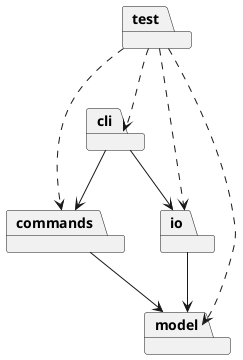

# SVG Editor 设计与过程文档

## 架构方案

### 模块职责

| 模块              | 职责                             |
| --------------- | ------------------------------ |
| `src/cli/`      | 读取 CLI 输入、解析参数、分发命令并输出结果。      |
| `src/model/`    | 保存文档、图形对象、父子关系和图形行为；不依赖其他模块。   |
| `src/commands/` | 实现可编辑操作及 Command、undo/redo 管理。 |
| `src/io/`       | 负责 SVG 文件读取、解析、序列化和保存。         |
| `test/`         | 保存自动化测试。                       |

当前迭代建立了可交互 CLI：`SvgEditorCli` 负责欢迎信息、命令读取和 `help`/`exit` 处理；图形、命令、SVG I/O 和 undo/redo 尚未实现。

### 依赖方向

允许 `cli` 依赖 `commands` 和 `io`，允许 `commands` 与 `io` 依赖 `model`；`model` 不依赖 CLI、I/O 或具体命令类。命令名分派集中在 CLI/命令分发器，图形类型分派集中在图形工厂，避免在各处重复按类型分支。

### PlantUML 包图

### 设计模式与扩展点

- Command：每个可撤销编辑操作封装为命令，并由历史管理器支持 undo/redo。
- Composite：叶子图形与 `g` 容器通过统一图形接口执行移动、缩放、设置和删除。
- Factory：集中创建内置图形类型；未来的 `box` 属于后续插件化阶段，本任务不实现。

预计变化点是图形类型、命令集合和 SVG 读写格式，因此分别预留模型层、命令层和 I/O 层边界。本阶段不提前创建空业务类。

## 过程记录

- 检查结果：Node.js v22.22.2、npm 10.9.7，依赖已安装；Git 仓库已有 `init` 提交和 `origin` 远程，工作区保留了未提交的 `AGENTS.md` 规则修改。
- 根据作业原文与 `AGENTS.md`，本次只建立可交互骨架，不实现图形编辑、SVG 读写或 undo/redo。
- 将原先只打印帮助文本的入口改为 `SvgEditorCli` 交互循环，使用 Node `readline` 逐行读取；`main.ts` 只负责创建并启动该类。
- 增加 `@types/node`，使 TypeScript 能检查 Node 内置模块和 `process`。
- 增加 `npm run cli` 启动脚本和 `node:test` 集成测试；测试通过子进程输入 `help`、未知命令和 `exit`，检查输出与退出码。
- 待后续记录：第一条 SVG 编辑业务命令实现、测试结果及发现的问题。

## 一致性自查

- 模块划分：`src/cli/` 已有 `main.ts`（入口）和 `SvgEditorCli.ts`（交互循环）；`test/` 已有 `cli.test.mjs`；`model`、`commands`、`io` 尚未创建。
- 依赖方向：CLI 只依赖 Node 内置 `readline`，未导入模型、命令或 I/O 层，符合当前依赖方向。
- 文档一致性：README 的启动命令、当前范围，与本文件的记录、`package.json`、源码和测试一致。

## 质量保证

- 环境：Node.js v22.22.2，npm 10.9.7。
- `npm run typecheck`：通过，无类型错误。
- `npm test`：先构建，再运行 `node --test test/cli.test.mjs`；1 个测试通过，0 失败。
- 手工验证：以管道输入 `help`、`exit` 执行 `npm run cli`，输出欢迎信息、帮助列表和 `Goodbye.`，进程正常退出。
- 未创建 Git 提交；按用户要求等待检查确认。

## 未完成事项

- SVG 图形模型、命令分发、Composite、Command、SVG I/O 和 undo/redo 尚未实现。
- 按用户要求，本轮变更尚未提交；等待用户检查和确认后再指导提交。
