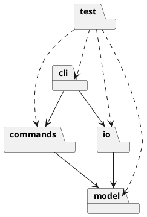

# SVG Editor 设计与过程文档

## 架构方案

### 模块职责

| 模块              | 职责                             |
| --------------- | ------------------------------ |
| `src/cli/`      | 读取 CLI 输入、解析参数、分发命令并输出结果。      |
| `src/model/`    | 保存文档、图形对象、父子关系和图形行为；不依赖其他模块。   |
| `src/commands/` | 实现可编辑操作及 Command、undo/redo 管理。 |
| `src/io/`       | 负责 SVG 文件读取、解析、序列化和保存。         |
| `test/`         | 保存自动化测试。                       |

当前 Task 1 只建立入口和配置；业务模块将在后续小步中按需求实现。

### 依赖方向

允许 `cli` 依赖 `commands` 和 `io`，允许 `commands` 与 `io` 依赖 `model`；`model` 不依赖 CLI、I/O 或具体命令类。命令名分派集中在 CLI/命令分发器，图形类型分派集中在图形工厂，避免在各处重复按类型分支。

### PlantUML 包图

### 设计模式与扩展点

- Command：每个可撤销编辑操作封装为命令，并由历史管理器支持 undo/redo。
- Composite：叶子图形与 `g` 容器通过统一图形接口执行移动、缩放、设置和删除。
- Factory：集中创建内置图形类型；未来的 `box` 属于后续插件化阶段，本任务不实现。

预计变化点是图形类型、命令集合和 SVG 读写格式，因此分别预留模型层、命令层和 I/O 层边界。本阶段不提前创建空业务类。

## 过程记录

- 检查结果：目录中只有 `AGENTS.md`、`Task1.md` 和作业原文，没有已有源码、Node 配置或 Git 元数据。
- 根据作业原文与 `AGENTS.md`，本次只建立可运行骨架，不实现图形编辑、SVG 读写或 undo/redo。
- 选择 TypeScript 严格模式，并使用 npm scripts 提供类型检查、构建和 CLI 启动入口。
- 待后续记录：第一条业务命令实现、测试结果及发现的问题。

## 一致性自查

- 模块划分：当前实际已建立 `src/cli/`；`model`、`commands`、`io` 和 `test` 目录尚未因空目录要求而创建，后续添加对应实现时创建。
- 依赖方向：当前入口只使用标准输出，没有业务依赖；暂无违反依赖方向的代码。
- 待完成：随着业务模块加入，逐次更新本节并检查实际导入关系。

## 质量保证

- 已配置 `npm run typecheck` 和 `npm run build`，安装依赖后执行。
- 已配置 `npm start`，用于确认编译后的 CLI 可以正常启动并退出。
- 本任务尚未配置测试框架，也没有业务行为可测试；首个业务切片实现后再引入轻量测试方案并记录实际结果。
- 尚未创建 Git 仓库，因此本任务无法执行提交、push 或 Git diff 验证；这不是已通过的验证项。

## 未完成事项

- SVG 图形模型、命令分发、Composite、Command、SVG I/O 和 undo/redo 尚未实现。
- 尚未配置 Git 远程仓库，无法提交或 push；不能猜测远程地址或分支。
