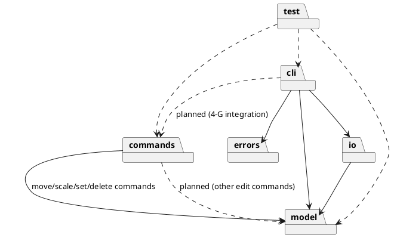
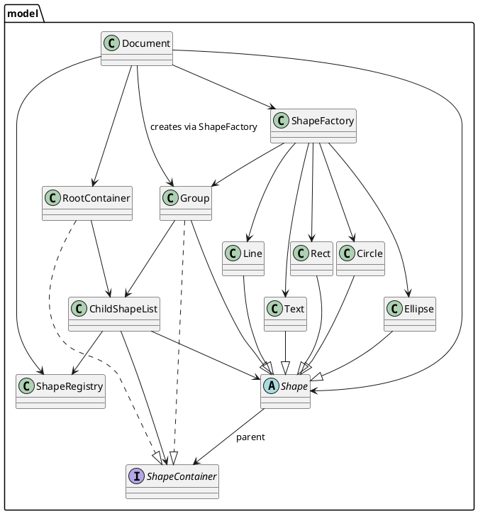
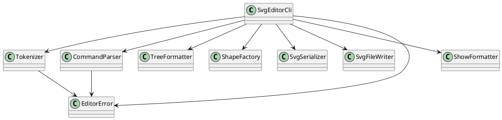
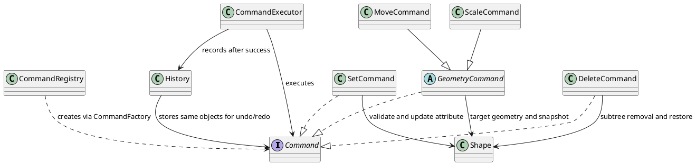

# SVG Editor 设计与过程文档

## 架构方案

### 模块职责

| 模块              | 职责                                            | 当前状态                   |
| --------------- | --------------------------------------------- | ---------------------- |
| `src/cli/`      | 读取输入、独立词法解析、命令参数解析（`CommandParser`）、命令分派并输出结果，递归格式化 tree、格式化 show。 | 已实现（含颜色校验、子树查询与属性明细） |
| `src/model/`    | 文档、根容器、Group 容器、子节点管理、全局 ID 索引、多态图形与注册表式图形工厂；Stage 4-A/4-B/4-C/4-D 增加结构编辑、几何更新、公共样式/属性更新与子树注册 API。 | 已实现 Stage 3-G、4-A/4-B/4-C/4-D 模型编辑基础 |
| `src/commands/` | Command 接口、命令工厂注册表、统一执行入口（`CommandExecutor`）、undo/redo 历史（`History`）以及 `MoveCommand`/`ScaleCommand`/`SetCommand`/`DeleteCommand`；CLI 接入与其余编辑命令后续实现。    | 基础层与 move/scale/set/delete 命令已实现，CLI 未接入 |
| `src/io/`       | SVG 序列化与文件写入。                                 | 已实现 save 子集            |
| `src/errors/`   | 共享的 `EditorError` 类型，承载可直接展示的错误消息。            | 已实现 Stage 2-E          |
| `test/`         | 自动化 CLI、Tokenizer、模型、命令注册表、命令历史、模型编辑 API、几何/set/delete 命令测试。     | 已实现                    |

当前实现的类：

- `Document`：保存画布宽高，持有 `ShapeRegistry`、`ShapeFactory` 和 `RootContainer`；提供根级图形添加/移除/查询、全局 ID 查询、通过工厂创建 Group 的 `createGroup()`、递归统计所有 Group 和图形的 `countShapes()`、受控的同容器重排和跨容器移动 `moveShape(shape, target, index)`，以及删除/恢复子树所需的 `unregisterDescendants(shape)`/`registerDescendants(shape)`（只处理后代并保持树关系，失败时回滚）。
- `ShapeRegistry`：用 `Map<string, Shape>` 维护全文档 ID 索引，ID 区分大小写；图形移除后允许该 ID 再次使用。
- `ShapeContainer`：容器接口，约定只读子节点、父容器、容器描述标签、添加、按索引插入、移除、包含查询和索引查询。
- `ChildShapeList`：可复用的子节点管理实现，统一维护子节点顺序、父节点关系和 ID 注册/注销；`add` 在末尾插入，`insert` 在指定索引插入并校验索引边界、重复挂载、重复 ID、自包含和祖先循环；由 `RootContainer` 和 `Group` 共同使用。
- `RootContainer`：实现 `ShapeContainer`，代表文档根容器；它不是一种 `Shape`，不继承图形基类，`parent` 固定为 `null`，`describe()` 返回 `svg`。
- `Group`：继承 `Shape` 并实现 `ShapeContainer`，复用 `ChildShapeList` 管理子节点；`asContainer()` 返回自身，自身负责 `g#id` 描述和递归 `<g>` SVG 序列化；`translateBy`/`scaleBy` 递归到每个子孙，几何快照为空数组；公共样式由基类保存并写入 `<g>` 的 presentation attributes。
- `Shape`：抽象图形基类，封装非空 ID、父容器引用、公共样式 `fill`/`stroke`/`stroke-width`、`asContainer()`、`describe()`、`toSvgElement()`、SVG 属性转义和 XML 文本内容转义；Stage 4-B 增加多态几何 API `translateBy`/`canTranslateBy`、`scaleBy`/`canScaleBy`、`captureGeometry`、`restoreGeometry`；Stage 4-C 增加 `getAttribute`/`validateAttribute`/`setAttribute`/`restoreAttribute` 和统一的属性序列化/描述辅助方法，普通叶形默认不是容器。
- `SvgColor`：位于 `src/model/`，集中保存 SVG 命名颜色关键字与 3/6 位十六进制规则，提供 `isValid(value)`；CLI 的 `CommandParser` 与模型属性更新共用同一校验。
- `Rect`：继承 `Shape`，用私有字段保存坐标、宽高，公共样式由基类保存；构造时校验几何；通过几何 API 平移/缩放 `x`、`y`、`width`、`height`，通过属性 API 更新几何与样式，自身负责 tree 描述和 `<rect>` 元素生成。
- `Circle`：继承 `Shape`，用私有字段保存圆心、半径，公共样式由基类保存；构造时校验圆心为有限数值且半径为正；通过几何 API 平移/缩放 `cx`、`cy`、`r`，自身负责 tree 描述和 `<circle>` 元素生成。
- `Ellipse`：继承 `Shape`，用私有字段保存圆心、水平/垂直半径，公共样式由基类保存；构造时校验圆心为有限数值且两个半径为正；通过几何 API 平移/缩放 `cx`、`cy`、`rx`、`ry`，自身负责 tree 描述和 `<ellipse>` 元素生成。
- `Line`：继承 `Shape`，用私有字段保存起止点，公共样式由基类保存；构造时校验所有端点为有限数值；通过几何 API 平移/缩放四个端点，tree 使用作业约定的 `(x1,y1) -> (x2,y2)` 格式，自身负责 `<line>` 元素生成。
- `Text`：继承 `Shape`，用私有字段保存位置和文本内容，公共样式由基类保存；构造时校验坐标为有限数值；通过几何 API 平移/缩放 `x`、`y`，通过属性 API 修改 `x`、`y`、`text`，SVG 文本内容按 XML 规则转义。
- `ShapeFactory`：以类型名为键的注册表式工厂，内置注册 `rect`、`circle`、`ellipse`、`line`、`text` 和 `g`；通过 `register`、`has`、`create(type, creation)`、`types()` 统一创建图形，`g` 创建参数携带文档 registry。
- `SvgEditorCli`：只承担命令协调。持有当前 `Document`，用 `readline` 逐行读取，先交给 `Tokenizer` 生成 token，再按命令名分派 `init`、`create`、`tree`、`show`、`save`、`help`、`exit`；各命令的参数解析全部委托 `CommandParser`，自身负责文档检查、重复 ID 检查、容器选择、经 `ShapeFactory` 创建图形并输出结果；`tree` 带 ID 时查找目标节点并报 `no such shape`，再调用 `TreeFormatter` 的子树格式化；`show` 查找目标节点并调用 `ShowFormatter`；`handleLine` 是统一错误边界，捕获 Tokenizer、CommandParser 和命令异常后输出单行 `error: ...`；启动时输出固定单行 banner，仅在 TTY 交互模式输出 `svg> ` 提示符。
- `CommandParser`：命令参数解析层。`parseInit`/`parseCreate`/`parseTree`/`parseShow`/`parseSave` 把 token 数组转换为结构化结果（`ParsedCreate` 携带图形类型、id、`ShapeCreation` 和可选 `containerId`；`parseTree` 返回可选节点 ID；`parseShow` 返回唯一节点 ID）；`create` 的类型识别、参数个数/数值/正数校验、`in <containerId>` 尾缀拆分和 fill/stroke 颜色语法校验都集中在此；颜色接受 SVG 命名关键字（大小写不敏感）与 3/6 位十六进制，非法时报 `invalid color for <field>: <value>`；解析错误抛出 `EditorError`，不访问文档、不构造图形、不输出日志。
- `Tokenizer`：把一行原始输入切分为 token 数组，处理普通空白、双引号参数和整行注释；引号错误抛出 `EditorError`；不执行命令、不访问文档、不输出日志。
- `EditorError`：位于 `src/errors/`，继承 `Error` 并设置 `name = 'EditorError'`，只保存完整用户可读消息；不依赖模型、CLI、I/O 或具体命令，也不包含错误码或分类系统。
- `Command`：接口，定义 `execute(): void` 和 `undo(): void` 命令契约；不包含 CLI、文档或输出逻辑。
- `CommandRegistry`：以命令名为键保存 `CommandFactory`，提供注册、查询、创建和名称列表；不执行命令，也不依赖模型或 I/O。
- `CommandExecutor`：统一执行入口（Invoker），构造时注入 `History`；`execute(command)` 先调用 `command.execute()`，仅成功后把同一个命令对象交给 `History` 记录；执行失败时异常向上传播，不进入历史，也不清空 redo 栈。
- `History`：管理 undo/redo 两个 `Command` 栈，不执行具体业务，也不读写模型快照。`record` 把成功命令压入 undo 栈并清空 redo 栈；`undo` 调用栈顶命令的 `undo()`，成功后把同一个对象移入 redo 栈；`redo` 复用同一对象再次调用 `execute()`，成功后移回 undo 栈；空栈返回 `false`，命令抛错时两个栈保持不变。
- `GeometryCommand`：几何编辑命令抽象基类，实现 `Command`；首次 `execute()` 先调用子类 `validate()` 检查全部新几何值，再递归捕获目标子树快照并调用 `apply()`；`undo()` 逐节点调用 `restoreGeometry` 精确恢复；redo 复用已有快照，不重新捕获。
- `MoveCommand`：继承 `GeometryCommand`，接收目标图形和 `dx`/`dy`；构造时拒绝非有限增量，执行前通过 `canTranslateBy` 检查整个目标子树的平移结果，失败报 `move would produce invalid geometry`；`apply()` 调用目标的 `translateBy`，容器由模型递归到子孙。
- `ScaleCommand`：继承 `GeometryCommand`，接收目标图形和正因子；构造时拒绝非有限或非正因子并抛出 `scale factor must be positive`，执行前通过 `canScaleBy` 检查所有缩放结果有限且尺寸为正，失败报 `scale would produce invalid geometry`；`apply()` 调用目标的 `scaleBy`；只缩放几何，不改变 `stroke-width`、`font-size` 或 fill/stroke 颜色。
- `SetCommand`：接收目标图形、属性名和类型化值；构造时调用目标的 `validateAttribute`，未知属性和非法值在命令创建阶段即失败；首次 execute 保存该属性的旧值（可选样式可能为 `undefined`），undo 通过 `restoreAttribute` 精确恢复，绕过新输入校验以保留旧状态；redo 复用旧值快照。
- `DeleteCommand`：接收 `Document` 和目标图形；构造时验证目标已挂接并保存原父容器和索引，未挂接或已删除的目标报 `no such shape: <id>`；execute 从原父容器移除目标并递归注销全部后代 ID，undo 先原子恢复后代注册再把目标插回原索引，redo 复用同一对象和位置快照。
- `SvgSerializer`：读取 `Document` 的尺寸和根容器内容，通过 `Shape.toSvgElement()` 生成 SVG 文本，不接触文件，也不读取图形专属属性。
- `SvgFileWriter`：只负责把文本写入指定路径。
- `TreeFormatter`：读取 `Document` 的尺寸和根容器内容，通过 `Shape.describe()` 递归生成稳定 tree 文本；`format(document)` 输出完整树，`formatSubtree(shape)` 以目标节点自身为根输出子树；通过 `Shape.asContainer()` 递归子节点，不使用具体图形类型判断；空文档输出 `(empty)`。
- `ShowFormatter`：通过多态 `Shape.describe()` 生成单个图形的属性明细：首行 `<type>#<id>  parent=<父容器>`，几何属性与公共样式分别为缩进行；样式行由新增的 `Shape.fill`/`stroke`/`strokeWidth` getter 统一生成，覆盖 fill、stroke 和 stroke-width；父标签取自 `Shape.parent.describe()`（根为 `svg`，Group 为 `g#id`）；不读取具体图形字段，也不在 CLI 中做类型判断。

### 依赖方向

当前代码的实际依赖：

- `cli` 可以依赖 `model`、`io` 和 `errors`。
- `io` 可以依赖 `model`。
- `commands` 可以依赖 `model`；`GeometryCommand`、`MoveCommand`、`ScaleCommand`、`SetCommand` 和 `DeleteCommand` 通过 `Shape`/`Document` 的几何、属性与子树注册 API 修改状态。
- `model` 不依赖 `cli`、`io`、`errors` 或具体命令类。
- `errors` 不依赖任何项目模块。
- `model` 内部：`Document` 组合 `ShapeRegistry`、`ShapeFactory` 和 `RootContainer`，并使用 `Shape`/`ShapeContainer`；`Document.createGroup()` 通过工厂的 `g` 创建器注入同一 registry 的 `Group`，`countShapes()` 通过 `Shape.asContainer()` 递归统计，`moveShape()` 通过 `ShapeContainer.insert/indexOf/remove` 完成受控重排和移动，`unregisterDescendants`/`registerDescendants` 通过 `Shape.asContainer()` 遍历子树并维护 registry；`RootContainer` 和 `Group` 都组合 `ChildShapeList`；`ChildShapeList` 使用 `ShapeRegistry`、`Shape` 和 `ShapeContainer`；`Shape` 以类型方式引用 `ShapeContainer` 作为父节点类型，并通过 `SvgColor` 校验公共样式，提供默认返回 `null` 的 `asContainer()`；`Group` 继承 `Shape`、实现 `ShapeContainer` 并覆盖 `asContainer()`；`Rect`、`Circle`、`Ellipse`、`Line`、`Text` 继承 `Shape`；`ShapeFactory` 注册并创建全部六种类型，`g` 的创建参数包含 registry。
- `cli` 内部：`SvgEditorCli` 依赖 `Tokenizer`、`CommandParser`、`TreeFormatter`、`ShowFormatter`、`ShapeFactory`、`Shape`/`ShapeContainer` 类型、`SvgSerializer`、`SvgFileWriter` 和 `EditorError`；`CommandParser` 依赖 `EditorError` 和 `SvgColor`，并以类型方式引用 `ShapeCreation`（model），不访问 `Document`、不构造图形；`Tokenizer` 依赖 `EditorError`，不依赖模型、I/O 或其他 CLI 类。
- `commands` 内部：`CommandRegistry` 只依赖同层 `Command` 类型；`CommandExecutor` 依赖 `Command` 类型和同层 `History`；`History` 只依赖 `Command` 类型并保存命令对象；`GeometryCommand` 以类型方式依赖 `Shape` 并负责目标子树快照，`MoveCommand`/`ScaleCommand` 继承 `GeometryCommand` 并调用 `translateBy`/`scaleBy`；`SetCommand` 以类型方式依赖 `Shape` 的 `validateAttribute`/`getAttribute`/`setAttribute`/`restoreAttribute`；`DeleteCommand` 以类型方式依赖 `Document` 和 `Shape`/`ShapeContainer`，通过子树注册 API 与父容器移除/插入完成删除和恢复；commands 层不依赖 CLI 或 I/O。
- `cli` 尚未依赖 `commands`；现有 `switch` 分派保持不变，commands 接入计划在 4-G。
- `test` 通过子进程调用编译后的 CLI，并直接加载编译后的 `Tokenizer`、`CommandParser`、`Document`、`Rect`、`Circle`、`Ellipse`、`Line`、`Text`、`ShapeFactory`、`ShapeRegistry`、`SvgSerializer`、`CommandRegistry`、`CommandExecutor`、`History`、`MoveCommand`、`ScaleCommand`、`SetCommand`、`DeleteCommand`、`ShowFormatter` 验证词法、命令解析、模型、工厂、注册表、执行器、历史、几何/set/delete 命令和显示行为。

规划中的依赖：

- `cli` 可以在具体命令接入后依赖 `commands` 进行编辑操作（计划 4-G）。
- 4-A/4-B/4-C/4-D 已建立执行器、历史、move/scale/set/delete 命令、公共属性 API 和子树注册 API；其余具体编辑命令尚未创建。

### PlantUML 包图

当前模型层的类关系：

当前 CLI 层的输入与协作关系：

当前 commands 层类关系：

### 设计模式与扩展点

- 当前使用封装、多态和注册表式工厂：`Shape` 定义统一接口，`Rect`、`Circle`、`Ellipse`、`Line`、`Text` 和 `Group` 把 tree 描述与 SVG 元素生成封装在自身；`TreeFormatter` 和 `SvgSerializer` 只依赖 `Shape` 接口；`ShapeFactory` 用类型到创建器的 Map 集中创建全部图形类型。
- Task 4 新增容器抽象：`ShapeContainer` 约定容器行为，`ChildShapeList` 复用子节点顺序、父节点关系和 ID 注册规则；`RootContainer` 只代表根容器，不继承 `Shape`；`Document` 不是容器，负责文档尺寸、全局 ID 索引和根容器。该抽象为未来 `Group`/Composite 提供基础，但 `Group`、嵌套遍历和 Composite 操作尚未实现。
- Task 5 将词法切分从 `SvgEditorCli` 抽离为 `Tokenizer`：Tokenizer 只生成 token，CLI 仍保留 `switch` 命令分派。这降低了输入解析与命令执行的耦合。
- Task 6 新增 `Command` 接口和 `CommandRegistry` 基础层：接口定义 `execute()`/`undo()` 契约，注册表用命令名保存无参工厂并支持注册、查询和创建；具体命令、命令历史和 undo/redo 尚未实现，CLI 也尚未接入注册表。
- Task 7（Stage 2-E）建立统一错误边界：`EditorError` 位于 `src/errors/`，`SvgEditorCli.handleLine` 是 CLI 唯一捕获并输出 `error: ...` 的位置；Tokenizer 和命令方法抛出可预期错误，不再各自打印。交互式 TTY 保留 `svg> ` 提示符，管道输入不输出提示符，启动 banner 固定为单行。
- Stage 3-A 新增 `Circle`：图形自身实现 `describe()` 和 `toSvgElement()`，`TreeFormatter`/`SvgSerializer` 未增加圆形类型判断。`SvgEditorCli.create` 当时仅为命令参数语法分派 rect/circle 两个解析路径，`ShapeFactory` 仍负责构造具体图形；注册表式工厂和统一类型分派留到 Task 3-F。
- Stage 3-B 新增 `Ellipse`：沿用同一多态路径，自身实现 `describe()`/`toSvgElement()`；CLI 增加 ellipse 参数解析路径，`TreeFormatter`/`SvgSerializer` 仍无图形类型分支。`ShapeFactory.supports()` 和 CLI 分支都扩展到 ellipse，注册表式工厂仍留到 Task 3-F。
- Stage 3-C 新增 `Line`：端点与可选 stroke 由 `Line` 自身封装，tree 使用作业约定的 `line#id (x1,y1) -> (x2,y2)` 格式且不显示 stroke，SVG 使用 `<line>`；CLI 增加 line 参数解析路径，`TreeFormatter`/`SvgSerializer` 仍无图形类型分支。零长度线和负坐标未被额外拒绝，保持作业约定的 SVG 坐标语义。
- Stage 3-D 新增 `Text`：位置和文本内容由 `Text` 自身封装，tree 使用 `text#id (x,y) "content"` 格式；SVG 文本内容使用新增的 `Shape.escapeText()` 转义 `&`、`<`、`>`，属性值继续使用 `escapeAttribute()`。CLI 只接受作业定义的 `create text <id> <x> <y> "content"`，未增加 fill/font-size 参数；`TreeFormatter`/`SvgSerializer` 仍无图形类型分支。
- Stage 3-E 引入 `Group` 容器：`Group` 继承 `Shape` 并实现 `ShapeContainer`，与 `RootContainer` 复用 `ChildShapeList`；`ShapeContainer` 增加 `parent`，使 `ChildShapeList` 能沿统一容器链拒绝自包含和祖先循环。`SvgSerializer` 对每个元素的完整文本逐行缩进，从而递归序列化嵌套 `<g>`；tree 递归显示留到 3-H，CLI `create ... in` 留到 3-G。
- Stage 3-F 将 `ShapeFactory` 改为注册表式工厂：私有 `Map<string, ShapeCreator>` 在构造时注册 `rect`/`circle`/`ellipse`/`line`/`text`/`g`，统一接口为 `register`、`has`、`create(type, creation)`、`types()`。重复/空白类型注册抛错且不覆盖，未知类型错误稳定，`types()` 返回副本。CLI 的每类参数解析分支只构建 `ShapeCreation`，构造统一交给工厂；`Document.createGroup()` 也委托工厂并传入 registry；CLI 新增 `create g` 空组创建。`CommandRegistry` 未改动。
- Stage 3-G 实现 `create ... in`：所有 `create` 使用 `create <type> <id> [params…] [in <containerId>]`。`in` 子句必须位于命令末尾，由关键字 `in` 和其后的容器 ID 两个 token 组成；省略时加入画布根。目标必须已存在且 `asContainer()` 非空，否则分别报 `no such container: <id>` / `not a container: <id>`；成功消息为 `type#id created in g#containerId`，根级创建保持原消息。`create g` 也支持 `in`，因此可创建嵌套组。可选 fill/stroke 位置上的单个尾缀 `in` 仍按样式值处理，只有其后还有容器 ID 时才构成 `in` 子句。`Document.countShapes()` 让 `save` 的元素计数包含 Group 及嵌套图形。
- 3-G 后置重构（用户指令）引入 `CommandParser`，形成 `Tokenizer → CommandParser → SvgEditorCli → ShapeFactory → Shape` 的解析-分派链路：CLI 不再包含各图形的参数解析与按类型展开的构造分支；类型相关逻辑仅保留在解析层的一张参数语法表（`createSpecs`，标注为待重构点：与 `ShapeFactory` 注册表覆盖同一组类型，新增图形时两处需同步）；图形构造统一经 `ShapeFactory` 注册表（`g` 仍经 `Document.createGroup()` 注入 registry）。同时新增 fill/stroke 颜色语法校验：接受 SVG 命名关键字（CSS 颜色关键字全集，大小写不敏感）与 3/6 位十六进制（大小写不敏感），非法时报 `invalid color for <field>: <value>`；省略颜色时保持 SVG 属性省略行为。错误优先级随之规整为：无文档 → 参数/颜色校验 → 重复 ID → 容器校验（此前容器校验先于参数校验）；既有测试全部保持通过。
- Stage 3-H 扩展 `tree`：`TreeFormatter.format()` 递归遍历 `ShapeContainer`，按 `├──`/`└──` 和 `│`/空格前缀输出多层结构；`formatSubtree(shape)` 以目标节点自身为根输出子树，普通图形只输出自身。CLI 通过 `Document.findShape()` 查找 `tree <id>` 目标，缺失时抛 `no such shape`；`CommandParser.parseTree` 接受 0 或 1 个参数。未新增树内元素计数行，`(N elements)` 仍沿用既有 `save` 的 `Document.countShapes()` 规则。
- Stage 3-I 实现 `show <id>`：`ShowFormatter` 基于多态 `Shape.describe()` 输出首行 `<type>#<id>  parent=<父容器>`，再把几何描述和 fill/stroke 分成缩进行；根级父标签为 `svg`，嵌套父标签为 `g#id`，Group 只输出头部行。`ShapeContainer` 增加 `describe()` 标签以补齐根容器无 ID 的模型缺口（根返回 `svg`，Group 复用 `g#id`）；CLI 通过 `Document.findShape()` 查找，缺失报 `no such shape`，`CommandParser.parseShow` 要求恰好 1 个参数。
- Stage 4-A 校准 Command 模式：`Command` 是命令接口；`CommandRegistry` 只按名称创建命令；`CommandExecutor` 是统一执行入口（Invoker）；具体编辑命令（4-B 起）封装操作并调用作为 Receiver 的模型对象；`Document`/`Shape`/`Group` 持有业务状态。`History` 是本项目为 undo/redo 增加的栈管理组件，不属于基础 Command 模式的必需角色，也不保存文档快照。
- Stage 4-A 新增 `CommandExecutor` 与 `History`：执行器先调用 `command.execute()`，仅成功后记录到历史；`History` 的 undo/redo 栈保存 `Command` 对象，undo/redo 成功后把同一个对象从一个栈转移到另一个栈；新命令成功后清空 redo 栈；空栈返回 `false`，命令抛错时两个栈保持不变。作业原文未规定空栈的用户可见文案，本阶段只确定基础层行为，CLI 文案留到 4-G 接入时再决定并记录。
- Stage 4-A 增加受控模型编辑 API：`ChildShapeList` 新增 `insert(shape, index)` 和 `indexOf(shape)`，`ShapeContainer`、`RootContainer`、`Group` 同步暴露；`Document.moveShape(shape, target, index)` 支持同容器最终位置重排和跨容器插入，校验索引、重复 ID、重复挂载、自包含和祖先循环，并在失败时回滚到原容器原位置。具体图形的属性写 API 未在本阶段定义，避免在 `move`/`scale`/`set` 语义确认前发明接口；4-B/4-C 再按图形属性表补充。
- Stage 4-B `scale` 规则（用户确认）：按作业“factor 同乘到全部几何属性（位置与尺寸）”执行，只缩放几何；`stroke-width`、`font-size`、fill/stroke 颜色和 text 内容不变。`font-size` 当前不在 create/set 白名单，本阶段不新增；不引入 SVG `transform`，直接修改模型几何值。
- Stage 4-B 模型几何 API：`Shape` 增加 `translateBy`/`canTranslateBy`、`scaleBy`/`canScaleBy`、`captureGeometry`、`restoreGeometry`；五种叶形按自身字段实现，Rect 的 `x/y/width/height`、Circle 的 `cx/cy/r`、Ellipse 的 `cx/cy/rx/ry`、Line 的四个端点、Text 的 `x/y`，其中 Text 内容与各图形样式不变；`Group` 把检查和操作递归到每个子孙且只应用一次，自身几何快照为空。
- Stage 4-B 命令：新增 `GeometryCommand`（首次 execute 先验证再由 `canTranslateBy`/`canScaleBy` 后的快照递归捕获目标子树原几何，undo 逐节点恢复，redo 复用同一快照）、`MoveCommand`（校验有限 `dx`/`dy` 和平移结果）和 `ScaleCommand`（校验有限正因子和缩放结果，非正因子错误为 `scale factor must be positive`）。所有已实现叶形和 Group 都支持；根 `svg` 不是 `Shape`，不能被命令直接作为目标；ID 解析与 `no such shape` 属于 4-G。
- Stage 4-C `set` 规则：白名单为公共 `fill`/`stroke`/`stroke-width`、各类型几何属性（rect `x/y/width/height`、circle `cx/cy/r`、ellipse `cx/cy/rx/ry`、line `x1/y1/x2/y2`、text `x/y`）以及 Text 的 `text` 内容；未知或类型不适用的属性报 `unknown attribute: <attr>`。位置坐标允许负数，尺寸必须为有限正数，`stroke-width` 接受有限非负数；fill/stroke 复用 create 的命名色与 3/6 位 hex 规则，非法报 `invalid color for <attr>: <value>`；text 接受任意字符串。
- Stage 4-C 模型属性 API：公共样式字段 `fill`/`stroke`/`strokeWidth` 上移到 `Shape` 基类，`Group` 也支持并写入 `<g>` 的 presentation attributes；各叶形通过 `getAttribute`/`validateAttribute`/`setAttribute`/`restoreAttribute` 暴露类型化属性更新，`setAttribute` 先校验再写入，undo 使用 `restoreAttribute` 精确恢复旧值（包括原本为 `undefined` 的样式和作为新输入本不合法的旧值）。`SvgColor` 集中颜色语法，`CommandParser` 与模型共用。
- Stage 4-C 命令：新增 `SetCommand`，构造时调用 `validateAttribute`，首次 execute 保存被修改属性的旧值，redo 复用该快照；`ShowFormatter` 改为从 `Shape.fill`/`stroke`/`strokeWidth` 生成样式行，覆盖 stroke-width 和 Line/Group；Rect/Circle/Ellipse/Text 的 tree 描述包含公共样式，Line 保持作业约定的无样式格式。
- Stage 4-D 删除规则：`delete <id>` 删除指定叶形或 Group；删除 Group 时连同整个子树，删除后立即注销子树全部 ID，因此 ID 可被新图形复用；undo 恢复同一对象身份、原父容器、原索引、兄弟顺序、父子关系和全部 ID 查询结果。未挂接或已删除的目标在命令构造时报 `no such shape: <id>`。
- Stage 4-D 模型 API：`Document.unregisterDescendants(shape)`/`registerDescendants(shape)` 只处理后代并保留子树关系，遍历 `Shape.asContainer()`；两个方法在失败时回滚已处理部分。`DeleteCommand` 构造时保存原父容器和索引，execute 通过父容器移除目标并注销后代，undo 先注册后代再把目标插回原索引，redo 复用同一对象和位置快照。
- `AGENTS.md` 要求 Command、Composite 和 undo/redo；当前已实现 Command 接口/注册表、`CommandExecutor`/`History`、`MoveCommand`/`ScaleCommand`/`SetCommand`/`DeleteCommand` 以及 Group 容器与递归几何操作，但其余具体编辑命令、Composite 编辑命令和 CLI 的 undo/redo 命令仍未实现，因此仍是阶段性缺失，不是最终架构。
- `SvgEditorCli.execute` 目前仍是唯一的命令名分派点；`CommandRegistry`、`CommandExecutor`、`History`、`MoveCommand`、`ScaleCommand`、`SetCommand` 和 `DeleteCommand` 存在但尚未接入 CLI（计划 4-G）。后续实现具体命令时再把注册表接入分派流程，并把编辑操作封装成 undo 单元。
- 图形类型、命令集合、SVG 格式是主要变化点；`Shape` 为新增图形提供统一多态接口、几何 API 和公共属性 API，`Circle`、`Ellipse`、`Line` 和 `Text` 验证了该扩展路径；`ShapeFactory` 已用注册表集中类型到创建器的映射，新增图形不再扩展类型分支；`Shape.asContainer()` 让容器识别和计数保持多态，`ShapeContainer`/`ChildShapeList` 由 `RootContainer` 和 `Group` 复用，`CommandRegistry` 为具体命令注册预留入口，`CommandExecutor`/`History` 为执行与撤销提供统一入口和栈管理，`Document.insert`/`moveShape`/`unregisterDescendants`/`registerDescendants` 为结构编辑提供受控 API。本阶段不提前创建其余具体命令类或插件类。

### 快照与撤销约定（Stage 4-A/4-B/4-C/4-D）

- 不对整个 `Document` 做默认深拷贝；`History` 只保存命令对象，不解析或保存快照内容。
- 具体命令在首次 `execute()` 时捕获撤销所需的最小旧状态；redo 复用同一命令对象，不得覆盖 undo 所需信息。若某类命令需要在重做时更新部分状态，必须说明原因并证明连续 execute/undo/redo 往返正确。
- 结构操作保存对象引用、原父容器、原索引和子节点顺序，恢复通过 `ShapeContainer.insert`/`indexOf` 与 `Document.moveShape` 完成；不直接修改子节点数组、父节点引用或 ID registry。
- 后续命令的快照清单：

  | 命令 | 撤销所需状态 |
  | --- | --- |
  | `move`/`scale`（已实现） | 所有受影响图形（含 Group 子孙）的原几何值 |
  | `set`（已实现） | 被修改属性的旧值（可选样式可能为 `undefined`） |
  | `delete`（已实现） | 被删除节点或子树的对象引用、原父容器、原索引及子树 ID |
  | `group`/`ungroup` | 相关对象、原父容器、原索引、新 Group ID 和子节点顺序 |
  | `addto`/`front`/`back` | 原父容器、原索引、目标容器和目标索引 |

- `move`/`scale` 已按该约定实现：`GeometryCommand` 首次 execute 时通过 `Shape.asContainer()` 递归捕获目标节点及其子孙的几何数组，undo 逐节点调用 `restoreGeometry` 精确恢复；快照在 redo 时不会被覆盖。
- `set` 已按该约定实现：`SetCommand` 构造时验证属性与值，首次 execute 通过 `getAttribute` 保存单个属性的旧值，undo 用 `restoreAttribute` 精确恢复（不做新输入校验），redo 复用同一旧值。
- `delete` 已按该约定实现：`DeleteCommand` 保存目标对象、原父容器和原索引；execute 通过父容器移除目标并用 `Document.unregisterDescendants` 递归注销后代 ID，undo 先用 `registerDescendants` 原子恢复 ID 再把同一对象插回原索引，redo 复用同一位置快照。子树对象和父子关系在删除期间保持，仅 registry 变化。
- 失败约定：命令必须在首次修改模型前完成全部可预见校验；`CommandExecutor` 只在 execute 成功后记录，`History` 只在 undo/redo 成功后转移栈项。若命令在修改后抛错，命令自身必须通过预校验或可靠回滚保证文档和历史不被部分污染。
- 4-A 的测试用测试替身验证通用快照与历史行为；4-B 已用真实叶形和 Group 验证 move/scale 的几何快照、连续 undo/redo 和失败原子性；4-C 已验证 set 的几何、样式、文本旧值恢复和失败原子性；4-D 已验证叶形、嵌套叶形、空/非空 Group 的删除、ID 复用、完整子树恢复和 LIFO 顺序。

## 过程记录

- Task 2 开始前检查：分支 `main`，HEAD `d67bde2`（`help and exit`），与 `origin/main` 一致；工作区干净；Node.js v22.22.2，npm 10.9.7。更早的 `8e8d144`（`init`）为初始提交；`final` 标签尚未创建。

- 对照作业原文确认：默认画布 800×600、错误统一以 `error:` 开头、未初始化文档报错、tree 使用 `svg (WxH)` 和 `rect#id` 形式。

- 原文未规定重复 `init`；按“新建空画布”解释为替换当前文档。原文也未规定只给一个尺寸、或新建后无文件名 `save` 的行为；分别采用缺失维度取默认值、以及报错而不是猜测默认路径。

- 实现分为 model（`Canvas`、`RectangleShape`、`ShapeFactory`）、io（`SvgSerializer`、`SvgFileWriter`）和 cli（`TreeFormatter`、`SvgEditorCli`）；`main.ts` 只负责启动。图形类型判断集中在 `ShapeFactory`，CLI 不直接构造矩形。

- Task 2 第一次测试运行 12 个用例中 10 个通过、2 个失败：测试直接匹配 tree 首行，但管道输出中该行前面带有 `svg> ` 提示符。修正测试，用 `withoutPrompt` 规范化输出后再断言；没有修改业务代码。重跑 12/12 通过。

- Task 2 手工执行 `npm run cli`，输入 `init 800 600`、`create rect r1 100 120 200 80 blue`、`tree`、`save <临时路径>`、`exit`；输出与生成的 SVG 均符合预期。未在浏览器中实际打开文件，浏览器验收步骤见根目录 README。

- Task 3 多态模型基础：从 `88131df` 开始，工作区仅有未跟踪的 `Task3.md`。新增 `Shape` 抽象基类和 `Rect`，将 `Canvas` 改为 `Shape[]`、`ShapeFactory.createRect()` 返回 `Rect`；`TreeFormatter` 改为调用 `describe()`，`SvgSerializer` 改为调用 `toSvgElement()`，随后删除 `RectangleShape.ts`。

- Task 3 验证：迁移后 `npm run typecheck` 通过；扩充测试后 `npm test` 为 17 个测试全部通过。`grep` 确认 `src/` 中没有 `RectangleShape` 或 `createRectangle` 残留引用，`TreeFormatter`/`SvgSerializer` 未读取矩形专属属性。

- Task 3 修正：发现 `dist/model/RectangleShape.js` 是上一轮构建残留，`tsc` 不会自动清理输出目录；已删除该生成文件（`dist/` 被 gitignore），源码无旧类引用。

- Task 2 历史记录中的 `RectangleShape` 保留为当时事实，不改写历史；当前架构以 `Shape`/`Rect` 为准。

- Task 4 开始前检查：分支 `main`，HEAD `1360a52`（`refactor: 建立 Shape 多态模型并迁移矩形实现(stage2-A)`），与 `origin/main` 一致；工作区仅有未跟踪的 `Task4.md`；当时 `Canvas` 仍是 `SvgEditorCli`、`TreeFormatter`、`SvgSerializer` 的文档模型，17 个测试作为回归基线。Node.js v22.22.2，npm 10.9.7。

- Task 4 重要设计决策：采用“Document + ShapeRegistry + ShapeContainer/ChildShapeList + RootContainer”方案。`Document` 只管理画布尺寸、全局 ID 索引和根容器；`RootContainer` 只代表根；`ChildShapeList` 统一管理子节点顺序、父节点和 ID 注册/注销；`Shape` 只保存自己的父容器引用。这样所有添加/移除只有一条受控路径，ID 索引和容器内容不会各自维护。

- 选择该方案的原因：Task 4 要求全局 ID 唯一性覆盖未来嵌套结构，同时要求根容器和未来 Group 复用容器规则。把 ID 注册表独立出来可以由所有容器共享；把子节点操作放进 `ChildShapeList`，未来 `Group` 继承 `Shape` 并实现 `ShapeContainer` 后可以直接组合同一实现，不需要复制 `add/remove` 或依赖 `Document`。

- 不采用“Document 直接持有 Map 和 RootContainer”的轻量方案：类更少，但 `Document` 与容器需要通过回调或相互引用协调 ID，未来 `Group` 若自行管理子节点会出现两套 `add/remove` 规则，容易造成 ID 索引与容器内容失同步；不满足“根容器与未来 Group 复用同一套规则”的目标。

- 不采用“Document 自己兼任根容器”的最小方案：会把文档级职责和容器级职责混在一个类中，违反 Task 4 对清晰边界的要求，也使未来 Group/Composite 缺少可复用基础，因此只适合临时原型。

- 父子关系子决策：`Shape` 使用私有 `parentContainer` 字段和只读 `parent` getter；`attachTo`/`detachFrom` 作为受控方法，只有当前父节点为空/匹配时才成功。没有引入 token 或 WeakMap 模拟包级私有访问，因为 TypeScript 无包级可见性，任务也明确不要求为访问控制增加复杂封装。

- ID 复用子决策：移除图形时 `ShapeRegistry.unregister` 删除该 ID，允许之后重新使用；这与“ID 不存在即可创建”的现有语义一致，并由“Document removes shapes, clears parents, and allows ID reuse”测试固定。

- 实现迁移：新增 `Document`、`ShapeRegistry`、`ShapeContainer`、`ChildShapeList`、`RootContainer`；`Shape` 增加父节点；CLI 改为持有 `Document`；`TreeFormatter`/`SvgSerializer` 改用 `Document` 尺寸和 `root.children`；`ShapeFactory` 保持只创建 `Rect`。搜索确认 `src/` 无 `Canvas` 引用后删除 `Canvas.ts`，避免保留两套文档状态。

- Task 4 验证：`npm run typecheck` 通过；`npm test` 24 个测试全部通过（原有 17 个 + 新增 7 个 Document/容器/父节点/ID 测试），首次完整运行无失败。手工执行 `npm run cli` 完成 `init 800 600 → create rect r1 100 120 200 80 blue → tree → save <临时路径> → exit`，输出和生成的 SVG 与迁移前一致。

- Task 4 修正：构建不会自动清理 `dist`，删除旧 `Canvas` 后发现 `dist/model/Canvas.js` 残留，已删除该生成文件（`dist/` 被 gitignore）；源码无 `Canvas` 引用。

- README 决策：本次删除 `Canvas` 并新增 Document/容器类，根 README 的 `src/model/` 目录职责条目会失真，因此只更新该条目；用户可见命令与输出未变，其他章节不改。

- 历史记录中 Task 2/3 的 `Canvas` 和 `RectangleShape` 表述保留为当时事实；当前架构已无这两个类。

- Task 5 开始前检查：分支 `main`，HEAD `b94ef0d`（`feat: 新增 Document 模型与统一容器抽象，迁移 Canvas 职责`），与 `origin/main` 一致；工作区仅有未跟踪的 `Task5.md`；`SvgEditorCli` 仍使用 `command.split(/\s+/)`，24 个测试作为回归基线。Node.js v22.22.2，npm 10.9.7。

- Task 5 词法设计：`Tokenizer` 使用状态机区分行首/注释、普通参数、双引号参数和引号结束；行首空白后为空行或 `#` 返回 `[]`；引号内累积空格和 `#`；闭合引号后仅允许空白或行尾；未闭合抛 `unclosed double quote`，其他非法引号结构抛 `invalid quote syntax`。

- 接入方式：`SvgEditorCli.handleLine` 不再使用 `trim()` 后 `split(/\s+/)`，而是调用 `Tokenizer.tokenize(line)`；token 为空时只显示下一次提示符；Tokenizer 和命令异常都进入现有 `try/catch`，输出单行 `error: ...`；`execute` 改为接收 token 数组，保留原 `switch` 分派。

- 测试：新增 `test/tokenizer.test.mjs` 的 12 个词法测试，覆盖空白、连续/前后空白、双引号空格、空字符串、未闭合、闭合后非空白、引号非参数起始、空行、注释、`#fff`、行内 `#` 和单引号；`test/cli.test.mjs` 增加 6 个集成测试，覆盖空行/注释、`#fff`、带空格路径、未闭合/非法引号后继续执行、无引号命令回归。

- `npm test` 脚本改为显式运行 `test/cli.test.mjs test/tokenizer.test.mjs`，不依赖 shell 通配符。

- Task 5 验证：`npm run typecheck` 通过；`npm test` 42 个测试全部通过（CLI 30 个 + Tokenizer 12 个），首次完整运行无失败。手工执行 `npm run cli`，输入包含注释、`#fff`、带空格引号路径、未闭合引号和非法引号；命令正常执行，两个引号错误各自输出后 CLI 继续，生成的 SVG 包含两个矩形和 `fill="#fff"`。

- Task 5 范围：未修改 `Shape.attachTo()` / `Shape.detachFrom()` 的可见性或父节点不变量；该模型层审查留作后续独立事项。

- README 决策：本次扩展了用户可见输入语法，根 README 增加简短输入规则（空白、双引号、整行注释），并更新 `src/cli/`、`test/` 的目录职责；其他段落不改。

- Task 6 开始前检查：分支 `main`，HEAD `968152d`（`feat: 实现独立 Tokenizer 并接入 CLI，支持引号参数与整行注释（Stage 2-C）`），与 `origin/main` 一致；工作区仅有未跟踪的 `Task6.md`；`src/commands/` 无文件，42 个现有测试作为回归基线。Node.js v22.22.2，npm 10.9.7。

- Task 6 设计决策：采用 Map 注册表和无参工厂方案。`Command` 只定义 `execute(): void` 和 `undo(): void`；`CommandRegistry` 用 `Map<string, CommandFactory>` 保存工厂，公开 `register`、`has`、`create`、`names`。命令名保留原始字符串，拒绝空字符串和纯空白；重复注册抛错且不覆盖；未知命令抛清晰错误；工厂异常原样传播；注册表不执行命令。

- 实现文件：新增 `src/commands/Command.ts` 和 `src/commands/CommandRegistry.ts`，没有创建具体命令、undo 管理器或 CLI 演示命令；`SvgEditorCli` 和现有 `switch` 未修改。

- Task 6 测试：新增 `test/command-registry.test.mjs` 的 8 个公开行为测试，覆盖注册、查询、创建、工厂调用、重复注册、空名称、未知命令、工厂异常和多个命令互不覆盖；`npm test` 脚本加入该文件。

- Task 6 修正：第一次运行 50 个测试时 46 个通过、4 个失败，原因是 `assert.throws` 的正则匹配到了 Node 输出的 `Error: ...` 字符串前缀；修正测试为使用 `{ message: ... }` 精确匹配，未修改生产代码。重跑 50/50 通过。

- Task 6 验证：`npm run typecheck` 通过；`npm test` 50 个测试全部通过（原有 42 个 + 新增 8 个）。本任务不改变 CLI，未额外手工运行 CLI；原有 30 个 CLI 集成测试作为回归。

- README 决策：本次新增 `src/commands/` 正式模块并改变当前实现范围，根 README 更新当前范围、`src/commands/` 职责和 `test/` 描述；未修改使用示例或无关章节。

- Task 7 开始前检查：分支 `main`，HEAD `7693850`（`feat(commands): 实现 Command 接口和 CommandRegistry 基础层（stage 2-D）`），与 `origin/main` 一致；工作区仅有未跟踪的 `Task7.md`；50 个现有测试作为回归基线。Node.js v22.22.2，npm 10.9.7。

- Task 7 现状核查：`SvgEditorCli.handleLine` 已有 `try/catch` 并输出单行 `error: ...`；但未知命令、参数错误、无文档、写文件失败等仍由各命令方法直接 `console.log`；仓库无 `EditorError`；banner 为两行旧欢迎语；提示符在管道输入下也会输出；EOF 通过 readline `close` 正常结束；空行、整行注释和 `#fff` 已由 Tokenizer 处理；无文档文案已符合要求；现有测试未覆盖 banner 精确文本、EOF、单错误前缀和管道无提示符。

- Task 7 设计决策：新增独立错误模块 `src/errors/EditorError.ts`，只负责携带完整用户可读消息；CLI 的可预期业务错误全部改为抛出 `EditorError`，由 `handleLine` 唯一添加一次 `error:` 前缀。Tokenizer 的两个引号错误也改为 `EditorError`，因为它们属于可预期输入错误。模型层与 I/O 层未改造异常类型，避免超出任务范围。提示符通过 `process.stdin.isTTY === true` 区分交互与管道输入，避免非交互输出依赖终端显示。

- Task 7 实现：新增 `src/errors/EditorError.ts`；修改 `src/cli/SvgEditorCli.ts`，统一错误抛出/捕获、固定单行 banner、TTY 提示符；修改 `src/cli/Tokenizer.ts` 的引号错误类型；扩展 `test/cli.test.mjs`，加入进程超时保护、banner 精确断言、单错误前缀、EOF/多行管道、失败不改文档等测试。命令语义、输出文案和 `switch` 分派未改变。

- Task 7 验证：针对性运行 `npm run build` 后 `node --test test/cli.test.mjs`，33/33 通过；`npm run typecheck` 通过；`npm test` 53/53 通过（CLI 33 + CommandRegistry 8 + Tokenizer 12）。

- Task 7 已知限制：交互式 TTY 下的 `svg> ` 提示符无法通过当前管道式进程测试验证；测试断言了管道输出不含提示符，交互分支由 `process.stdin.isTTY` 代码路径保留。

- README 决策：新增 `src/errors/` 目录改变了根 README 展示的源码布局，因此只在 `src/io/` 之后补一条 `src/errors/` 职责；CLI 命令、运行方式和错误文案未变，其他章节不改。

- Task 3-A 开始前检查：分支 `main`，HEAD `97dc9e6`（`docs: 更新 AGENTS.md 和 doc/AGENTS.md 的规则与结构`），与 `origin/main` 一致；工作区仅有未提交的 `项目规划.md` 阶段 3 任务拆分（用户已有工作，保留并在本任务中同步更新）；53 个测试作为回归基线。Node.js v22.22.2，npm 10.9.7。

- Task 3-A 作业核对：作业规定 `create circle <id> <cx> <cy> <r> [fill]`，生成 `<circle id="…" cx="…" cy="…" r="…" fill="…"/>`；fill 省略时不写该属性。作业未为圆形校验规定专门文案，沿用矩形风格采用“圆心必须为有限数值、半径必须为正”，不因越界拒绝图形；tree 沿用现有单空格属性格式，输出 `circle#id cx=… cy=… r=… [fill=…]`。

- Task 3-A 设计决策：新增 `Circle extends Shape`，几何属性和可选 fill 使用私有字段，构造器校验有限圆心与正半径，`describe()`/`toSvgElement()` 由图形自身实现；`ShapeFactory` 增加 `supports('circle')` 和 `createCircle()`。CLI 在创建前完成参数解析、重复 ID 检查和半径校验，任一失败都不修改文档；`TreeFormatter`/`SvgSerializer` 未增加圆形分支。未引入注册表式工厂、其他图形或编辑命令。

- Task 3-A 实现：新增 `src/model/Circle.ts`；修改 `src/model/ShapeFactory.ts`、`src/cli/SvgEditorCli.ts`（create 的 rect/circle 参数路径、help）和 `test/cli.test.mjs`（Circle 模型测试、CLI 创建与保存、非法参数/重复 ID 不改文档）。

- Task 3-A 验证：`npm run build && node --test test/cli.test.mjs` 为 39/39 通过；`npm run typecheck` 通过；`npm test` 为 59/59 通过（CLI 39 + CommandRegistry 8 + Tokenizer 12）。本任务未手工打开浏览器验收 SVG 渲染。

- README 决策：本次新增用户可见的 `create circle` 命令，改变当前范围、示例、手工验收和 `src/model/` 职责，根 README 更新这些相关段落；未修改输入规则、构建流程和其他无关章节。

- `项目规划.md` 同步：更新当前基线（`97dc9e6`、Stage 2-E 已提交、3-A 未提交）、修正过时的 `Canvas`/`RectangleShape` 描述，标记 3-A 完成并把下一项标为 3-B。

- Task 3-B 开始前检查：分支 `main`，HEAD `0dac9ac`（`feat: 新增圆形图形支持，包含模型与CLI实现`），`origin/main` 为 `97dc9e6`，本地领先 1 个提交；工作区干净；59 个测试作为回归基线。Node.js v22.22.2，npm 10.9.7。

- Task 3-B 作业核对：作业规定 `create ellipse <id> <cx> <cy> <rx> <ry> [fill]`，生成 `<ellipse id="…" cx="…" cy="…" rx="…" ry="…" fill="…"/>`；fill 省略时不写该属性。作业未为椭圆校验规定专门文案，沿用 circle/rect 风格采用“圆心必须为有限数值、两个半径必须为正”，不因越界拒绝图形；tree 沿用现有单空格属性格式，输出 `ellipse#id cx=… cy=… rx=… ry=… [fill=…]`。

- Task 3-B 设计决策：新增 `Ellipse extends Shape`，几何属性和可选 fill 使用私有字段，构造器校验有限圆心与正半径；`describe()`/`toSvgElement()` 由图形自身实现。`ShapeFactory` 增加 `supports('ellipse')` 和 `createEllipse()`；CLI 增加 ellipse 参数解析路径和未知类型辅助方法，在创建前完成参数解析、重复 ID 检查和半径校验，任一失败都不修改文档；`TreeFormatter`/`SvgSerializer` 未增加 ellipse 分支。未引入注册表式工厂、其他图形或编辑命令。

- Task 3-B 实现：新增 `src/model/Ellipse.ts`；修改 `src/model/ShapeFactory.ts`、`src/cli/SvgEditorCli.ts`（create 的 ellipse 参数路径、help、未知类型辅助）和 `test/cli.test.mjs`（Ellipse 模型测试、CLI 创建与保存、非法参数/重复 ID 不改文档）。

- Task 3-B 验证：`npm run build && node --test test/cli.test.mjs` 为 45/45 通过；`npm run typecheck` 通过；`npm test` 为 65/65 通过（CLI 45 + CommandRegistry 8 + Tokenizer 12）。本任务未手工打开浏览器验收 SVG 渲染。

- README 决策：本次新增用户可见的 `create ellipse` 命令，改变当前范围、示例、手工验收和 `src/model/` 职责，根 README 更新这些相关段落；未修改输入规则、构建流程和其他无关章节。

- `项目规划.md` 同步：更新当前基线与 3-A 已提交状态，标记 3-B 完成并把下一项标为 3-C。

- Task 3-C 开始前检查：分支 `main`，HEAD `c3be76b`（`feat: 新增椭圆图形支持，包含模型与CLI实现`），`origin/main` 为 `97dc9e6`，本地领先 2 个提交；工作区干净；65 个测试作为回归基线。Node.js v22.22.2，npm 10.9.7。

- Task 3-C 作业核对：作业规定 `create line <id> <x1> <y1> <x2> <y2> [stroke]`，生成 `<line id="…" x1="…" y1="…" x2="…" y2="…" stroke="…"/>`；stroke 省略时不写该属性，外观遵循 SVG 默认（stroke 初始为 none）。tree 示例使用 `line#id (x1,y1) -> (x2,y2)`，不显示 stroke。作业未禁止零长度线或负坐标，本任务不额外发明限制。

- Task 3-C 设计决策：新增 `Line extends Shape`，端点与可选 stroke 使用私有字段，构造器只校验端点为有限数值；`describe()` 遵循作业的箭头格式且不输出 stroke，`toSvgElement()` 按 id/x1/y1/x2/y2/stroke 顺序生成元素并转义 id、stroke。`ShapeFactory` 增加 `supports('line')` 和 `createLine()`；CLI 增加 line 参数解析路径，在创建前完成参数解析和重复 ID 检查，失败时不修改文档；`TreeFormatter`/`SvgSerializer` 未增加 line 分支。

- Task 3-C 实现：新增 `src/model/Line.ts`；修改 `src/model/ShapeFactory.ts`、`src/cli/SvgEditorCli.ts`（create 的 line 参数路径、help）和 `test/cli.test.mjs`（Line 模型测试、CLI 创建与保存、非法参数/重复 ID 不改文档）。

- Task 3-C 验证：`npm run build && node --test test/cli.test.mjs` 为 51/51 通过；`npm run typecheck` 通过；`npm test` 为 71/71 通过（CLI 51 + CommandRegistry 8 + Tokenizer 12）。本任务未手工打开浏览器验收 SVG 渲染。

- README 决策：本次新增用户可见的 `create line` 命令，改变当前范围、示例、手工验收和 `src/model/` 职责，根 README 更新这些相关段落；未修改输入规则、构建流程和其他无关章节。

- `项目规划.md` 同步：更新当前基线与 3-B 已提交状态，标记 3-C 完成并把下一项标为 3-D。

- Task 3-D 开始前检查：分支 `main`，HEAD `c3be76b`（`feat: 新增椭圆图形支持，包含模型与CLI实现`），`origin/main` 为 `97dc9e6`，本地领先 2 个提交；工作区包含上一轮未提交的 Task 3-C Line 实现，本任务在其基础上增量修改、未覆盖已有工作；71 个测试作为回归基线。Node.js v22.22.2，npm 10.9.7。

- Task 3-D 作业核对：作业规定 `create text <id> <x> <y> "content"`，生成 `<text id="…" x="…" y="…">content</text>`，文本内容是子文本而非属性；tree 使用 `text#id (x,y) "content"`。create 表未提供 fill/font-size 参数，本任务不自行增加；文本内容按 XML 规则转义 `&`、`<`、`>`，属性值按属性规则转义 `&`、`"`、`<`、`>`。

- Task 3-D 设计决策：新增 `Text extends Shape`，位置和内容使用私有字段，构造器校验 x/y 为有限数值，允许空内容和内容中的引号；`describe()` 输出作业约定的位置与双引号内容，`toSvgElement()` 生成 `<text>` 子文本。`Shape` 增加受保护的 `escapeText()` 用于 XML 文本内容，`escapeAttribute()` 保持不变。`ShapeFactory` 增加 `supports('text')` 和 `createText()`；CLI 只接受恰好 5 个参数（含 text 类型），在创建前完成坐标解析和重复 ID 检查，失败时不修改文档；`TreeFormatter`/`SvgSerializer` 未增加 text 分支。

- Task 3-D 实现：新增 `src/model/Text.ts`；修改 `src/model/Shape.ts`（文本转义）、`src/model/ShapeFactory.ts`、`src/cli/SvgEditorCli.ts`（create 的 text 参数路径、help）和 `test/cli.test.mjs`（Text 模型测试、CLI 创建/保存、非法参数/重复 ID 不改文档）。

- Task 3-D 验证：`npm run build && node --test test/cli.test.mjs` 为 57/57 通过；`npm run typecheck` 通过；`npm test` 为 77/77 通过（CLI 57 + CommandRegistry 8 + Tokenizer 12）；上述结果为测试清理前记录。本任务未手工打开浏览器验收 SVG 渲染。

- Task 3-D 已知限制：当前 Tokenizer 不支持在双引号参数内转义双引号，因此 CLI 无法直接传入包含双引号的 text 内容；模型层可正确保留并输出双引号，CLI 测试使用单引号和 XML 特殊字符覆盖。

- README 决策：本次新增用户可见的 `create text` 命令，改变当前范围、示例、手工验收和 `src/model/` 职责，根 README 更新这些相关段落；未修改输入规则、构建流程和其他无关章节。

- `项目规划.md` 同步：更新当前基线（3-C 仍未提交、3-D 完成后 77/77），标记 3-D 完成并把下一项标为 3-E。

- Task 3-E 开始前检查：分支 `main`，HEAD `b206aab`（`feat: 新增 Line 和 Text 图形类型及 CLI 支持`），`origin/main` 为 `97dc9e6`，本地领先 3 个提交；工作区干净；测试清理后的 62 个测试作为回归基线。Node.js v22.22.2，npm 10.9.7。

- Task 3-E 作业/规划核对：本任务只建立 Group 容器、统一容器 API 和序列化，不实现 `group`/`ungroup` 等阶段 4 编辑命令。CLI `create g` 与 `create ... in` 需要容器参数和父级选择，按规划留到 Task 3-G；tree 递归显示和元素计数按规划留到 Task 3-H。

- Task 3-E 设计决策：`Group extends Shape implements ShapeContainer`，与 `RootContainer` 共用 `ChildShapeList`；`ShapeContainer` 增加只读 `parent`，`RootContainer.parent` 为 `null`，`Group` 复用 `Shape.parent`，`ChildShapeList` 在注册前沿容器祖先链拒绝自包含和祖先循环，不引入 `instanceof Group` 分支。Group 构造需要文档级 registry，因此由 `Document.createGroup(id)` 注入；`ShapeFactory` 暂不创建 Group，工厂注册表化留到 Task 3-F。`SvgSerializer` 改为对每个元素的完整文本逐行缩进，支持嵌套 `<g>`；空 Group 输出 `<g id="…"/>`。

- Task 3-E 实现：新增 `src/model/Group.ts`；修改 `src/model/ShapeContainer.ts`、`RootContainer.ts`、`ChildShapeList.ts`、`Document.ts`、`src/io/SvgSerializer.ts` 和 `test/cli.test.mjs`（6 个 Group 模型/序列化测试）。`SvgEditorCli`、`TreeFormatter` 和 help 未修改。

- Task 3-E 验证：`npm run build && node --test test/cli.test.mjs` 为 48/48 通过；`npm run typecheck` 通过；`npm test` 为 68/68 通过（CLI 文件 48 + CommandRegistry 8 + Tokenizer 12）。本任务未手工打开浏览器验收 SVG 渲染。

- Task 3-E 已知限制：Group 在挂接到文档前即可向同一 registry 添加子节点，因此脱离根的子节点仍能被 `Document.findShape` 找到；移除非空 Group 只会移除 Group 自身，其后代仍保留注册并形成脱离文档的子树。这些行为不影响本任务验收，后续 Composite 编辑命令需明确处理。

- README 决策：Group 模型和嵌套 SVG 序列化改变了当前阶段范围，且根 README 原先声称“containers 未实现”，因此更新根 README 的范围说明和 `src/model/` 职责；CLI 命令列表与用法不变。

- `项目规划.md` 同步：更新当前基线（3-C/3-D 已提交为 `b206aab`、3-E 本地未提交、68/68），标记 3-E 完成并把下一项标为 3-F。

- Task 3-F 开始前检查：分支 `main`，HEAD `ce41ac9`（`feat: 新增 Group 容器实现及统一容器行为`），`origin/main` 为 `97dc9e6`，本地领先 4 个提交；工作区干净；68 个测试作为回归基线。Node.js v22.22.2，npm 10.9.7。

- Task 3-F 验收核对：注册表式工厂需覆盖所有已实现类型（含 `g`）、未知类型稳定报错、重复注册策略明确且有测试、内部 Map 不泄露、现有创建命令回归、`CommandRegistry` 不变。CLI 各图形的参数解析语法仍不同，因此保留解析分支，只把对象构造统一交给工厂。

- Task 3-F 设计决策：`ShapeFactory` 用私有 `Map<string, ShapeCreator>`，构造函数注册 `rect`/`circle`/`ellipse`/`line`/`text`/`g`；`ShapeCreation` 携带 id、按类型解释的数值参数数组、可选 fill/stroke/content 和 `g` 所需 registry。`register` 拒绝空/纯空白和重复名称且不覆盖，`has`/`create`/`types` 提供统一查询与创建，`types()` 返回副本，未知类型抛出稳定错误。`Document.createGroup()` 委托工厂并注入文档 registry；CLI 保留每类参数解析，构造统一调用 `create`，并新增 `create g <id>`；`CommandRegistry` 未修改。

- Task 3-F 实现：修改 `src/model/ShapeFactory.ts`、`src/model/Document.ts`、`src/cli/SvgEditorCli.ts`（统一 create 调用、g 分支、help）和 `test/cli.test.mjs`（3 个工厂测试、2 个 CLI g 测试）。

- Task 3-F 验证：`npm run build && node --test test/cli.test.mjs` 为 53/53 通过；`npm run typecheck` 通过；`npm test` 为 73/73 通过（CLI 文件 53 + CommandRegistry 8 + Tokenizer 12）。本任务未手工打开浏览器验收 SVG 渲染。

- Task 3-F 已知限制：`ShapeCreation.numbers` 是按图形类型解释的位置参数，工厂创建器依赖调用方提供正确数量；Group 创建必须通过 `Document.createGroup()` 或显式传入 registry。CLI `create g` 只能创建空组，填充 Group 仍需 3-G 的 `create ... in`。

- README 决策：新增用户可见的 `create g` 命令并改变阶段范围，根 README 更新命令列表、示例和 Group 范围说明；构建流程与其他命令不变。

- `项目规划.md` 同步：更新当前基线（3-E 已提交为 `ce41ac9`、3-F 本地未提交、73/73），标记 3-F 完成并把下一项标为 3-G。
- Task 3-G 开始前检查：分支 `main`，HEAD `9b73ff2`（`feat: 将 ShapeFactory 改为注册表式工厂并支持创建空组`），与 `origin/main` 一致；工作区干净；73 个测试作为回归基线。Node.js v22.22.2，npm 10.9.7。
- Task 3-G 语法决策（实施前记录）：`create <type> <id> [params…] [in <containerId>]`；`in` 只在命令末尾由关键字和容器 ID 两个 token 组成；默认根；目标必须存在且为 Group；错误文案 `no such container` / `not a container`；组内成功消息追加 `in g#<id>`；`create g` 也支持 `in`；尾缀单个 `in` 仍可作样式值；`save` 统计嵌套元素。
- Task 3-G 设计决策：CLI 在类型分派后拆出末尾 `in` 对，再通过 `Shape.asContainer()` 解析目标，避免 `instanceof Group`；每个类型仍负责自己的参数校验，校验完成后才调用目标容器的 `add`，失败不修改文档。创建方法返回 `Shape`，成功消息由 `create` 统一输出。`Document.countShapes()` 通过 `asContainer()` 递归统计 Group 和子图形，供 `save` 使用；`TreeFormatter` 未修改，递归树留给 3-H。
- Task 3-G 实现：修改 `src/model/Shape.ts`（`asContainer()`）、`src/model/Group.ts`（返回自身）、`src/model/Document.ts`（`countShapes()`）、`src/cli/SvgEditorCli.ts`（尾缀解析、目标校验、统一成功消息、`save` 计数、help）和 `test/cli.test.mjs`（2 个 `in` 测试）；`TreeFormatter`、`Tokenizer` 和 `CommandRegistry` 未修改。
- Task 3-G 验证：`npm run build && node --test test/cli.test.mjs` 为 55/55 通过；`npm run typecheck` 通过；`npm test` 为 75/75 通过（CLI 文件 55 + CommandRegistry 8 + Tokenizer 12）。本任务未手工打开浏览器验收 SVG 渲染。
- Task 3-G 已知限制：`tree` 仍只显示根级节点，已放入 Group 的子节点要等 3-H 才显示；`group`/`ungroup` 和 `addto` 尚未实现；Group 脱离文档后的生命周期语义仍未细化。
- README 决策：新增用户可见的 `in <groupId>` 语法、组内成功消息和嵌套元素计数，根 README 更新命令说明与阶段范围；构建流程不变。
- `项目规划.md` 同步：更新当前基线（3-F 已提交并推送为 `9b73ff2`、3-G 本地未提交、75/75），标记 3-G 完成并把下一项标为 3-H。
- 3-G 后置重构开始前检查：分支 `main`，HEAD `5f7d600`（`feat: 实现 create 命令支持 in 子句指定目标容器`，Task 3-G 已提交并推送），工作区仅含用户对 `AGENTS.md` 的未提交规则补充，与本任务无关、未触碰；基线 `npm run typecheck` 通过、`npm test` 75/75 通过。Node.js v22.22.2，npm 10.9.7。
- 3-G 后置重构设计决策（用户指令任务）：新增 `src/cli/CommandParser.ts` 承接 `init`/`create`/`tree`/`save` 的全部参数解析——`create` 用一张按类型描述参数个数的语法表统一处理六个类型（个数校验、数值解析、正数校验、text 内容、可选 fill/stroke、`in` 尾缀拆分），输出 `ParsedCreate` 结构；CLI 保留命令名 `switch` 分派与协调职责（无文档检查、重复 ID 检查、容器解析、输出），`g` 经 `Document.createGroup()` 注入 registry，其余类型统一调用 `ShapeFactory.create`，CLI 不再有任何按图形类型展开的构造分支。颜色校验仅作用于 CLI 解析路径：命名色取 CSS 关键字全集并大小写不敏感（SVG 关键字本身大小写不敏感），hex 接受 3/6 位（既有测试和作业示例依赖 `#fff`/`#eee`），错误消息沿用 `invalid number for <field>: <value>` 风格定为 `invalid color for <field>: <value>`（作业原文未规定该文案，已在此记录决策）。
- 3-G 后置重构实现：新增 `src/cli/CommandParser.ts`（约 210 行）；`src/cli/SvgEditorCli.ts` 从 479 行减至约 240 行，删除 `buildShape`、六个按类型的 create 方法和 `parseNumber`/`splitContainerClause`/`failUsage`/`failUnknownShapeType`；`test/cli.test.mjs` 新增 4 个测试（2 个颜色 CLI 端到端 + 2 个 CommandParser 单元）。模型层、`ShapeFactory`、`CommandRegistry`、Tokenizer 均未修改。
- 3-G 后置重构验证：`npm run typecheck` 通过；`npm test` 79/79 通过（CLI 文件 59 + CommandRegistry 8 + Tokenizer 12）；`git diff --check` 无空白错误（仅 LF/CRLF 提示）。本任务未手工打开浏览器验收 SVG 渲染。
- 3-G 后置重构已知限制：颜色校验只覆盖 CLI 输入路径，模型层直接构造（如测试中的 `new Rect(..., 'red&"<>')`）仍不校验，属于既有的模型/CLI 校验分工；错误优先级规整后，同一命令同时存在“坏参数 + 坏容器”时先报参数错误（此前先报容器错误），既有测试未覆盖该组合；尾缀单个 `in`（如 `create rect r 1 2 3 4 in`）此前被当作 fill 值接受，现在会因颜色校验报错，属任务要求的预期行为变化。
- README 决策：颜色校验是新的用户可见行为，根 README 更新命令说明中 fill/stroke 的合法形式；构建流程与其他命令行为不变。
- `项目规划.md` 同步：更新当前基线（HEAD `5f7d600`、本重构本地未提交、79/79），修正 3-G 条目的过时提交状态，并在 3-G 与 3-H 之间记录本重构；下一项仍为 3-H。该重构后已提交为 `525fca1`。
- Task 3-H 开始前检查：分支 `main`，HEAD `525fca1`（`refactor(cli): 新增 CommandParser 并实现颜色校验，精简 CLI 代码`），`origin/main` 为 `5f7d600`，本地领先 1 个提交；工作区仅有用户对 `项目规划.md` 的任务说明修改（未触碰）；79 个测试作为回归基线。Node.js v22.22.2，npm 10.9.7。
- Task 3-H 作业核对：作业 `tree <id>` 示例以目标节点自身为根（如 `g#n1`），不再输出 `svg (WxH)` 头；`tree` 输出本身没有 `(N elements)` 行，元素计数沿用既有 `save` 消息和 `Document.countShapes()` 规则，本任务不重复实现计数。
- Task 3-H 设计决策：`TreeFormatter.format(document)` 递归遍历 `ShapeContainer`，用 `prefix + (├──/└──)` 和 `prefix + (│   /    )` 延续或终止竖线；子节点通过 `Shape.asContainer()` 获取，不使用具体类型判断。`formatSubtree(shape)` 以目标 `describe()` 为第一行，Group 再递归子节点，普通图形只输出自身。CLI 的 `tree` 通过 `CommandParser.parseTree` 接受 0 或 1 个 ID，`Document.findShape()` 查找，缺失时报 `no such shape`，多余参数报 `usage: tree [id]`。
- Task 3-H 实现：修改 `src/cli/TreeFormatter.ts`（递归全树 + 子树格式化）、`src/cli/CommandParser.ts`（`parseTree` 返回可选 ID、`tree [id]` usage）、`src/cli/SvgEditorCli.ts`（目标查找、`no such shape`、help）和 `test/cli.test.mjs`（3 个 tree 测试并更新 CommandParser 单元）；模型层未修改。
- Task 3-H 验证：`npm run build && node --test test/cli.test.mjs` 为 62/62 通过；`npm run typecheck` 通过；`npm test` 为 82/82 通过（CLI 文件 62 + CommandRegistry 8 + Tokenizer 12）；`git diff --check` 无空白错误（仅 LF/CRLF 提示）。本任务未手工打开浏览器验收 SVG 渲染。
- Task 3-H 已知限制：`tree` 输出不包含元素计数行；计数仅由 `save` 消息体现（既有嵌套测试为 7 elements）。`tree <id>` 的子树根不显示 `svg (WxH)`，与作业示例一致；空 Group 子树只显示 Group 自身，不追加 `(empty)`。
- README 决策：`tree` 从无参数变为 `tree [id]`，属于用户可见命令语法变化，根 README 更新命令列表；其他命令和构建流程不变。
- `项目规划.md` 同步：更新当前基线（3-G+ 已提交为 `525fca1`、3-H 本地未提交、82/82），标记 3-H 完成并把下一项标为 3-I。
- Task 3-I 开始前检查：分支 `main`，HEAD `e933e17`（`feat(cli): 扩展 tree 命令支持递归显示全树和指定子树`，Task 3-H 已提交），`origin/main` 为 `5f7d600`，本地领先 2 个提交；工作区干净；82 个测试作为回归基线。Node.js v22.22.2，npm 10.9.7。
- Task 3-I 作业核对：作业只给出 `show c1` 示例：首行 `circle#c1  parent=g#markers`，随后两空格缩进的几何行 `cx=100 cy=100 r=20` 和 fill 行 `fill=red`。作业未规定根级父标签、Group 自身明细和错误文案，因此采用以下决策：根级父标签为 `svg`；Group 只输出头部行；缺失 ID 沿用既有 `no such shape`；参数必须恰好 1 个。
- Task 3-I 设计决策：新增 `ShowFormatter`，复用 `Shape.describe()`：首 token 作为 `<type>#<id>` 标签，剩余文本保留原始几何/内容，仅剥离末尾连续的 `fill=`/`stroke=` 段作为单独样式行，避免拆分文本内容导致空白丢失。父标签通过模型多态的 `Shape.parent.describe()` 获取；为此给 `ShapeContainer` 增加 `describe()`，`RootContainer` 返回 `svg`，`Group` 复用 `g#id`，不在 CLI 中做容器类型判断。
- Task 3-I 实现：新增 `src/cli/ShowFormatter.ts`；修改 `src/model/ShapeContainer.ts`、`src/model/RootContainer.ts`、`src/cli/CommandParser.ts`（`parseShow`）、`src/cli/SvgEditorCli.ts`（`show` 命令、help）和 `test/cli.test.mjs`（2 个 show 测试并扩展 CommandParser 单元）；其他模型类、`TreeFormatter`、`ShapeFactory`、`CommandRegistry` 未修改。
- Task 3-I 验证：`npm run build && node --test test/cli.test.mjs` 为 64/64 通过；`npm run typecheck` 通过；`npm test` 为 84/84 通过（CLI 文件 64 + CommandRegistry 8 + Tokenizer 12）；`git diff --check` 无空白错误（仅 LF/CRLF 提示）。本任务未手工打开浏览器验收 SVG 渲染。
- Task 3-I 已知限制：`show` 对 Group 只输出 `g#id  parent=...` 头部，不列出子节点或子节点数量（作业未规定）；根级父标签 `svg` 为本任务决策；`show` 不读取文件，也不扩展成交互界面。
- README 决策：新增用户可见命令 `show <id>`，根 README 更新命令列表与当前范围；构建流程和其他命令不变。
- `项目规划.md` 同步：更新当前基线（3-H 已提交为 `e933e17`、3-I 本地未提交、84/84），标记 3-I 完成并把下一项标为 3-J。
- Task 3-J 开始前检查：分支 `main`，HEAD `4436c83`（`feat(cli): 实现 show 命令，显示形状或组的详细属性`，Task 3-I 已提交），`origin/main` 为 `5f7d600`，本地领先 3 个提交；工作区干净；84 个测试作为回归基线。Node.js v22.22.2，npm 10.9.7。
- Task 3-J 集成验收设计：新增 1 个阶段 3 transcript 测试，按顺序执行全部图形创建、Group/嵌套 Group、`create ... in`、tree 全树/子树、show 属性明细、无效容器/重复 ID/非法颜色失败、save；断言命令输出、完整/子树 tree 行、show 行、9 elements 计数和最终 SVG 的嵌套顺序、属性、XML 转义及失败图形不存在。
- Task 3-J 浏览器渲染验收：生成代表性 SVG，启动仅绑定 `127.0.0.1` 的临时 HTTP 服务，用浏览器实际打开；确认白底矩形、红圆、蓝椭圆、黑线、`Diagram & <test>`、嵌套 `Box & <label>` 全部正常渲染，SVG 相关控制台/网络无错误。验收后已停止临时服务并删除临时文件。
- Task 3-J 验证：`npm run typecheck` 通过；`npm test` 85/85 通过（CLI 文件 65 + CommandRegistry 8 + Tokenizer 12）；`git diff --check` 无空白错误（仅 LF/CRLF 提示）。文档一致性抽查范围：`AGENTS.md`、`doc/AGENTS.md`、`项目规划.md`、`doc/README.md`、根 README 与当前代码/测试状态；已记录阶段 3 完成范围、已知限制和阶段 4 待办，未发现需要静默修正的冲突。
- Task 3-J 结论：3-A 至 3-I 验收项与阶段 3 集成回归均通过，阶段 3 完成。`group`/`ungroup`/`addto` 等属于阶段 4，不计入阶段 3 缺陷。
- README 决策：本任务只新增集成测试和验收记录，未改变 CLI 行为、构建流程、目录职责或阶段范围，根 README 无需更新。
- `项目规划.md` 同步：更新当前基线（3-I 已提交为 `4436c83`、3-J 本地未提交、85/85），标记阶段 3 完成并把下一项标为阶段 4。

- 测试清理（2026-10-26）：删除 `test/cli.test.mjs` 中 15 个重复或低价值用例（各图形 getter/describe、重复的失败状态/重复 ID、重复的 rect 端到端测试和 `keeps unquoted command parsing unchanged`），CLI 测试由 57 降至 42，完整测试由 77/77 降至 62/62；文件由 1274 行降至 1057 行。保留各图形的拒绝路径、SVG 转义、CLI 集成、Document 不变量、Tokenizer 错误和 EOF/管道测试。未修改 Text 实现。

- Task 4-A 开始前检查：分支 `main`，HEAD 与 `origin/main` 均为 `c5b316e`（`test: 阶段3集成验收通过`），本地与远程一致；工作区仅有用户新增的阶段 4 任务规划修改（`项目规划.md`），与本任务不冲突，已保留并在本任务中同步；85 个测试作为回归基线。Node.js v22.22.2，npm 10.9.7。
- Task 4-A 作业/规划核对：作业要求使用 Command 模式并支持 undo/redo；已有 `Command.execute(): void` / `undo(): void` 契约和 `CommandRegistry`，本任务按规划保留该契约、不新增 `UndoableCommand`，只建立执行器、历史管理和模型编辑基础，不实现具体编辑命令，也不接入 CLI。作业原文未规定 undo/redo 空栈的用户可见文案，因此 `History` 空栈返回 `false` 且不改变栈，CLI 反馈留到 4-G 决定并记录。
- Task 4-A1 职责校准：`Command` 为命令接口；`CommandRegistry` 只按名称创建命令；`CommandExecutor` 作为统一执行入口（Invoker），只在 `execute()` 成功后记录；具体编辑命令（4-B 起）封装业务并调用模型 Receiver；`Document`/`Shape`/`Group` 负责实际状态；`History` 是本项目增加的 undo/redo 栈管理，不属于基础 Command 模式的必需角色，不执行具体业务，也不保存文档快照。
- Task 4-A2 设计决策：`History` 用两个 `Command[]` 分别保存 undo/redo，栈中保存同一个命令对象；`record` 压入 undo 并清空 redo；`undo`/`redo` 先调用命令的 `undo()`/`execute()`，成功后才移动栈项，失败时异常向上传播且栈不变；空栈返回 `false`。`CommandExecutor` 构造时注入 `History`，`execute(command)` 先调用 `command.execute()`，再 `history.record(command)`，失败命令不进入历史、不清空 redo。未引入命令快照类或 `UndoableCommand`。
- Task 4-A3 快照约定：明确禁止默认深拷贝 `Document`，快照由具体命令在首次 execute 时捕获，History 不解析快照；结构操作保存对象引用、原父容器、原索引和顺序，恢复通过模型 API 完成。已在 `doc/README.md` 记录 move/scale、set、delete、group/ungroup、addto/front/back 的快照清单，并用测试替身命令验证属性旧值、节点顺序、父子关系、ID 查询和连续 undo/redo。
- Task 4-A4 模型 API：`ChildShapeList` 新增 `insert(shape, index)` 与 `indexOf(shape)`，`ShapeContainer`、`RootContainer`、`Group` 同步暴露；`Document.moveShape(shape, target, index)` 支持同容器最终位置重排和跨容器插入，统一校验整数索引、索引边界、重复挂载、重复 ID、自包含和祖先循环，跨容器失败时回滚到原容器原位置。具体图形的属性写 API 未在本任务定义，避免在 move/scale/set 语义确认前发明接口；该部分留到 4-B/4-C，并已作为已知限制记录。
- Task 4-A 实现：新增 `src/commands/CommandExecutor.ts`、`src/commands/History.ts`；修改 `src/model/ChildShapeList.ts`（insert/indexOf）、`ShapeContainer.ts`、`RootContainer.ts`、`Group.ts`（接口与委托）、`Document.ts`（moveShape）；新增 `test/history.test.mjs`（10 个执行器/历史/快照测试）和 `test/model-editing.test.mjs`（7 个插入/移动/边界测试），并更新 `package.json` 的测试文件列表。CLI、具体命令、`CommandRegistry` 和 `Shape` 属性均未修改。
- Task 4-A 验证：`npm run typecheck` 通过；针对性测试 `node --test test/model-editing.test.mjs test/history.test.mjs` 为 17/17 通过；`npm test` 为 102/102 通过（CLI 65 + CommandRegistry 8 + History 10 + ModelEditing 7 + Tokenizer 12）；`git diff --check` 无空白错误（仅 LF/CRLF 提示）。本任务没有用户可见 CLI 变化，未手工运行 CLI 或浏览器验收。
- Task 4-A 已知限制：`CommandExecutor`/`History` 尚未接入 CLI，`undo`/`redo` 命令不可用；没有具体编辑命令；生产图形的属性更新 API 尚未实现，属性快照测试使用测试替身；空栈的用户可见文案未定；可预见错误依赖命令自身预校验，执行器不会自动回滚“先改模型后抛错”的命令。
- README 决策：根 README 原先声明“没有命令历史”，4-A 新增 `CommandExecutor` 与 `History` 后该表述会失真，且 `src/commands/` 目录职责发生变化，因此做最小更新；CLI 命令、构建流程和用户可见行为未变，其他章节不改。
- `项目规划.md` 同步：更新当前基线（`c5b316e`、3-J 已提交、4-A 本地未提交、102/102），标记 4-A 完成并把下一项标为 4-B。

- Task 4-B 开始前检查：分支 `main`，HEAD `0ff2da9`（`feat: 实现命令执行器与历史管理基础架构`，Task 4-A 已提交），`origin/main` 为 `c5b316e`，本地领先 1 个提交；工作区干净；102 个测试作为回归基线。Node.js v22.22.2，npm 10.9.7。
- Task 4-B 作业核对：作业定义 `move <id> <dx> <dy>` 为增量平移，容器整体平移；`scale <id> <factor>` 为等比缩放，factor 同乘到图形的全部几何属性（位置与尺寸），容器递归到每个子孙；非正因子报 `scale factor must be positive`。作业未规定 scale 成功反馈和 move 非法增量的专用文案。用户已确认 scale 仅缩放几何：`stroke-width`、`font-size`、fill/stroke 颜色和 text 内容不变；`font-size` 当前不在 create/set 白名单，本阶段不新增。
- Task 4-B 设计决策：`Shape` 增加多态 `translateBy`/`canTranslateBy`、`scaleBy`/`canScaleBy`、`captureGeometry`/`restoreGeometry`；五种叶形自行更新几何字段，`Group` 将检查、平移和缩放递归到每个子孙且只应用一次，Group 自身几何快照为空。`GeometryCommand` 在首次 execute 时先调用子类 `validate()`，再递归捕获目标子树原几何并 `apply()`；undo 逐节点恢复，redo 复用同一快照。`MoveCommand` 构造时拒绝非有限 `dx`/`dy`，执行前拒绝会产生非有限结果的平移；`ScaleCommand` 构造时拒绝非有限或非正 factor，执行前拒绝非有限或非正结果。错误文案为 `move deltas must be finite numbers`、`move would produce invalid geometry`、`scale factor must be positive`、`scale would produce invalid geometry`。
- Task 4-B 目标范围：所有已实现叶形和 Group 都支持 move/scale；根 `svg` 不是 `Shape`，不能被命令直接作为目标；作业未定义其他“不支持的目标”，ID 解析和 `no such shape` 属于 4-G。命令不读取终端、不打印成功消息。
- Task 4-B 实现：新增 `src/commands/GeometryCommand.ts`、`MoveCommand.ts`、`ScaleCommand.ts` 和 `test/geometry-commands.test.mjs`；修改 `src/model/Shape.ts`、`Rect.ts`、`Circle.ts`、`Ellipse.ts`、`Line.ts`、`Text.ts`、`Group.ts` 与 `package.json` 测试列表。CLI、`CommandRegistry`、`History`/`CommandExecutor` 和 SVG 序列化未修改。
- Task 4-B 验证：`npm run typecheck` 通过；针对性测试 `node --test test/geometry-commands.test.mjs` 为 14/14 通过；`npm test` 为 116/116 通过（CLI 65 + CommandRegistry 8 + GeometryCommands 14 + History 10 + ModelEditing 7 + Tokenizer 12）；`git diff --check` 无空白错误（仅 LF/CRLF 提示）。本任务没有用户可见 CLI 变化，未手工运行 CLI 或浏览器验收。
- Task 4-B 已知限制：`MoveCommand`/`ScaleCommand` 尚未接入 CLI，`move`/`scale` 命令不可用，成功反馈和 ID 解析留到 4-G；scale 只缩放几何，文本字体大小和描边宽度保持不变是用户确认的规则；命令层使用普通 `Error` 携带消息，尚未改为 `EditorError`；极端运算结果会在执行前被拒绝，错误文案为内部暂定，4-G 可再对齐作业输出约定。
- README 决策：根 README 原先声明“没有具体编辑命令”，4-B 新增 `MoveCommand`/`ScaleCommand` 后该表述会失真，且 `src/commands/` 职责扩展，因此做最小更新；CLI 命令、构建流程和用户可见行为未变。
- `项目规划.md` 同步：更新当前基线（`0ff2da9`、4-A 已提交、4-B 本地未提交、116/116），标记 4-B 完成并把下一项标为 4-C。

- Task 4-C 开始前检查：分支 `main`，HEAD `e1a2182`（`feat: 实现 MoveCommand 和 ScaleCommand 几何编辑命令及相关 API`，Task 4-B 已提交），`origin/main` 为 `c5b316e`，本地领先 2 个提交；工作区干净；116 个测试作为回归基线。Node.js v22.22.2，npm 10.9.7。
- Task 4-C 作业核对：作业的 `set` 白名单为公共 `fill`/`stroke`/`stroke-width`、各类型几何属性（rect `x/y/width/height`、circle `cx/cy/r`、ellipse `cx/cy/rx/ry`、line `x1/y1/x2/y2`、text `x/y`）以及 Text 的 `text` 内容；未知属性统一报 `unknown attribute: <attr>`。作业未规定非法值的具体文案和 `stroke-width` 的数值范围，本任务采用以下决策：位置坐标允许负数，尺寸必须为有限正数，`stroke-width` 接受有限非负数（0 合法），fill/stroke 复用 create 的命名色与 3/6 位 hex 规则，text 接受任意字符串。
- Task 4-C 设计决策：把公共样式字段 `fill`/`stroke`/`strokeWidth` 上移到 `Shape` 基类，五种叶形和 `Group` 统一序列化 `fill`、`stroke`、`stroke-width`（固定顺序），Text 内容改为可更新；新增 `getAttribute`/`validateAttribute`/`setAttribute`/`restoreAttribute`，各叶形只实现自身属性和类型校验，不在 CLI 或命令中按图形类型分支。`setAttribute` 先校验再写入；`restoreAttribute` 供 undo 使用且不重新校验，以便恢复原本为 `undefined` 的样式或作为新输入不合法的旧值。新增 `SvgColor` 集中颜色语法，`CommandParser` 与模型共用。
- Task 4-C 命令与显示：新增 `SetCommand`，构造时调用 `validateAttribute`，首次 execute 保存单个属性的旧值，redo 复用旧值快照；未知属性和非法值在命令创建阶段失败，不进入历史。`ShowFormatter` 改为从 `Shape.fill`/`stroke`/`strokeWidth` getter 生成样式行，覆盖 stroke-width 和 Line/Group；Rect/Circle/Ellipse/Text 的 tree 描述包含公共样式，Line 保持作业约定的无样式格式。
- Task 4-C 实现：新增 `src/model/SvgColor.ts`、`src/commands/SetCommand.ts`、`test/set-command.test.mjs`；修改 `src/model/Shape.ts`、`Rect.ts`、`Circle.ts`、`Ellipse.ts`、`Line.ts`、`Text.ts`、`Group.ts`、`src/cli/CommandParser.ts`、`src/cli/ShowFormatter.ts` 和 `package.json` 测试列表。CLI 命令分派、`SvgEditorCli`、`CommandRegistry`、`History`/`CommandExecutor` 和 `SvgSerializer` 未修改。
- Task 4-C 验证：`npm run typecheck` 通过；针对性测试 `node --test test/set-command.test.mjs` 为 12/12 通过；`npm test` 为 128/128 通过（CLI 65 + CommandRegistry 8 + GeometryCommands 14 + SetCommands 12 + History 10 + ModelEditing 7 + Tokenizer 12）；`git diff --check` 无空白错误（仅 LF/CRLF 提示）。本任务没有用户可见 CLI 变化，未手工运行 CLI 或浏览器验收。
- Task 4-C 已知限制：`SetCommand` 尚未接入 CLI，`set` 命令不可用，参数解析、成功反馈和 ID 解析留到 4-G；fill/stroke 不接受 SVG 的 `none`，因为 create 的既有规则也不接受；`font-size` 不在白名单且模型无字段；Line 的 tree 描述仍不显示样式；命令层使用普通 `Error` 携带消息。
- README 决策：根 README 原先只列出可测试的 `MoveCommand`/`ScaleCommand`，4-C 新增 `SetCommand` 后该范围说明会遗漏，因此做最小更新；CLI 命令列表、构建流程和用户可见行为未变。
- `项目规划.md` 同步：更新当前基线（`e1a2182`、4-B 已提交、4-C 本地未提交、128/128），标记 4-C 完成并把下一项标为 4-D。

- Task 4-D 开始前检查：分支 `main`，HEAD `d7ea979`（`feat: 实现 SetCommand 及公共属性/样式更新 API`，Task 4-C 已提交），`origin/main` 为 `c5b316e`，本地领先 3 个提交；工作区干净；128 个测试作为回归基线。Node.js v22.22.2，npm 10.9.7。
- Task 4-D 作业核对：`delete <id>` 删除指定叶形；删除 Group 时连同全部子孙；ID 不存在报 `no such shape: <id>`。作业未规定删除后 ID 复用细节，本任务采用：删除后立即注销整个子树的 ID，因此 ID 可被新图形复用；undo 通过保存的对象引用、原父容器和原索引恢复同一树结构和全部 ID 查询结果。
- Task 4-D 设计决策：在 `Document` 增加 `unregisterDescendants(shape)`/`registerDescendants(shape)`，只处理后代、保留子树的父子关系和顺序，并通过 `Shape.asContainer()` 遍历；两个方法失败时回滚已处理部分。`DeleteCommand` 构造时保存原父容器和索引，未挂接或已删除目标报 `no such shape`；execute 由原父容器移除目标后注销后代，undo 先注册后代再把目标插回原索引，redo 复用同一对象和位置快照。删除期间不拆散子树，只改变根容器挂接和 registry。
- Task 4-D 实现：新增 `src/commands/DeleteCommand.ts` 和 `test/delete-command.test.mjs`；修改 `src/model/Document.ts`、`package.json` 测试列表。CLI、`CommandRegistry`、`History`/`CommandExecutor`、`Shape` 和 SVG 序列化未修改。
- Task 4-D 验证：`npm run typecheck` 通过；针对性测试 `node --test test/delete-command.test.mjs` 为 10/10 通过；`npm test` 为 138/138 通过（CLI 65 + CommandRegistry 8 + DeleteCommands 10 + GeometryCommands 14 + SetCommands 12 + History 10 + ModelEditing 7 + Tokenizer 12）；`git diff --check` 无空白错误（仅 LF/CRLF 提示）。本任务没有用户可见 CLI 变化，未手工运行 CLI 或浏览器验收。
- Task 4-D 已知限制：`DeleteCommand` 尚未接入 CLI，`delete` 命令、ID 解析和成功反馈留到 4-G；删除后若在 undo 前用同一 ID 创建新图形，undo 会因 registry 冲突而失败（正常 LIFO 历史通常不会出现）；Line 等形状的 tree 样式显示规则沿用 4-C；命令层使用普通 `Error` 携带消息。
- README 决策：根 README 原先只列出可测试的 `MoveCommand`/`ScaleCommand`/`SetCommand`，4-D 新增 `DeleteCommand` 后该范围说明会遗漏，因此做最小更新；CLI 命令列表、构建流程和用户可见行为未变。
- `项目规划.md` 同步：更新当前基线（`d7ea979`、4-C 已提交、4-D 本地未提交、138/138），标记 4-D 完成并把下一项标为 4-E。

## 一致性自查

- 模块划分：实际目录为 `src/cli/`（`main.ts`、`SvgEditorCli.ts`、`CommandParser.ts`、`Tokenizer.ts`、`TreeFormatter.ts`、`ShowFormatter.ts`）、`src/model/`（`Shape.ts`、`Rect.ts`、`Circle.ts`、`Ellipse.ts`、`Line.ts`、`Text.ts`、`Group.ts`、`Document.ts`、`ShapeRegistry.ts`、`ShapeContainer.ts`、`ChildShapeList.ts`、`RootContainer.ts`、`ShapeFactory.ts`、`SvgColor.ts`）、`src/commands/`（`Command.ts`、`CommandRegistry.ts`、`CommandExecutor.ts`、`History.ts`、`GeometryCommand.ts`、`MoveCommand.ts`、`ScaleCommand.ts`、`SetCommand.ts`、`DeleteCommand.ts`）、`src/io/`（`SvgSerializer.ts`、`SvgFileWriter.ts`）、`src/errors/`（`EditorError.ts`）、`test/cli.test.mjs`、`test/tokenizer.test.mjs`、`test/command-registry.test.mjs`、`test/model-editing.test.mjs`、`test/history.test.mjs`、`test/geometry-commands.test.mjs`、`test/set-command.test.mjs`、`test/delete-command.test.mjs`；`Canvas.ts` 已删除。
- 依赖方向：`SvgEditorCli` 导入 `Document`、`ShapeFactory`、`Shape`/`ShapeContainer` 类型、`Tokenizer`、`CommandParser`、`TreeFormatter`、`ShowFormatter`、`io` 和 `EditorError`；`CommandParser` 导入 `EditorError` 和 `SvgColor`，并以类型方式引用 `ShapeCreation`，不访问 Document、不构造图形；`Tokenizer` 只导入 `EditorError`，不依赖模型或 I/O；`EditorError` 没有项目内导入；`TreeFormatter`/`ShowFormatter`/`SvgSerializer` 导入 `Document`/`Shape` 并只调用 `describe()`/`toSvgElement()`/`asContainer()` 和公共样式 getter；`Document` 组合 `ShapeRegistry`、`ShapeFactory` 和 `RootContainer`，通过工厂的 `g` 创建器注入同一 registry，通过 `Shape.asContainer()` 递归统计，通过 `ShapeContainer.insert/indexOf/remove` 实现 `moveShape()`，并通过 `unregisterDescendants`/`registerDescendants` 维护子树 registry；`RootContainer` 和 `Group` 组合 `ChildShapeList`；`ChildShapeList` 使用 `ShapeRegistry`、`Shape` 和 `ShapeContainer`；`Shape` 以类型方式引用 `ShapeContainer` 并通过 `SvgColor` 校验公共样式；`Group` 继承 `Shape`、实现 `ShapeContainer` 并覆盖 `asContainer()`；`Rect`、`Circle`、`Ellipse`、`Line`、`Text` 继承 `Shape`；`ShapeFactory` 注册并创建全部六种类型；`CommandRegistry` 只以类型方式引用同层 `Command`；`CommandExecutor` 以类型方式依赖 `Command` 和同层 `History`；`History` 只以类型方式依赖 `Command`；`GeometryCommand`、`MoveCommand`、`ScaleCommand`、`SetCommand` 通过 `Shape` 的几何/属性 API 工作，`DeleteCommand` 通过 `Document` 子树注册 API 与父容器移除/插入工作；commands 层可依赖 model，但未导入 CLI 或 I/O。未发现 `model → cli/io/errors` 的依赖。
- 错误边界：`src/cli/` 中只有 `SvgEditorCli.handleLine` 的 `catch` 输出 `error: ...`；其他 CLI 方法不再直接打印错误，而是抛出 `EditorError`；Tokenizer 的引号错误也抛出 `EditorError`。模型层仍使用通用 `Error`，未在本任务中改造。
- 多态输出：`TreeFormatter` 和 `SvgSerializer` 没有图形类型判断，Rect、Circle、Ellipse、Line、Text 与 Group 各自实现 `describe()`/`toSvgElement()`；`SvgSerializer` 只负责逐行缩进，Group 自身递归序列化子节点。
- 图形创建分派：`SvgEditorCli.create` 调用 `CommandParser.parseCreate` 获得结构化结果后，统一调用 `ShapeFactory.create(type, creation)`；`g` 经 `Document.createGroup()` 委托工厂。CLI 中不再有按图形类型展开的构造分支；类型相关逻辑只在解析层的 `createSpecs` 语法表（待重构点：与工厂注册表覆盖同一组类型，需同步维护）；工厂内部只有一张类型到创建器的 Map；`CommandRegistry` 未修改。
- 容器归属：`CommandParser` 拆出末尾 `in <containerId>`（默认无），CLI 解析目标：默认 `Document.root`；指定 ID 通过 `Document.findShape()` 查找，再由 `Shape.asContainer()` 判断是否是容器，不使用 `instanceof Group`。参数校验、重复 ID 检查和容器校验都完成后才调用目标容器的 `add`，错误文案为 `no such container` / `not a container`。
- 命令解析：`SvgEditorCli` 不再包含参数解析代码；`init`/`tree`/`save` 的参数校验和 `create` 的全部参数校验（个数、数值、正数、text 内容、颜色）都在 `CommandParser`；`Tokenizer` 仍只负责词法切分，二者不重复。
- 元素计数：`Document.countShapes()` 从根递归遍历，Group 自身和所有子图形各计一个；`save` 使用该计数，因此嵌套 Group 不再被漏计。
- 容器规则：`RootContainer` 和 `Group` 共享 `ChildShapeList` 的添加/按索引插入/移除、顺序、父节点和 registry 规则；`Document.moveShape()` 使用同一套 `insert`/`indexOf`/`remove` 完成同容器重排和跨容器移动，并在失败时回滚；`ShapeContainer.parent` 使循环检查沿统一祖先链进行，`src/` 中没有 `instanceof Group` 分支。
- tree 输出：`TreeFormatter.format()` 递归完整树，`formatSubtree()` 输出指定节点子树；两者都通过 `Shape.describe()`/`Shape.asContainer()` 工作，没有 Group/Circle/Text 等类型判断；完整树保留 `svg (WxH)` 头和空文档 `(empty)`，子树以目标节点自身为第一行。
- show 输出：`ShowFormatter` 以 `Shape.describe()` 生成标签和几何/内容明细，剥离末尾 `fill`/`stroke`/`stroke-width` 段后，再由 `Shape.fill`/`stroke`/`strokeWidth` getter 统一生成样式行，因此 Line 和 Group 的样式也能显示；父标签来自 `Shape.parent.describe()`（根 `svg`、Group `g#id`），CLI 和格式化器都没有具体图形类型判断。
- 词法解析：`src/cli/` 中没有 `command.split(/\s+/)`；CLI 通过 `Tokenizer.tokenize()` 获取 token 数组后再分派。
- 注册表：`CommandRegistry` 只提供注册、查询、创建和名称列表；不执行命令，不创建具体命令；CLI 当前未导入或使用它。
- 命令历史：`CommandExecutor` 只在 `execute()` 成功后调用 `History.record()`；失败命令不进入栈且不清空 redo。`History` 只保存同一个 `Command` 对象，undo/redo 成功后移动栈项，失败时栈不变；空栈返回 `false`。已实现 `MoveCommand`/`ScaleCommand`/`SetCommand`/`DeleteCommand`，但 CLI 尚未接入 undo/redo。
- 模型编辑 API：`ChildShapeList.insert()` 校验整数索引、索引边界、重复挂载、重复 ID、自包含和祖先循环，`add()` 等价于末尾插入；`Document.moveShape()` 对同容器使用最终位置语义、跨容器使用插入位置语义，并在跨容器插入失败时回滚原容器原位置；测试覆盖正常、非法和边界路径，节点结构与 ID registry 保持一致。
- 几何编辑：`Shape` 的多态几何 API 让命令只依赖 `translateBy`/`scaleBy` 与快照方法，CLI 和命令类没有按图形类型分支；`Group` 递归子孙且只应用一次；Text 只移动/缩放坐标，不改变内容；`canTranslateBy`/`canScaleBy` 在修改前检查整个子树的全部新值，防止非有限或非正尺寸。
- 属性编辑：公共 `fill`/`stroke`/`strokeWidth` 由 `Shape` 统一保存和序列化，几何/文本/样式属性通过多态 `getAttribute`/`validateAttribute`/`setAttribute`/`restoreAttribute` 更新，命令和 CLI 没有按图形类型展开的属性分支；未知属性、类型不适用的属性、非有限数值、非正尺寸、非法颜色和非法 stroke-width 均在写入前拒绝；`SetCommand` 只保存单个属性的旧值，undo 使用 `restoreAttribute` 精确恢复。
- 子树删除：`DeleteCommand` 保存原父容器和索引，通过父容器 `remove` 注销目标自身，再用 `Document.unregisterDescendants` 注销全部后代；undo 先用 `registerDescendants` 原子恢复后代 ID，再 `insert` 回原索引；删除期间子树对象和父子关系保持，registry 与根容器挂接同步，测试覆盖 ID 复用和 ID 冲突回滚。
- 一类一文件：上述实现类均为独立文件，文件名与类名一致。
- 文档一致性：根目录 README 的命令语法、已实现范围和运行方式，与本文件、`package.json`、源码和测试一致。
- 阶段冲突：Command 接口、`CommandRegistry`、`CommandExecutor`、`History`、`MoveCommand`、`ScaleCommand`、`SetCommand` 与 `DeleteCommand` 已实现，但其余具体编辑命令、Composite 编辑命令和 CLI 的 undo/redo 尚未实现，已在本节和“未完成事项”中明确记录；`AGENTS.md` 未被修改。

## 质量保证

- 环境：Node.js v22.22.2，npm 10.9.7。
- `npm run typecheck`：通过，无类型错误。
- 针对性测试：`npm run build` 后运行 `node --test test/cli.test.mjs`，65 个 CLI/模型测试全部通过（其中进程级 CLI 测试 54 个，CommandParser 单元 2 个，工厂/Group 模型测试 9 个）。
- Task 4-A 针对性测试：`node --test test/model-editing.test.mjs test/history.test.mjs`，17 个测试全部通过（History 10 + ModelEditing 7）。
- Task 4-B 针对性测试：`node --test test/geometry-commands.test.mjs`，14 个测试全部通过。
- Task 4-C 针对性测试：`node --test test/set-command.test.mjs`，12 个测试全部通过。
- Task 4-D 针对性测试：`node --test test/delete-command.test.mjs`，10 个测试全部通过。
- `npm test`：先构建，再运行 `node --test test/cli.test.mjs test/tokenizer.test.mjs test/command-registry.test.mjs test/model-editing.test.mjs test/history.test.mjs test/geometry-commands.test.mjs test/set-command.test.mjs test/delete-command.test.mjs`；138 个测试通过，0 失败（CLI 文件 65 + CommandRegistry 8 + DeleteCommands 10 + GeometryCommands 14 + SetCommands 12 + History 10 + ModelEditing 7 + Tokenizer 12）。
- 不变量检查：测试覆盖根容器顺序、大小写敏感 ID、重复 ID、重复/跨容器挂载、添加/移除失败不改状态、移除后清除父节点、ID 复用，以及 ID 索引与容器内容一致。
- move/scale 检查：测试覆盖五种叶形与 Group 的平移/缩放字段、Group 嵌套子孙只应用一次、Text 内容与各图形样式不变、快照往返、叶形和 Group 的 undo/redo、连续 undo/redo、非法因子/增量、构造失败保留 redo 栈、嵌套子节点结构和 ID 查询保持，以及溢出/下溢结果在修改前被拒绝。
- set 检查：测试覆盖五种叶形几何属性、Text 内容、公共 fill/stroke/stroke-width、Group 样式和 SVG 属性顺序、未知/类型不适用属性、非有限数值、非正尺寸、非法颜色、非法 stroke-width、SetCommand 的 undo/redo、可选样式从无到有再清除、旧值本不合法时的精确恢复、构造失败不改文档/历史、嵌套节点结构和 ID 查询保持，以及 show 对 Rect/Line/Group 样式的显示。
- delete 检查：测试覆盖根级/嵌套叶形、空/非空 Group、完整子树 ID 注销与恢复、对象身份和父子关系、兄弟顺序、ID 立即可复用、重复删除/未挂接目标、构造失败保留 redo 栈、多次删除的 LIFO undo/redo，以及 `unregisterDescendants`/`registerDescendants` 的原子性和 ID 冲突回滚。
- 历史检查：测试覆盖成功后记录、失败不记录且保留双栈、undo/redo 抛错时栈不变、新命令清空 redo、空栈返回 `false`、同一命令对象往返、属性旧值恢复、父子/顺序/ID 查询恢复、连续两次 undo/redo 和失败命令不污染文档/历史。
- 模型编辑 API 检查：测试覆盖开头/中间/末尾插入、非法索引、重复挂载、重复 ID、自包含、祖先循环、跨容器移动、同容器最终位置重排、失败回滚，以及 `indexOf` 的已挂接/外部节点行为；所有失败路径均断言结构与 registry 不变。
- 引用检查：`src/` 中无 `Canvas`、`RectangleShape` 或 `createRectangle` 残留；`TreeFormatter`/`ShowFormatter`/`SvgSerializer` 只调用 `describe()`/`toSvgElement()`/`asContainer()`，未读取图形专属属性。
- Circle 检查：构造器拒绝空 ID、非有限圆心和非正/非有限半径；测试覆盖 `cx`/`cy`/`r` 的正常访问、可选 fill、describe/SVG 属性顺序与转义；CLI 测试覆盖重复 ID、非法参数、缺少/多余参数，并断言失败后 tree 只保留原有图形。
- Ellipse 检查：构造器拒绝空 ID、非有限圆心和非正/非有限 `rx`/`ry`；测试覆盖 `cx`/`cy`/`rx`/`ry` 的正常访问、可选 fill、describe/SVG 属性顺序与转义；CLI 测试覆盖重复 ID、非法参数、缺少/多余参数，并断言失败后 tree 只保留 circle 和原有 ellipse。
- Line 检查：构造器拒绝空 ID 和非有限端点，允许零长度线与负坐标；测试覆盖端点/可选 stroke、作业约定的 describe 箭头格式、SVG 属性顺序与 id/stroke 转义；CLI 测试覆盖重复 ID、非法参数、缺少/多余参数，并断言失败后 tree 只保留原有线。
- Text 检查：构造器拒绝空 ID 和非有限坐标，允许空内容和内容中的引号；测试覆盖位置/内容、作业约定的 describe 格式、`&`/`<`/`>` 文本转义、id 属性转义以及双引号保留；CLI 测试覆盖含空格/单引号/XML 字符/空内容的创建与保存、重复 ID、非法参数、缺少/多余参数，并断言失败后 tree 只保留原有图形。
- Group 检查：测试覆盖根级/嵌套 Group 的添加顺序、父链、全局 ID、重复 ID 失败不改状态、自包含/祖先循环拒绝、子节点移除和顺序；`SvgSerializer` 精确断言空 `<g/>` 与多层嵌套缩进输出。CLI 测试覆盖 `create g` 空组创建/保存、重复 ID 和参数错误。未测试脱离文档后移除非空 Group 的生命周期语义。
- ShapeFactory 检查：测试覆盖六个内置类型均通过 `create(type, creation)` 创建、未知类型稳定错误、重复注册抛错且不覆盖、空/纯空白名称拒绝，以及 `types()` 返回副本；CLI 的 rect/circle/ellipse/line/text/g 创建均经过统一工厂接口。
- `in` 检查：测试覆盖默认根、指定 Group、嵌套 Group、g/rect/text/line/circle 的 `in` 创建、组内成功消息、嵌套 SVG 输出、`save` 元素计数、目标不存在、目标不是容器、跨容器重复 ID，以及失败后 SVG 不含被拒绝的图形。
- 颜色检查：CLI 测试覆盖命名色（`red`、`navy`、`darkseagreen`）、大小写不敏感（`Red`）、6 位与 3 位 hex（`#4a90d9`、`#ABC`、`#fff`）的接受，以及 `notacolor`、`#ff`、`#gggggg`、`12red` 等非法 fill/stroke 的拒绝和失败不改文档；CommandParser 单元测试覆盖结构化解析结果（numbers/fill/stroke/content/containerId）、未知类型、usage、正数校验和 init/tree/save 参数。
- tree 检查：CLI 测试覆盖空文档 `(empty)`（既有）、普通图形平铺（既有）、单 Group 多子节点、多层嵌套的缩进与 `│` 延续、`tree <group>` 子树、`tree <shape>` 单节点、`tree <missing>` 的 `no such shape` 和多余参数的 `usage: tree [id]`；CommandParser 单元覆盖 `parseTree` 的 0/1/2 参数。`save` 嵌套元素计数回归沿用既有 `(7 elements)` 断言。
- show 检查：CLI 测试覆盖嵌套 Group 内 circle 的 `parent=g#markers` 与几何/fill 分行、根级 rect 的 `parent=svg` 与 hex fill、含空格 text 的内容行、Group 头部行、无文档、缺失 ID 的 `no such shape`、无参数/多余参数的 `usage: show <id>`；CommandParser 单元覆盖 `parseShow` 的 1/0/2 参数。
- 阶段 3 集成检查：1 个 transcript 测试端到端覆盖全部图形、Group/嵌套、`in`、完整/子树 tree、show、颜色/容器/重复 ID 失败不改状态、XML 转义、全局 ID 唯一性、嵌套顺序和 9 elements 计数；生成 SVG 后通过临时 localhost HTTP 服务在浏览器实际渲染，所有预期图形和文本可见，无 SVG 相关控制台/网络错误。
- 解析分层检查：`SvgEditorCli` 中已无 `parseNumber`、参数分支或按类型的构造分支；`src/cli/` 的参数解析集中在 `CommandParser`，词法切分仍只在 `Tokenizer`。
- 词法检查：`Tokenizer` 独立存在于 `src/cli/Tokenizer.ts`；`src/cli/` 中没有 `command.split(/\s+/)`；CLI 通过 token 数组分派，引号异常由 `handleLine` 统一输出且不退出。
- 错误处理检查：CLI 命令方法中不再有 `console.log('error: ...')`；`error:` 前缀只由 `handleLine` 添加；测试覆盖未知命令、参数错误、无文档、写文件失败和 Tokenizer 错误，均只出现一次前缀。
- 注册表检查：`CommandRegistry` 只以类型方式依赖 `Command`；测试覆盖注册、查询、创建、工厂调用、重复注册、空名称、未知命令、工厂异常和多名称独立；未执行命令，未创建具体命令，CLI 未导入注册表。
- CLI 回归：54 个进程级 CLI 测试全部通过，覆盖 rect/circle/ellipse/line/text/g 创建、`in` 归属、颜色接受与拒绝、完整/子树 tree 输出、show 属性明细、阶段 3 集成 transcript、SVG 保存、banner 精确文本、管道无提示符、EOF 正常退出和失败不改文档；工厂与 Group 模型/序列化测试也全部通过。
- 交互提示符限制：当前自动化测试通过管道运行 CLI，只验证了管道输出不含 `svg> `；TTY 交互提示符由 `process.stdin.isTTY === true` 分支保留，未在自动化测试中验证。
- 浏览器验收：Task 3-J 实际通过本地 HTTP 服务在浏览器打开代表性 SVG，确认全部图形/文本渲染正常；未做多浏览器兼容性测试。
- Git 检查（Task 3-J）：本轮开始时 `main` 为 `4436c83`、`origin/main` 为 `5f7d600`（本地领先 3 个提交），工作区干净；完成后的实际状态为 `main...origin/main [ahead 3]`，未提交修改为 `doc/README.md`、`test/cli.test.mjs`、`项目规划.md`（`git diff --stat` 为 3 个文件、+123/−12）；`git diff --check` 未报告空白错误，仅提示 LF/CRLF 换行符警告；未创建 commit、push 或 tag，改动保留等待审查。
- Git 检查（Task 4-A）：开始时 `main` 与 `origin/main` 均为 `c5b316e`，工作区仅有用户新增的 `项目规划.md` 阶段 4 规划修改；完成后 `main...origin/main` 无分歧，未提交修改为 `README.md`、`doc/README.md`、`package.json`、`src/model/ChildShapeList.ts`、`Document.ts`、`Group.ts`、`RootContainer.ts`、`ShapeContainer.ts`、`项目规划.md`，新增未跟踪文件为 `src/commands/CommandExecutor.ts`、`src/commands/History.ts`、`test/history.test.mjs`、`test/model-editing.test.mjs`；`git diff --check` 未报告空白错误，仅提示 LF/CRLF 换行符警告；未创建 commit、push 或 tag，改动保留等待审查。
- Git 检查（Task 4-B）：开始时 `main` 为 `0ff2da9`、`origin/main` 为 `c5b316e`（本地领先 1 个提交），工作区干净；完成后仍为 `main...origin/main [ahead 1]`，未提交修改为 `README.md`、`doc/README.md`、`package.json`、`src/model/Shape.ts`、`Rect.ts`、`Circle.ts`、`Ellipse.ts`、`Line.ts`、`Text.ts`、`Group.ts`、`项目规划.md`，新增未跟踪文件为 `src/commands/GeometryCommand.ts`、`MoveCommand.ts`、`ScaleCommand.ts`、`test/geometry-commands.test.mjs`；`git diff --check` 未报告空白错误，仅提示 LF/CRLF 换行符警告；未创建 commit、push 或 tag，改动保留等待审查。
- Git 检查（Task 4-C）：开始时 `main` 为 `e1a2182`、`origin/main` 为 `c5b316e`（本地领先 2 个提交），工作区干净；完成后仍为 `main...origin/main [ahead 2]`，未提交修改为 `README.md`、`doc/README.md`、`package.json`、`src/cli/CommandParser.ts`、`src/cli/ShowFormatter.ts`、`src/model/Shape.ts`、`Rect.ts`、`Circle.ts`、`Ellipse.ts`、`Line.ts`、`Text.ts`、`Group.ts`、`项目规划.md`，新增未跟踪文件为 `src/commands/SetCommand.ts`、`src/model/SvgColor.ts`、`test/set-command.test.mjs`；`git diff --check` 未报告空白错误，仅提示 LF/CRLF 换行符警告；未创建 commit、push 或 tag，改动保留等待审查。
- Git 检查（Task 4-D）：开始时 `main` 为 `d7ea979`、`origin/main` 为 `c5b316e`（本地领先 3 个提交），工作区干净；完成后仍为 `main...origin/main [ahead 3]`，未提交修改为 `README.md`、`doc/README.md`、`package.json`、`src/model/Document.ts`、`项目规划.md`，新增未跟踪文件为 `src/commands/DeleteCommand.ts`、`test/delete-command.test.mjs`；`git diff --check` 未报告空白错误，仅提示 LF/CRLF 换行符警告；未创建 commit、push 或 tag，改动保留等待审查。

## 未完成事项

- `group`/`ungroup`、`addto` 尚未实现；`tree` 已支持完整树和指定节点子树，`show` 已支持属性明细。
- `show` 对 Group 只输出头部行；根级父标签固定显示为 `svg`；这是作业未明确处的最小决策。
- `tree` 输出不包含 `(N elements)` 行；元素计数仅由 `save` 消息体现，沿用 `Document.countShapes()`。
- Group 在挂接文档前即可向共享 registry 添加子节点；移除非空 Group 不会递归处理后代，后代仍保留注册并形成脱离文档的子树。后续 Composite 编辑命令需明确这些生命周期语义。
- `read`、`canvas`、`group`、`ungroup`、`addto`、`front`、`back`、`undo`、`redo`；`move`/`scale`/`set`/`delete` 目前只有命令类，CLI 尚未接入。
- 具体编辑命令中仅 `MoveCommand`/`ScaleCommand`/`SetCommand`/`DeleteCommand` 已实现；CLI 的 `move`/`scale`/`set`/`delete`、其余编辑命令和 undo/redo 尚未接入；`Command`、`CommandRegistry`、`CommandExecutor`、`History`、`GeometryCommand` 已具备基础能力；Group 目前具备容器结构、空组/嵌套组创建和序列化。
- `History` 空栈返回 `false`；作业原文未规定 undo/redo 空栈的用户可见文案，需在 4-G 接入 CLI 时决定并记录。
- 几何属性、样式/文本属性和子树注册 API 已随 4-B/4-C/4-D 实现；`set`/`delete` 的 CLI 参数解析、成功反馈和错误文案对齐仍属于 4-G。
- `scale` 按用户确认的规则只缩放几何，`stroke-width`、`font-size` 和 fill/stroke 颜色不变；Text 只改变坐标，字体大小和内容不变。`set` 可修改公共样式和 Text 内容，但 `font-size` 不在 create/set 白名单，模型没有该字段。
- `MoveCommand`/`ScaleCommand`/`SetCommand`/`DeleteCommand` 使用普通 `Error` 携带内部错误消息，尚未统一为 `EditorError`；CLI 成功反馈、`no such shape`、数值解析和错误文案对齐属于 4-G。
- 删除后 ID 立即可复用；若在 undo 前用旧 ID 创建新图形，undo 删除会因 registry 冲突失败。正常 LIFO 历史通常不会出现该组合，未额外设计冲突解决策略。
- `Document.unregisterDescendants`/`registerDescendants` 是公开模型 API，供删除命令及后续结构命令使用；调用方必须保证同一 registry 与树关系一致。
- `save` 无文件名且无来源路径时明确报错；`read` 实现后再接入“保存到读入路径”。
- 按本阶段规范，不支持行内注释、单引号引用和反斜杠转义；只有行首 `#` 作为整行注释。
- Stage 2-E 已完成 `EditorError`、统一错误边界、固定单行 banner、TTY/管道提示符区分和 EOF/管道行为测试；交互式 TTY 提示符未纳入自动化测试。
- Stage 3-A 已完成 Circle，Stage 3-B 已完成 Ellipse，Stage 3-C 已完成 Line，Stage 3-D 已完成 Text，Stage 3-E 已完成 Group 容器与嵌套 SVG 序列化，Stage 3-F 已完成注册表式工厂与 `create g`，Stage 3-G 已完成 `create ... in`，Stage 3-H 已完成递归 tree 与 `tree [id]`，Stage 3-I 已完成 `show <id>`，Stage 3-J 已完成阶段 3 集成验收（transcript、浏览器渲染、文档一致性）；阶段 3 完成。Stage 4-A 已完成 Command 模式校准、`CommandExecutor`/`History` 基础、快照约定和结构编辑基础；Stage 4-B 已完成 `MoveCommand`/`ScaleCommand`、几何更新 API 与精确 undo/redo；Stage 4-C 已完成 `SetCommand`、公共样式与属性更新 API、show 样式显示；Stage 4-D 已完成 `DeleteCommand`、子树 ID 注销/恢复与完整 undo/redo；阶段 4 的其余具体编辑命令（`group`/`ungroup`/`addto`/`front`/`back`）和 CLI undo/redo 尚未实现。
- Tokenizer 不支持在双引号参数内转义双引号，CLI 无法直接输入包含双引号的 text 内容；模型层已正确处理并测试该情况，后续若需 CLI 支持需单独立项。
- Text 的 tree 描述按作业格式用双引号包裹原始内容；内容自身含双引号时输出存在视觉歧义，未自行定义额外转义规则。
- 阶段 2 的 A–E 已完成；具体编辑命令和 CLI undo/redo 仍属于后续阶段。Command 接口/注册表基础已在 Task 6 完成，`CommandExecutor`/`History` 基础在 Task 4-A 完成，Stage 2-E 统一错误与 REPL 行为已在 Task 7 完成，Tokenizer 与双引号参数已在 Task 5 完成，Document、根容器和父节点基础已在 Task 4 完成。
- `ShapeFactory` 已用注册表集中创建全部六种类型；`Document.createGroup()` 通过工厂注入 registry。CLI 的参数解析已集中到 `CommandParser`（其 `createSpecs` 语法表与工厂注册表覆盖同一组类型，新增图形时两处需同步，已标注为待重构点），构造统一走工厂。`SvgEditorCli` 尚未接入 `CommandRegistry`，命令名 `switch` 分派保持不变。
- 颜色校验只作用于 CLI 解析路径；模型层直接构造图形时 fill/stroke 仍接受任意字符串（转义测试依赖此行为）。若后续要求模型层也校验颜色，需单独立项。
- `Shape.attachTo()` / `Shape.detachFrom()` 的可见性与父节点不变量审查仍待后续独立处理。
