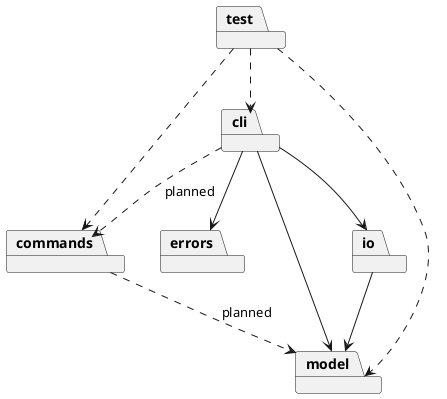
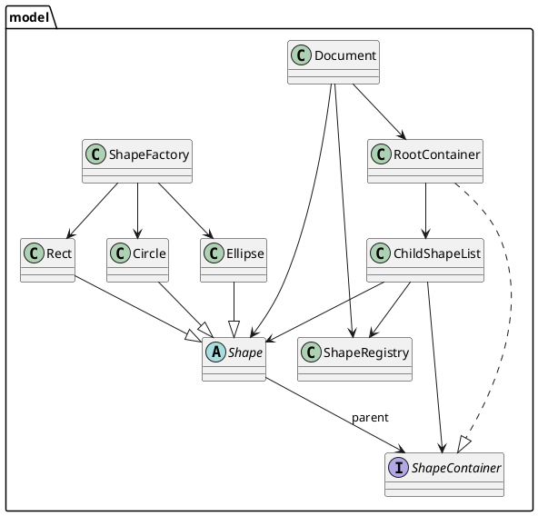
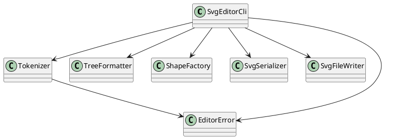
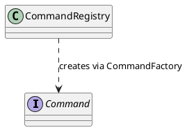

# SVG Editor 设计与过程文档

## 架构方案

### 模块职责

| 模块              | 职责                                         | 当前状态               |
| --------------- | ------------------------------------------ | ------------------ |
| `src/cli/`      | 读取输入、独立词法解析、命令分派并输出结果，格式化 tree。            | 已实现                |
| `src/model/`    | 文档、根容器、容器子节点管理、全局 ID 索引、多态图形与图形工厂。         | 已实现 Stage 3-B（Rect/Circle/Ellipse） |
| `src/commands/` | Command 接口、命令工厂注册表；具体编辑命令与 undo/redo 后续实现。 | 基础层已实现，具体命令未实现     |
| `src/io/`       | SVG 序列化与文件写入。                              | 已实现 save 子集        |
| `src/errors/`   | 共享的 `EditorError` 类型，承载可直接展示的错误消息。         | 已实现 Stage 2-E      |
| `test/`         | 自动化 CLI、Tokenizer、模型与 CommandRegistry 测试。  | 已实现                |

当前实现的类：

- `Document`：保存画布宽高，持有 `ShapeRegistry` 和 `RootContainer`；提供根级图形的添加、移除、查询以及全局 ID 查询。
- `ShapeRegistry`：用 `Map<string, Shape>` 维护全文档 ID 索引，ID 区分大小写；图形移除后允许该 ID 再次使用。
- `ShapeContainer`：容器接口，约定只读子节点、添加、移除和包含查询。
- `ChildShapeList`：可复用的子节点管理实现，统一维护子节点顺序、父节点关系和 ID 注册/注销；当前由 `RootContainer` 使用，未来 `Group` 可以组合同一实现。
- `RootContainer`：实现 `ShapeContainer`，代表文档根容器；它不是一种 `Shape`，不继承图形基类。
- `Shape`：抽象图形基类，封装非空 ID、父容器引用、`describe()`、`toSvgElement()` 和 SVG 属性转义。
- `Rect`：继承 `Shape`，用私有字段保存坐标、宽高和可选 fill，构造时校验几何；自身负责 tree 描述和 `<rect>` 元素生成。
- `Circle`：继承 `Shape`，用私有字段保存圆心、半径和可选 fill，构造时校验圆心为有限数值且半径为正；自身负责 tree 描述和 `<circle>` 元素生成。
- `Ellipse`：继承 `Shape`，用私有字段保存圆心、水平/垂直半径和可选 fill，构造时校验圆心为有限数值且两个半径为正；自身负责 tree 描述和 `<ellipse>` 元素生成。
- `ShapeFactory`：集中识别支持的图形类型并创建 `Rect`、`Circle` 或 `Ellipse`，避免 CLI 直接构造图形；当前仍使用类型分支，注册表式工厂留到 Task 3-F。
- `SvgEditorCli`：持有当前 `Document`，用 `readline` 逐行读取，先交给 `Tokenizer` 生成 token，再分派 `init`、`create`、`tree`、`save`、`help`、`exit`；`handleLine` 是统一错误边界，捕获 Tokenizer 和命令异常后输出单行 `error: ...`；启动时输出固定单行 banner，仅在 TTY 交互模式输出 `svg> ` 提示符。
- `Tokenizer`：把一行原始输入切分为 token 数组，处理普通空白、双引号参数和整行注释；引号错误抛出 `EditorError`；不执行命令、不访问文档、不输出日志。
- `EditorError`：位于 `src/errors/`，继承 `Error` 并设置 `name = 'EditorError'`，只保存完整用户可读消息；不依赖模型、CLI、I/O 或具体命令，也不包含错误码或分类系统。
- `Command`：接口，定义 `execute(): void` 和 `undo(): void` 命令契约；不包含 CLI、文档或输出逻辑。
- `CommandRegistry`：以命令名为键保存 `CommandFactory`，提供注册、查询、创建和名称列表；不执行命令，也不依赖模型或 I/O。
- `SvgSerializer`：读取 `Document` 的尺寸和根容器内容，通过 `Shape.toSvgElement()` 生成 SVG 文本，不接触文件，也不读取图形专属属性。
- `SvgFileWriter`：只负责把文本写入指定路径。
- `TreeFormatter`：读取 `Document` 的尺寸和根容器内容，通过 `Shape.describe()` 生成稳定的 tree 文本，不读取图形专属属性。

### 依赖方向

当前代码的实际依赖：

- `cli` 可以依赖 `model`、`io` 和 `errors`。
- `io` 可以依赖 `model`。
- `model` 不依赖 `cli`、`io`、`errors` 或具体命令类。
- `errors` 不依赖任何项目模块。
- `model` 内部：`Document` 组合 `ShapeRegistry` 和 `RootContainer`，并使用 `Shape`；`RootContainer` 组合 `ChildShapeList`；`ChildShapeList` 使用 `ShapeRegistry` 和 `Shape`；`Shape` 只以类型方式引用 `ShapeContainer` 作为父节点类型；`Rect`、`Circle` 和 `Ellipse` 继承 `Shape`；`ShapeFactory` 创建 `Rect`、`Circle` 和 `Ellipse`。
- `cli` 内部：`SvgEditorCli` 依赖 `Tokenizer`、`TreeFormatter`、`ShapeFactory`、`SvgSerializer`、`SvgFileWriter` 和 `EditorError`；`Tokenizer` 依赖 `EditorError`，不依赖模型、I/O 或其他 CLI 类。
- `commands` 内部：`CommandRegistry` 只依赖同层的 `Command` 类型；不依赖 `SvgEditorCli`、`Document`、具体图形或 I/O。
- `cli` 尚未依赖 `commands`；现有 `switch` 分派保持不变。
- `test` 通过子进程调用编译后的 CLI，并直接加载编译后的 `Tokenizer`、`Document`、`Rect`、`Circle`、`Ellipse`、`CommandRegistry` 验证词法、模型和注册表行为。

规划中的依赖：

- 后续具体编辑命令可以依赖 `model`；`cli` 可以在具体命令实现后依赖 `commands` 进行编辑操作。
- 本任务只建立了 Command 接口和注册表，没有创建具体命令或命令历史。

### PlantUML 包图

当前模型层的类关系：

当前 CLI 层的输入与协作关系：

当前 commands 层类关系：

### 设计模式与扩展点

- 当前使用封装、多态和工厂：`Shape` 定义统一接口，`Rect`、`Circle` 和 `Ellipse` 把 tree 描述与 SVG 元素生成封装在自身；`TreeFormatter` 和 `SvgSerializer` 只依赖 `Shape` 接口；`ShapeFactory` 集中识别并创建 `Rect`、`Circle` 或 `Ellipse`。
- Task 4 新增容器抽象：`ShapeContainer` 约定容器行为，`ChildShapeList` 复用子节点顺序、父节点关系和 ID 注册规则；`RootContainer` 只代表根容器，不继承 `Shape`；`Document` 不是容器，负责文档尺寸、全局 ID 索引和根容器。该抽象为未来 `Group`/Composite 提供基础，但 `Group`、嵌套遍历和 Composite 操作尚未实现。
- Task 5 将词法切分从 `SvgEditorCli` 抽离为 `Tokenizer`：Tokenizer 只生成 token，CLI 仍保留 `switch` 命令分派。这降低了输入解析与命令执行的耦合。
- Task 6 新增 `Command` 接口和 `CommandRegistry` 基础层：接口定义 `execute()`/`undo()` 契约，注册表用命令名保存无参工厂并支持注册、查询和创建；具体命令、命令历史和 undo/redo 尚未实现，CLI 也尚未接入注册表。
- Task 7（Stage 2-E）建立统一错误边界：`EditorError` 位于 `src/errors/`，`SvgEditorCli.handleLine` 是 CLI 唯一捕获并输出 `error: ...` 的位置；Tokenizer 和命令方法抛出可预期错误，不再各自打印。交互式 TTY 保留 `svg> ` 提示符，管道输入不输出提示符，启动 banner 固定为单行。
- Stage 3-A 新增 `Circle`：图形自身实现 `describe()` 和 `toSvgElement()`，`TreeFormatter`/`SvgSerializer` 未增加圆形类型判断。`SvgEditorCli.create` 当时仅为命令参数语法分派 rect/circle 两个解析路径，`ShapeFactory` 仍负责构造具体图形；注册表式工厂和统一类型分派留到 Task 3-F。
- Stage 3-B 新增 `Ellipse`：沿用同一多态路径，自身实现 `describe()`/`toSvgElement()`；CLI 增加 ellipse 参数解析路径，`TreeFormatter`/`SvgSerializer` 仍无图形类型分支。`ShapeFactory.supports()` 和 CLI 分支都扩展到 ellipse，注册表式工厂仍留到 Task 3-F。
- `AGENTS.md` 要求 Command、Composite 和 undo/redo；当前已实现 Command 接口和注册表基础，但具体命令、Composite 和 undo/redo 仍未实现，因此仍是阶段性缺失，不是最终架构。
- `SvgEditorCli.execute` 目前仍是唯一的命令名分派点；`CommandRegistry` 存在但未接入 CLI。后续实现具体命令时再把注册表接入分派流程，并把编辑操作封装成 undo 单元。
- 图形类型、命令集合、SVG 格式是主要变化点；`Shape` 为新增图形提供统一多态接口，`Circle` 和 `Ellipse` 验证了该扩展路径；`ShapeFactory` 预留类型分派位置，Task 3-F 将改为注册表式工厂；`ShapeContainer`/`ChildShapeList` 为未来 `Group` 预留容器复用点，`CommandRegistry` 为具体命令注册预留入口，`model`、`io` 与 `commands` 的边界已划分。本阶段不提前创建 `Group`、具体命令类或插件类。

## 过程记录

- Task 2 开始前检查：分支 `main`，HEAD `d67bde2`（`help and exit`），与 `origin/main` 一致；工作区干净；Node.js v22.22.2，npm 10.9.7。更早的 `8e8d144`（`init`）为初始提交；`final` 标签尚未创建。
- 对照作业原文确认：默认画布 800×600、错误统一以 `error:` 开头、未初始化文档报错、tree 使用 `svg (WxH)` 和 `rect#id` 形式。
- 原文未规定重复 `init`；按“新建空画布”解释为替换当前文档。原文也未规定只给一个尺寸、或新建后无文件名 `save` 的行为；分别采用缺失维度取默认值、以及报错而不是猜测默认路径。
- 实现分为 model（`Canvas`、`RectangleShape`、`ShapeFactory`）、io（`SvgSerializer`、`SvgFileWriter`）和 cli（`TreeFormatter`、`SvgEditorCli`）；`main.ts` 只负责启动。图形类型判断集中在 `ShapeFactory`，CLI 不直接构造矩形。
- Task 2 第一次测试运行 12 个用例中 10 个通过、2 个失败：测试直接匹配 tree 首行，但管道输出中该行前面带有 `svg> ` 提示符。修正测试，用 `withoutPrompt` 规范化输出后再断言；没有修改业务代码。重跑 12/12 通过。
- Task 2 手工执行 `npm run cli`，输入 `init 800 600`、`create rect r1 100 120 200 80 blue`、`tree`、`save <临时路径>`、`exit`；输出与生成的 SVG 均符合预期。未在浏览器中实际打开文件，浏览器验收步骤见根目录 README。
- Task 3 多态模型基础：从 `88131df` 开始，工作区仅有未跟踪的 `Task3.md`。新增 `Shape` 抽象基类和 `Rect`，将 `Canvas` 改为 `Shape[]`、`ShapeFactory.createRect()` 返回 `Rect`；`TreeFormatter` 改为调用 `describe()`，`SvgSerializer` 改为调用 `toSvgElement()`，随后删除 `RectangleShape.ts`。
- Task 3 验证：迁移后 `npm run typecheck` 通过；扩充测试后 `npm test` 为 17 个测试全部通过。`grep` 确认 `src/` 中没有 `RectangleShape` 或 `createRectangle` 残留引用，`TreeFormatter`/`SvgSerializer` 未读取矩形专属属性。
- Task 3 修正：发现 `dist/model/RectangleShape.js` 是上一轮构建残留，`tsc` 不会自动清理输出目录；已删除该生成文件（`dist/` 被 gitignore），源码无旧类引用。
- Task 2 历史记录中的 `RectangleShape` 保留为当时事实，不改写历史；当前架构以 `Shape`/`Rect` 为准。
- Task 4 开始前检查：分支 `main`，HEAD `1360a52`（`refactor: 建立 Shape 多态模型并迁移矩形实现(stage2-A)`），与 `origin/main` 一致；工作区仅有未跟踪的 `Task4.md`；当时 `Canvas` 仍是 `SvgEditorCli`、`TreeFormatter`、`SvgSerializer` 的文档模型，17 个测试作为回归基线。Node.js v22.22.2，npm 10.9.7。
- Task 4 重要设计决策：采用“Document + ShapeRegistry + ShapeContainer/ChildShapeList + RootContainer”方案。`Document` 只管理画布尺寸、全局 ID 索引和根容器；`RootContainer` 只代表根；`ChildShapeList` 统一管理子节点顺序、父节点和 ID 注册/注销；`Shape` 只保存自己的父容器引用。这样所有添加/移除只有一条受控路径，ID 索引和容器内容不会各自维护。
- 选择该方案的原因：Task 4 要求全局 ID 唯一性覆盖未来嵌套结构，同时要求根容器和未来 Group 复用容器规则。把 ID 注册表独立出来可以由所有容器共享；把子节点操作放进 `ChildShapeList`，未来 `Group` 继承 `Shape` 并实现 `ShapeContainer` 后可以直接组合同一实现，不需要复制 `add/remove` 或依赖 `Document`。
- 不采用“Document 直接持有 Map 和 RootContainer”的轻量方案：类更少，但 `Document` 与容器需要通过回调或相互引用协调 ID，未来 `Group` 若自行管理子节点会出现两套 `add/remove` 规则，容易造成 ID 索引与容器内容失同步；不满足“根容器与未来 Group 复用同一套规则”的目标。
- 不采用“Document 自己兼任根容器”的最小方案：会把文档级职责和容器级职责混在一个类中，违反 Task 4 对清晰边界的要求，也使未来 Group/Composite 缺少可复用基础，因此只适合临时原型。
- 父子关系子决策：`Shape` 使用私有 `parentContainer` 字段和只读 `parent` getter；`attachTo`/`detachFrom` 作为受控方法，只有当前父节点为空/匹配时才成功。没有引入 token 或 WeakMap 模拟包级私有访问，因为 TypeScript 无包级可见性，任务也明确不要求为访问控制增加复杂封装。
- ID 复用子决策：移除图形时 `ShapeRegistry.unregister` 删除该 ID，允许之后重新使用；这与“ID 不存在即可创建”的现有语义一致，并由“Document removes shapes, clears parents, and allows ID reuse”测试固定。
- 实现迁移：新增 `Document`、`ShapeRegistry`、`ShapeContainer`、`ChildShapeList`、`RootContainer`；`Shape` 增加父节点；CLI 改为持有 `Document`；`TreeFormatter`/`SvgSerializer` 改用 `Document` 尺寸和 `root.children`；`ShapeFactory` 保持只创建 `Rect`。搜索确认 `src/` 无 `Canvas` 引用后删除 `Canvas.ts`，避免保留两套文档状态。
- Task 4 验证：`npm run typecheck` 通过；`npm test` 24 个测试全部通过（原有 17 个 + 新增 7 个 Document/容器/父节点/ID 测试），首次完整运行无失败。手工执行 `npm run cli` 完成 `init 800 600 → create rect r1 100 120 200 80 blue → tree → save <临时路径> → exit`，输出和生成的 SVG 与迁移前一致。
- Task 4 修正：构建不会自动清理 `dist`，删除旧 `Canvas` 后发现 `dist/model/Canvas.js` 残留，已删除该生成文件（`dist/` 被 gitignore）；源码无 `Canvas` 引用。
- README 决策：本次删除 `Canvas` 并新增 Document/容器类，根 README 的 `src/model/` 目录职责条目会失真，因此只更新该条目；用户可见命令与输出未变，其他章节不改。
- 历史记录中 Task 2/3 的 `Canvas` 和 `RectangleShape` 表述保留为当时事实；当前架构已无这两个类。
- Task 5 开始前检查：分支 `main`，HEAD `b94ef0d`（`feat: 新增 Document 模型与统一容器抽象，迁移 Canvas 职责`），与 `origin/main` 一致；工作区仅有未跟踪的 `Task5.md`；`SvgEditorCli` 仍使用 `command.split(/\s+/)`，24 个测试作为回归基线。Node.js v22.22.2，npm 10.9.7。
- Task 5 词法设计：`Tokenizer` 使用状态机区分行首/注释、普通参数、双引号参数和引号结束；行首空白后为空行或 `#` 返回 `[]`；引号内累积空格和 `#`；闭合引号后仅允许空白或行尾；未闭合抛 `unclosed double quote`，其他非法引号结构抛 `invalid quote syntax`。
- 接入方式：`SvgEditorCli.handleLine` 不再使用 `trim()` 后 `split(/\s+/)`，而是调用 `Tokenizer.tokenize(line)`；token 为空时只显示下一次提示符；Tokenizer 和命令异常都进入现有 `try/catch`，输出单行 `error: ...`；`execute` 改为接收 token 数组，保留原 `switch` 分派。
- 测试：新增 `test/tokenizer.test.mjs` 的 12 个词法测试，覆盖空白、连续/前后空白、双引号空格、空字符串、未闭合、闭合后非空白、引号非参数起始、空行、注释、`#fff`、行内 `#` 和单引号；`test/cli.test.mjs` 增加 6 个集成测试，覆盖空行/注释、`#fff`、带空格路径、未闭合/非法引号后继续执行、无引号命令回归。
- `npm test` 脚本改为显式运行 `test/cli.test.mjs test/tokenizer.test.mjs`，不依赖 shell 通配符。
- Task 5 验证：`npm run typecheck` 通过；`npm test` 42 个测试全部通过（CLI 30 个 + Tokenizer 12 个），首次完整运行无失败。手工执行 `npm run cli`，输入包含注释、`#fff`、带空格引号路径、未闭合引号和非法引号；命令正常执行，两个引号错误各自输出后 CLI 继续，生成的 SVG 包含两个矩形和 `fill="#fff"`。
- Task 5 范围：未修改 `Shape.attachTo()` / `Shape.detachFrom()` 的可见性或父节点不变量；该模型层审查留作后续独立事项。
- README 决策：本次扩展了用户可见输入语法，根 README 增加简短输入规则（空白、双引号、整行注释），并更新 `src/cli/`、`test/` 的目录职责；其他段落不改。
- Task 6 开始前检查：分支 `main`，HEAD `968152d`（`feat: 实现独立 Tokenizer 并接入 CLI，支持引号参数与整行注释（Stage 2-C）`），与 `origin/main` 一致；工作区仅有未跟踪的 `Task6.md`；`src/commands/` 无文件，42 个现有测试作为回归基线。Node.js v22.22.2，npm 10.9.7。
- Task 6 设计决策：采用 Map 注册表和无参工厂方案。`Command` 只定义 `execute(): void` 和 `undo(): void`；`CommandRegistry` 用 `Map<string, CommandFactory>` 保存工厂，公开 `register`、`has`、`create`、`names`。命令名保留原始字符串，拒绝空字符串和纯空白；重复注册抛错且不覆盖；未知命令抛清晰错误；工厂异常原样传播；注册表不执行命令。
- 实现文件：新增 `src/commands/Command.ts` 和 `src/commands/CommandRegistry.ts`，没有创建具体命令、undo 管理器或 CLI 演示命令；`SvgEditorCli` 和现有 `switch` 未修改。
- Task 6 测试：新增 `test/command-registry.test.mjs` 的 8 个公开行为测试，覆盖注册、查询、创建、工厂调用、重复注册、空名称、未知命令、工厂异常和多个命令互不覆盖；`npm test` 脚本加入该文件。
- Task 6 修正：第一次运行 50 个测试时 46 个通过、4 个失败，原因是 `assert.throws` 的正则匹配到了 Node 输出的 `Error: ...` 字符串前缀；修正测试为使用 `{ message: ... }` 精确匹配，未修改生产代码。重跑 50/50 通过。
- Task 6 验证：`npm run typecheck` 通过；`npm test` 50 个测试全部通过（原有 42 个 + 新增 8 个）。本任务不改变 CLI，未额外手工运行 CLI；原有 30 个 CLI 集成测试作为回归。
- README 决策：本次新增 `src/commands/` 正式模块并改变当前实现范围，根 README 更新当前范围、`src/commands/` 职责和 `test/` 描述；未修改使用示例或无关章节。
- Task 7 开始前检查：分支 `main`，HEAD `7693850`（`feat(commands): 实现 Command 接口和 CommandRegistry 基础层（stage 2-D）`），与 `origin/main` 一致；工作区仅有未跟踪的 `Task7.md`；50 个现有测试作为回归基线。Node.js v22.22.2，npm 10.9.7。
- Task 7 现状核查：`SvgEditorCli.handleLine` 已有 `try/catch` 并输出单行 `error: ...`；但未知命令、参数错误、无文档、写文件失败等仍由各命令方法直接 `console.log`；仓库无 `EditorError`；banner 为两行旧欢迎语；提示符在管道输入下也会输出；EOF 通过 readline `close` 正常结束；空行、整行注释和 `#fff` 已由 Tokenizer 处理；无文档文案已符合要求；现有测试未覆盖 banner 精确文本、EOF、单错误前缀和管道无提示符。
- Task 7 设计决策：新增独立错误模块 `src/errors/EditorError.ts`，只负责携带完整用户可读消息；CLI 的可预期业务错误全部改为抛出 `EditorError`，由 `handleLine` 唯一添加一次 `error:` 前缀。Tokenizer 的两个引号错误也改为 `EditorError`，因为它们属于可预期输入错误。模型层与 I/O 层未改造异常类型，避免超出任务范围。提示符通过 `process.stdin.isTTY === true` 区分交互与管道输入，避免非交互输出依赖终端显示。
- Task 7 实现：新增 `src/errors/EditorError.ts`；修改 `src/cli/SvgEditorCli.ts`，统一错误抛出/捕获、固定单行 banner、TTY 提示符；修改 `src/cli/Tokenizer.ts` 的引号错误类型；扩展 `test/cli.test.mjs`，加入进程超时保护、banner 精确断言、单错误前缀、EOF/多行管道、失败不改文档等测试。命令语义、输出文案和 `switch` 分派未改变。
- Task 7 验证：针对性运行 `npm run build` 后 `node --test test/cli.test.mjs`，33/33 通过；`npm run typecheck` 通过；`npm test` 53/53 通过（CLI 33 + CommandRegistry 8 + Tokenizer 12）。
- Task 7 已知限制：交互式 TTY 下的 `svg> ` 提示符无法通过当前管道式进程测试验证；测试断言了管道输出不含提示符，交互分支由 `process.stdin.isTTY` 代码路径保留。
- README 决策：新增 `src/errors/` 目录改变了根 README 展示的源码布局，因此只在 `src/io/` 之后补一条 `src/errors/` 职责；CLI 命令、运行方式和错误文案未变，其他章节不改。
- Task 3-A 开始前检查：分支 `main`，HEAD `97dc9e6`（`docs: 更新 AGENTS.md 和 doc/AGENTS.md 的规则与结构`），与 `origin/main` 一致；工作区仅有未提交的 `项目规划.md` 阶段 3 任务拆分（用户已有工作，保留并在本任务中同步更新）；53 个测试作为回归基线。Node.js v22.22.2，npm 10.9.7。
- Task 3-A 作业核对：作业规定 `create circle <id> <cx> <cy> <r> [fill]`，生成 `<circle id="…" cx="…" cy="…" r="…" fill="…"/>`；fill 省略时不写该属性。作业未为圆形校验规定专门文案，沿用矩形风格采用“圆心必须为有限数值、半径必须为正”，不因越界拒绝图形；tree 沿用现有单空格属性格式，输出 `circle#id cx=… cy=… r=… [fill=…]`。
- Task 3-A 设计决策：新增 `Circle extends Shape`，几何属性和可选 fill 使用私有字段，构造器校验有限圆心与正半径，`describe()`/`toSvgElement()` 由图形自身实现；`ShapeFactory` 增加 `supports('circle')` 和 `createCircle()`。CLI 在创建前完成参数解析、重复 ID 检查和半径校验，任一失败都不修改文档；`TreeFormatter`/`SvgSerializer` 未增加圆形分支。未引入注册表式工厂、其他图形或编辑命令。
- Task 3-A 实现：新增 `src/model/Circle.ts`；修改 `src/model/ShapeFactory.ts`、`src/cli/SvgEditorCli.ts`（create 的 rect/circle 参数路径、help）和 `test/cli.test.mjs`（Circle 模型测试、CLI 创建与保存、非法参数/重复 ID 不改文档）。
- Task 3-A 验证：`npm run build && node --test test/cli.test.mjs` 为 39/39 通过；`npm run typecheck` 通过；`npm test` 为 59/59 通过（CLI 39 + CommandRegistry 8 + Tokenizer 12）。本任务未手工打开浏览器验收 SVG 渲染。
- README 决策：本次新增用户可见的 `create circle` 命令，改变当前范围、示例、手工验收和 `src/model/` 职责，根 README 更新这些相关段落；未修改输入规则、构建流程和其他无关章节。
- `项目规划.md` 同步：更新当前基线（`97dc9e6`、Stage 2-E 已提交、3-A 未提交）、修正过时的 `Canvas`/`RectangleShape` 描述，标记 3-A 完成并把下一项标为 3-B。
- Task 3-B 开始前检查：分支 `main`，HEAD `0dac9ac`（`feat: 新增圆形图形支持，包含模型与CLI实现`），`origin/main` 为 `97dc9e6`，本地领先 1 个提交；工作区干净；59 个测试作为回归基线。Node.js v22.22.2，npm 10.9.7。
- Task 3-B 作业核对：作业规定 `create ellipse <id> <cx> <cy> <rx> <ry> [fill]`，生成 `<ellipse id="…" cx="…" cy="…" rx="…" ry="…" fill="…"/>`；fill 省略时不写该属性。作业未为椭圆校验规定专门文案，沿用 circle/rect 风格采用“圆心必须为有限数值、两个半径必须为正”，不因越界拒绝图形；tree 沿用现有单空格属性格式，输出 `ellipse#id cx=… cy=… rx=… ry=… [fill=…]`。
- Task 3-B 设计决策：新增 `Ellipse extends Shape`，几何属性和可选 fill 使用私有字段，构造器校验有限圆心与正半径；`describe()`/`toSvgElement()` 由图形自身实现。`ShapeFactory` 增加 `supports('ellipse')` 和 `createEllipse()`；CLI 增加 ellipse 参数解析路径和未知类型辅助方法，在创建前完成参数解析、重复 ID 检查和半径校验，任一失败都不修改文档；`TreeFormatter`/`SvgSerializer` 未增加 ellipse 分支。未引入注册表式工厂、其他图形或编辑命令。
- Task 3-B 实现：新增 `src/model/Ellipse.ts`；修改 `src/model/ShapeFactory.ts`、`src/cli/SvgEditorCli.ts`（create 的 ellipse 参数路径、help、未知类型辅助）和 `test/cli.test.mjs`（Ellipse 模型测试、CLI 创建与保存、非法参数/重复 ID 不改文档）。
- Task 3-B 验证：`npm run build && node --test test/cli.test.mjs` 为 45/45 通过；`npm run typecheck` 通过；`npm test` 为 65/65 通过（CLI 45 + CommandRegistry 8 + Tokenizer 12）。本任务未手工打开浏览器验收 SVG 渲染。
- README 决策：本次新增用户可见的 `create ellipse` 命令，改变当前范围、示例、手工验收和 `src/model/` 职责，根 README 更新这些相关段落；未修改输入规则、构建流程和其他无关章节。
- `项目规划.md` 同步：更新当前基线与 3-A 已提交状态，标记 3-B 完成并把下一项标为 3-C。

## 一致性自查

- 模块划分：实际目录为 `src/cli/`（`main.ts`、`SvgEditorCli.ts`、`Tokenizer.ts`、`TreeFormatter.ts`）、`src/model/`（`Shape.ts`、`Rect.ts`、`Circle.ts`、`Ellipse.ts`、`Document.ts`、`ShapeRegistry.ts`、`ShapeContainer.ts`、`ChildShapeList.ts`、`RootContainer.ts`、`ShapeFactory.ts`）、`src/commands/`（`Command.ts`、`CommandRegistry.ts`）、`src/io/`（`SvgSerializer.ts`、`SvgFileWriter.ts`）、`src/errors/`（`EditorError.ts`）、`test/cli.test.mjs`、`test/tokenizer.test.mjs`、`test/command-registry.test.mjs`；`Canvas.ts` 已删除。
- 依赖方向：`SvgEditorCli` 导入 `Document`、`ShapeFactory`、`Tokenizer`、`io` 和 `EditorError`；`Tokenizer` 只导入 `EditorError`，不依赖模型或 I/O；`EditorError` 没有项目内导入；`TreeFormatter`/`SvgSerializer` 导入 `Document` 并读取 `root.children`，只调用 `describe()`/`toSvgElement()`；`Document` 组合 `ShapeRegistry` 和 `RootContainer`；`RootContainer` 组合 `ChildShapeList`；`ChildShapeList` 使用 `ShapeRegistry` 和 `Shape`；`Shape` 以类型方式引用 `ShapeContainer`；`Rect`、`Circle` 和 `Ellipse` 继承 `Shape`；`ShapeFactory` 创建 `Rect`、`Circle` 和 `Ellipse`；`CommandRegistry` 只以类型方式引用同层 `Command`，未导入 CLI、模型或 I/O。未发现 `model → cli/io/errors` 的依赖。
- 错误边界：`src/cli/` 中只有 `SvgEditorCli.handleLine` 的 `catch` 输出 `error: ...`；其他 CLI 方法不再直接打印错误，而是抛出 `EditorError`；Tokenizer 的引号错误也抛出 `EditorError`。模型层仍使用通用 `Error`，未在本任务中改造。
- 多态输出：`TreeFormatter` 和 `SvgSerializer` 没有 `rect`/`circle`/`ellipse` 类型判断，Rect、Circle 与 Ellipse 各自实现 `describe()`/`toSvgElement()`；`SvgEditorCli.create` 中的 rect/circle/ellipse 分支只负责命令参数语法，并由 `ShapeFactory` 构造图形。
- 词法解析：`src/cli/` 中没有 `command.split(/\s+/)`；CLI 通过 `Tokenizer.tokenize()` 获取 token 数组后再分派。
- 注册表：`CommandRegistry` 只提供注册、查询、创建和名称列表；不执行命令，不创建具体命令；CLI 当前未导入或使用它。
- 一类一文件：上述实现类均为独立文件，文件名与类名一致。
- 文档一致性：根目录 README 的命令语法、已实现范围和运行方式，与本文件、`package.json`、源码和测试一致。
- 阶段冲突：Command 接口与 `CommandRegistry` 基础已实现，但具体命令、Composite 和 undo/redo 尚未实现，已在本节和“未完成事项”中明确记录；`AGENTS.md` 未被修改。

## 质量保证

- 环境：Node.js v22.22.2，npm 10.9.7。
- `npm run typecheck`：通过，无类型错误。
- 针对性测试：`npm run build` 后运行 `node --test test/cli.test.mjs`，45 个 CLI 集成测试全部通过。
- `npm test`：先构建，再运行 `node --test test/cli.test.mjs test/tokenizer.test.mjs test/command-registry.test.mjs`；65 个测试通过，0 失败（CLI 45 + CommandRegistry 8 + Tokenizer 12）。
- 不变量检查：测试覆盖根容器顺序、大小写敏感 ID、重复 ID、重复/跨容器挂载、添加/移除失败不改状态、移除后清除父节点、ID 复用，以及 ID 索引与容器内容一致。
- 引用检查：`src/` 中无 `Canvas`、`RectangleShape` 或 `createRectangle` 残留；`TreeFormatter`/`SvgSerializer` 读取 `Document.root.children`，只调用 `describe()`/`toSvgElement()`，未读取图形专属属性。
- Circle 检查：构造器拒绝空 ID、非有限圆心和非正/非有限半径；测试覆盖 `cx`/`cy`/`r` 的正常访问、可选 fill、describe/SVG 属性顺序与转义；CLI 测试覆盖重复 ID、非法参数、缺少/多余参数，并断言失败后 tree 只保留原有图形。
- Ellipse 检查：构造器拒绝空 ID、非有限圆心和非正/非有限 `rx`/`ry`；测试覆盖 `cx`/`cy`/`rx`/`ry` 的正常访问、可选 fill、describe/SVG 属性顺序与转义；CLI 测试覆盖重复 ID、非法参数、缺少/多余参数，并断言失败后 tree 只保留 circle 和原有 ellipse。
- 词法检查：`Tokenizer` 独立存在于 `src/cli/Tokenizer.ts`；`src/cli/` 中没有 `command.split(/\s+/)`；CLI 通过 token 数组分派，引号异常由 `handleLine` 统一输出且不退出。
- 错误处理检查：CLI 命令方法中不再有 `console.log('error: ...')`；`error:` 前缀只由 `handleLine` 添加；测试覆盖未知命令、参数错误、无文档、写文件失败和 Tokenizer 错误，均只出现一次前缀。
- 注册表检查：`CommandRegistry` 只以类型方式依赖 `Command`；测试覆盖注册、查询、创建、工厂调用、重复注册、空名称、未知命令、工厂异常和多名称独立；未执行命令，未创建具体命令，CLI 未导入注册表。
- CLI 回归：45 个 CLI 测试全部通过，覆盖 rect 原有行为、circle/ellipse 创建、树输出、SVG 保存、banner 精确文本、管道无提示符、EOF 正常退出和失败不改文档。
- 交互提示符限制：当前自动化测试通过管道运行 CLI，只验证了管道输出不含 `svg> `；TTY 交互提示符由 `process.stdin.isTTY === true` 分支保留，未在自动化测试中验证。
- 浏览器验收步骤仍见根 README；Task 3-B 未手工在浏览器中打开生成的 SVG。
- Git 检查：本轮开始时 `main` 为 `0dac9ac`、`origin/main` 为 `97dc9e6`（本地领先 1 个提交），工作区干净；完成后 `git diff --check` 无空白错误（仅有 LF/CRLF 提示），工作区为 6 个已跟踪文件修改、未跟踪 `src/model/Ellipse.ts`；未创建 commit、push 或 tag。

## 未完成事项

- 其他图形类型（line/text/g）、Group 容器与嵌套关系、`in` 子句。
- `read`、`canvas`、`move`、`scale`、`set`、`delete`、`group`、`ungroup`、`addto`、`front`、`back`、`show`、`undo`、`redo`。
- 具体编辑命令、命令历史、Composite 容器行为和 undo/redo 尚未实现；`Command` 接口与 `CommandRegistry` 只是基础层。
- `save` 无文件名且无来源路径时明确报错；`read` 实现后再接入“保存到读入路径”。
- 按本阶段规范，不支持行内注释、单引号引用和反斜杠转义；只有行首 `#` 作为整行注释。
- Stage 2-E 已完成 `EditorError`、统一错误边界、固定单行 banner、TTY/管道提示符区分和 EOF/管道行为测试；交互式 TTY 提示符未纳入自动化测试。
- Stage 3-A 已完成 Circle，Stage 3-B 已完成 Ellipse（Shape 子类、工厂创建、CLI `create circle`/`create ellipse`、tree/SVG 输出和测试）；Stage 3 其余任务（Line、Text、Group/Composite、注册表式工厂、`create ... in`、tree 子树、show、集成验收）尚未完成。
- 阶段 2 的 A–E 已完成；具体编辑命令和 undo/redo 仍属于后续阶段。Command 接口/注册表基础已在 Task 6 完成，Stage 2-E 统一错误与 REPL 行为已在 Task 7 完成，Tokenizer 与双引号参数已在 Task 5 完成，Document、根容器和父节点基础已在 Task 4 完成。
- `ShapeFactory` 仍按 rect/circle/ellipse 类型分支创建图形，注册表式工厂留到 Task 3-F；`SvgEditorCli` 尚未接入 `CommandRegistry`，现有命令 `switch` 分派保持不变。
- `Shape.attachTo()` / `Shape.detachFrom()` 的可见性与父节点不变量审查仍待后续独立处理。
