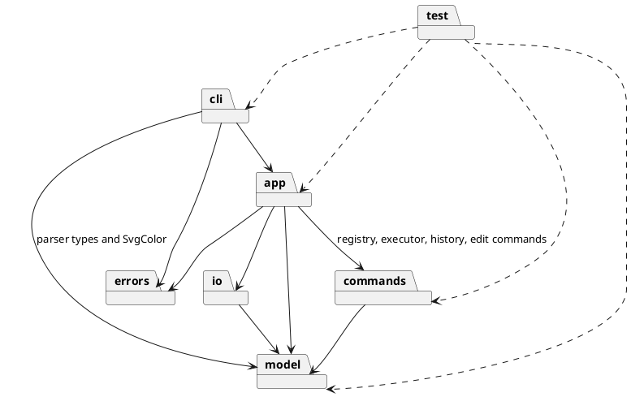
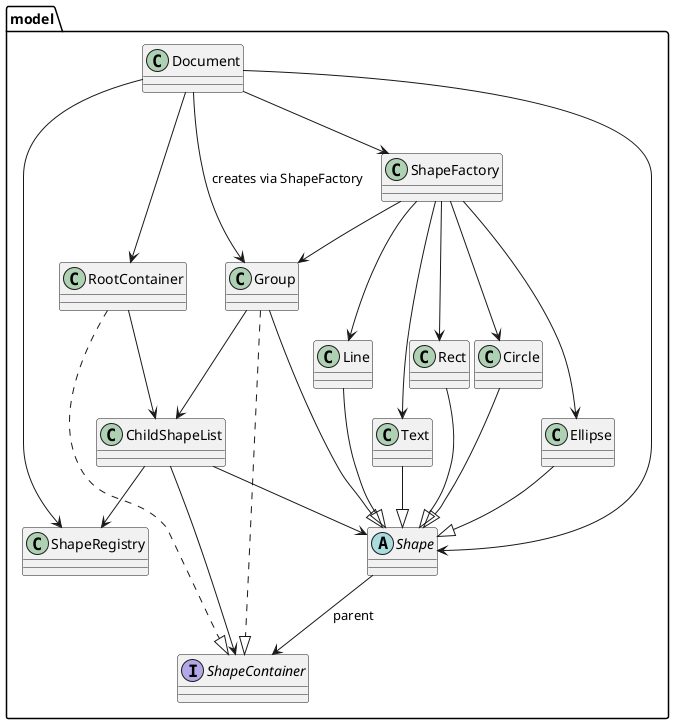
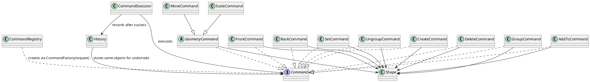

# SVG Editor 设计与过程文档

仓库地址：[https://github.com/Dinversky/svg-editor.git](https://github.com/Dinversky/svg-editor.git)

## 一、架构方案

### 1.1 模块划分与职责

| 模块 | 职责 | 主要类 |
| --- | --- | --- |
| `src/cli/` | 读取输入、词法切分、把命令参数解析为类型化请求、调用应用层并逐行输出；`handleLine` 是唯一错误边界 | `main`、`SvgEditorCli`、`Tokenizer`、`CommandParser` |
| `src/app/` | 持有当前文档、源文件路径、历史、执行器、命令注册表与 IO 组件；注册并分发应用命令处理器；生成 tree/show 文本 | `SvgEditorApplication`、`ApplicationCommandDispatcher`、`ApplicationCommandHandler`、`ApplicationRequest`、`TreeFormatter`、`ShowFormatter` |
| `src/model/` | 文档尺寸与根容器、Group 容器、子节点顺序与父关系、全局 ID 索引、多态图形、注册表式图形工厂、颜色语法 | `Document`、`ShapeRegistry`、`ShapeContainer`、`ChildShapeList`、`RootContainer`、`Shape`、`Rect`、`Circle`、`Ellipse`、`Line`、`Text`、`Group`、`ShapeFactory`、`SvgColor` |
| `src/commands/` | Command 接口、携带请求上下文的命令工厂注册表、统一执行入口、undo/redo 历史、全部编辑命令 | `Command`、`CommandRegistry`、`CommandExecutor`、`History`、`GeometryCommand`、`MoveCommand`、`ScaleCommand`、`SetCommand`、`DeleteCommand`、`GroupCommand`、`UngroupCommand`、`AddToCommand`、`FrontCommand`、`BackCommand`、`CreateCommand` |
| `src/io/` | SVG 序列化、文件读写、XML 有序解析、XML 到模型转换 | `SvgSerializer`、`SvgFileWriter`、`SvgFileReader`、`SvgXmlParser`、`SvgDocumentBuilder` |
| `src/errors/` | 可预期的用户可见错误 | `EditorError` |
| `test/` | 8 个测试文件的自动化测试，覆盖词法、解析、应用层、模型、命令、历史与 IO | 见「质量保证」 |

当前实现的分层调用：CLI 负责输入与输出，应用层负责状态与协调，命令层封装可撤销操作，模型层持有业务状态，IO 层负责序列化与文件。

关键类职责：

- `Document`：保存画布宽高，持有 `ShapeRegistry`、`ShapeFactory` 与 `RootContainer`；提供 `findShape`、`hasShape`、`createGroup`、`countShapes`、`moveShape`、`unregisterDescendants`/`registerDescendants`、`resize`。
- `ShapeRegistry`：全文档 ID 索引，ID 区分大小写，图形移除后该 ID 可再次使用。
- `ShapeContainer` / `ChildShapeList`：容器契约与复用的子节点实现，统一维护顺序、父关系、ID 注册/注销，并校验索引边界、重复挂载、自包含与祖先循环。
- `RootContainer` / `Group`：根容器与 Group 共用 `ChildShapeList`；`RootContainer` 的 `parent` 为 `null`、描述为 `svg`；`Group` 继承 `Shape` 并实现 `ShapeContainer`，`asContainer()` 返回自身，递归序列化 `<g>`。
- `Shape` 与五个叶形：抽象基类封装 ID、父容器、公共样式 `fill`/`stroke`/`stroke-width`、`describe()`、`toSvgElement()`、属性与文本转义；叶形各自实现几何 API（`translateBy`/`scaleBy`/`captureGeometry`/`restoreGeometry`）与属性 API（`getAttribute`/`validateAttribute`/`setAttribute`/`restoreAttribute`）。
- `ShapeFactory`：以类型名为键的注册表工厂，内置 `rect`/`circle`/`ellipse`/`line`/`text`/`g`，接口为 `register`、`has`、`create(type, creation)`、`types()`。
- `SvgEditorCli`：逐行读取并切分 token，`help`/`exit` 留在交互层，其余命令把 `{name, parse}` 惰性输入交给应用层并逐行输出结果；负责单行 `error:` 前缀、启动 banner、TTY 提示符与 EOF/管道行为。
- `CommandParser`：把 token 数组转换为结构化结果并包装成 `ApplicationRequest`；承担参数个数、数值、正数、颜色、text 内容与 `in <containerId>` 尾缀校验。
- `ApplicationCommandDispatcher` / `ApplicationCommandHandler`：按命令名查找处理器并把惰性 `parse()` 交给它；处理器先检查文档等状态再解析参数。
- `SvgEditorApplication`：应用协调者，持有文档、`sourcePath`、`History`、`CommandExecutor`、`CommandRegistry<EditRequest>`、反馈表与 IO 组件；负责 ID/容器解析、命令构造与执行、undo/redo 反馈、IO 锁与输出文本。
- `Command` / `CommandRegistry` / `CommandExecutor` / `History`：命令契约；按名创建命令并把请求上下文交给工厂；执行成功后才记录历史；管理 undo/redo 双栈与 IO 锁。
- `SvgSerializer` / `SvgFileWriter` / `SvgFileReader` / `SvgXmlParser` / `SvgDocumentBuilder`：通过多态生成 SVG 文本；文件读写；用 `preserveOrder` 生成有序元素树；把元素树转换为新的 `Document` 并按规则产生 warning。

### 1.2 依赖方向

当前代码的实际依赖（允许方向）：

- `cli → app`、`model`（解析类型与 `SvgColor`）、`errors`。
- `app → model`、`commands`、`io`、`errors`。
- `commands → model`（全部编辑命令通过模型 API 修改状态）。
- `io → model`（另含 Node `node:fs` 与 `fast-xml-parser`）。
- `errors` 独立，被 CLI 与应用层使用。
- `model → model`：`Document` 组合 `ShapeRegistry`/`ShapeFactory`/`RootContainer`；`RootContainer`、`Group` 组合 `ChildShapeList`；`ChildShapeList` 使用 `ShapeRegistry`/`Shape`/`ShapeContainer`；`Shape` 以类型方式引用 `ShapeContainer`，并用 `SvgColor` 校验公共样式。
- `test → 编译产物`：以子进程运行 CLI，并直接加载编译后的各层模块。

### 1.3 包图

### 1.4 类图

模型层：

命令层：

### 1.5 设计模式与落点

- **Command**（作业必选）：`Command` 定义 `execute()`/`undo()`；`CommandRegistry` 按名称用 `CommandFactory<TRequest>` 创建命令；`CommandExecutor` 是统一执行入口（Invoker）；应用层处理器承担请求解析与协调；具体命令封装操作并调用模型（Receiver）；`History` 是本项目为 undo/redo 增加的栈管理组件，保存命令对象。
- **Composite**：`Group` 继承 `Shape` 并实现 `ShapeContainer`，与 `RootContainer` 共用 `ChildShapeList`；序列化、遍历、几何与属性操作对叶形和容器统一处理，容器识别统一通过 `asContainer()` 完成。
- **注册表式工厂**：`ShapeFactory` 用私有 Map 集中创建六种类型，重复或空白类型抛错、未知类型报稳定错误、`types()` 返回副本；CLI 与读取链路都经 `create(type, creation)` 构造图形。
- **多态输出**：`TreeFormatter`、`ShowFormatter`、`SvgSerializer` 仅调用 `describe()`/`toSvgElement()`/`asContainer()` 与公共样式 getter。
- **统一错误边界**：解析与应用层抛出 `EditorError`，`SvgEditorCli.handleLine` 唯一输出 `error: ...`。
- 扩展点：新增图形 = 新增 `Shape` 子类 + 工厂注册 + 解析层类型语法表 + 读取侧元素映射；新增普通命令 = 请求类型 + 解析方法 + 应用层处理器注册。
- 需同步维护的类型/名称映射：`ShapeFactory` 注册表、`CommandParser.createSpecs`、`SvgDocumentBuilder.createLeaf`（读取侧按元素名读取属性）、`CommandParser.parseCommand` 与 `ApplicationCommandDispatcher` 的注册名（由 5-G 的一致性测试核对）。

### 1.6 快照与撤销约定

- `History` 保存 `Command` 对象，命令在首次 `execute()` 时捕获撤销所需的最小旧状态，redo 复用同一对象与快照；快照范围限于该命令影响的对象。
- 结构操作保存对象引用、原父容器、原索引与子节点顺序，恢复通过 `ShapeContainer.insert`/`indexOf` 与 `Document.moveShape` 完成。

| 命令 | 撤销所需状态 |
| --- | --- |
| `move`/`scale` | 目标子树（含 Group 子孙）的原几何值 |
| `set` | 被修改属性的旧值（可选样式可能为 `undefined`） |
| `delete` | 被删除节点或子树的对象引用、原父容器、原索引及子树 ID |
| `group`/`ungroup` | 相关对象、原父容器、原索引、新 Group ID 与子节点顺序 |
| `create` | 已构造图形与目标容器；undo 要求图形仍挂接且容器为空 |
| `addto`/`front`/`back` | 原父容器、原索引、目标容器与目标索引 |

- 失败约定：命令在首次修改模型前完成全部可预见校验；`CommandExecutor` 仅在 execute 成功后记录；`History` 仅在 undo/redo 成功后转移栈项。
- 文档类命令通过 `History.lock()` 记录状态：`init` 清空并锁定历史；`read` 替换文档后清空并锁定历史；`save` 成功写入后锁定；`canvas` 修改尺寸后锁定。锁定时 `undo`/`redo` 报 `undo/redo not allowed after io command`，下一次编辑命令成功时由 `History.record` 解锁，历史内容在锁定期间保留。

### 1.7 读取决策（阶段 5 预决策，已由 5-A 至 5-G 实现）

- 解析库：`fast-xml-parser` v5 + `preserveOrder: true`。理由：小文件场景性能影响有限，`preserveOrder` 天然保留子节点顺序，纯 JavaScript、无原生依赖，并自动处理 XML 声明与注释；备选的 `@xmldom/xmldom` 需自行过滤空白文本节点，`sax` 需自建元素树。

| 事项 | 决策 |
| --- | --- |
| 子节点顺序 | 严格按文档顺序挂接，元素顺序即 z-order |
| 属性顺序 | 输出按模型固定顺序，round-trip 保证语义一致 |
| `transform` | 打印 warning 后保留原坐标几何 |
| 未识别标签 | 跳过该元素及其子树并逐个 warning |
| 未识别属性 | 静默忽略 |
| 颜色值 | 原样读入；`create`/`set` 仍按 `SvgColor` 校验 |
| 无效元素 | 缺必需属性、数值非有限或尺寸非正时跳过并 warning |
| 重复 ID | `error: id already exists: <id>`，整次读取失败，当前文档保留 |
| 缺失 ID | 自动补 `<tag><n>` 并 warning，序号按标签名递增且跳过已占用 ID |
| 画布尺寸 | `width`/`height` → `viewBox` 第三/四值 → 800×600 |
| 命名空间 | 按元素本地名匹配标签 |
| `<text>` | 取直接文本并去除首尾空白，子元素按未识别标签处理 |
| XML 声明、注释、空白 | 忽略 |

决策依据均回到作业原文核对（如 `transform` 仅出现在背景知识、4.2 错误表只规定 `cannot read file`、4.4 的 `data-kind` 降级先例），过程见「过程记录」。

## 二、修订记录

| 阶段 | 主要变更 | 原因 |
| --- | --- | --- |
| 阶段 2 | 建立 `Shape` 多态模型、`Document`/`ShapeContainer`/`ChildShapeList` 容器抽象、`Tokenizer`、`Command`+`CommandRegistry`、`EditorError` | 满足多态、封装与统一错误边界要求，为 Group 与命令分层打基础 |
| 阶段 3 | 五种叶形与 `Group`、注册表式 `ShapeFactory`、`create ... in`、`tree [id]`/`show`、`CommandParser` 从 CLI 拆出 | 消除 CLI 中的按类型构造分支，形成 解析 → 分派 → 工厂 → 模型 链路 |
| 阶段 4 | `CommandExecutor`/`History`、九个编辑命令、IO undo 锁、应用层 `src/app/` 与统一分发 | 实现可撤销编辑与 undo/redo，并把业务协调从 CLI 移入应用层 |
| 阶段 5 | `SvgFileReader`/`SvgXmlParser`/`SvgDocumentBuilder`、`read`/`canvas`、无参数 `save` | 补齐作业要求的读取、画布与往返能力 |
| 2026-10-30 | 测试目录由 15 个文件合并为 8 个；IO 锁错误文案统一为 `undo/redo not allowed after io command` | 降低测试结构冗余并同步用户修改的文案 |

## 三、过程记录（关键决策与问题）

- **文档模型方案选择**：对比“`Document` 兼任根容器”“`Document` 直接持有 Map 与根容器”“`Document` + `ShapeRegistry` + `ChildShapeList` + `RootContainer`”三种方案，选择第三种。它让全局 ID、父子关系与子节点顺序只有一条受控路径，并且 `Group` 可以直接复用同一套容器规则。
- **CLI 参数解析膨胀的纠正**：阶段 3 中原型代码把每类图形的解析与构造分支堆在 `SvgEditorCli` 中，CLI 接近 480 行。抽出 `CommandParser` 后 CLI 约 240 行，参数解析集中一处，同时统一了颜色校验与错误优先级（无文档 → 参数/颜色 → 重复 ID → 容器）。
- **AI 生成测试的三处问题**：
  1. 断言 tree 首行时忽略了管道输出中的 `svg> ` 提示符，导致 2 个假失败；用 `withoutPrompt` 归一化输出后通过，业务代码未改。
  2. `assert.throws` 用正则匹配消息，命中了 Node 错误输出中的 `Error: ` 前缀，导致 4 个假失败；改为 `{ message: ... }` 精确匹配。
  3. 删除旧类后 `dist/` 仍残留 `RectangleShape.js`、`Canvas.js`（`tsc` 清空输出目录的行为需要显式处理），已删除残留文件并确认源码无旧类引用。
- **Command 模式角色校准**：按作业 PDF 区分 `Command`（接口）、`CommandRegistry`（按名创建）、`CommandExecutor`（Invoker）、模型（Receiver），并把 `History` 明确标注为本项目为 undo/redo 增加的组件，避免把新增组件混入基础模式描述。
- **需要用户确认的命令语义**：`scale` 只缩放几何（样式与文本内容保持原值）、`front` 对应同级数组末尾（视觉最上层）、`back` 对应索引 0、`addto` 同容器时移到末尾。这些规则在实现前与用户确认并写入本文档。
- **用户报告的缺陷**：`init`/`save` 之后执行 `undo` 会直接撤销更早的编辑命令。根因是 `History` 只记录编辑命令，文档类命令没有留下任何状态。修复为 `History` 增加 `ioLocked`/`lock()`/`isLocked`，应用层在读取栈顶前拒绝 undo/redo；锁保留历史，下一次编辑命令成功时自动解锁。
- **`positionOf()` 的脆弱实现**：原来通过解析 `Shape.describe()` 的展示文本取坐标，把展示格式当成了数据源。改为按 `x/y`、`cx/cy`、`x1/y1` 调用 `getAttribute()`，未新增模型方法。
- **读取行为的逐条决策**：`transform`、未识别标签、未识别属性、重复 ID、缺失 ID、画布尺寸等规则都回到作业原文核对后确定（见 1.7），并以 warning/error 的可观察行为固定下来。
- **测试结构与文案同步（2026-10-30）**：`test/` 由 15 个文件合并为 8 个，196 个用例逐字保留；合并前基线为 191/196，5 个失败来自 IO 锁文案变更，随文案同步修正后 196/196 通过。
- **人工验收**：阶段 3 集成验收时生成代表性 SVG，经本地 HTTP 服务在浏览器实际渲染（矩形、圆、椭圆、线、含 `&`/`<` 的文本与嵌套文本均正常，无 SVG 相关控制台错误）；阶段 4、5 通过管道 transcript 手工回放编辑命令、undo/redo、IO 锁与 read/canvas/save 交互。

## 四、一致性自查

1. **模块划分**：实际目录与 1.1 一致——`src/cli/`（4 个文件）、`src/app/`（6 个）、`src/model/`（14 个）、`src/commands/`（15 个）、`src/io/`（5 个）、`src/errors/`（1 个），`test/` 为 8 个测试文件；模型层当前类为 `Document`、`Rect` 等，各实现类均一类一文件且文件名与类名一致。与早期方案的结构差异（`Canvas` → `Document`、CLI `switch` → 应用层分发、`TreeFormatter`/`ShowFormatter` 移入 `src/app/`）记录在「修订记录」与「过程记录」。
2. **依赖方向**：抽查范围为 `src/` 下全部 45 个文件的顶层 `import` 语句与关键调用关系，结果与 1.2 一致——模型层只导入模型层内部模块；命令层只导入模型层与同层 `Command`；IO 层只导入模型层、`node:fs` 与 `fast-xml-parser`；CLI 导入 `app`/`model` 类型、`SvgColor` 与 `errors`。`TreeFormatter`/`ShowFormatter`/`SvgSerializer` 只调用多态方法与公共样式 getter；`src/` 中的 `instanceof` 仅用于错误消息提取（`instanceof Error`）；参数切分集中在 `Tokenizer`。

## 五、质量保证

- **类型检查**：`npm run typecheck` 通过（本次检查）。
- **自动化测试**：`npm test`（先构建，再用 `node --test` 运行 8 个文件）196/196 通过，构成：CLI 端到端、Tokenizer、`CommandRegistry`、`History` 与 IO 锁、模型编辑 API、全部命令对象、应用层分发与行为、SVG 读写链路。
- **关键行为断言**：失败命令保持文档与 redo 栈不变；undo/redo 精确恢复属性旧值、节点顺序、父子关系、对象身份与 ID 查询；`create ... in`、嵌套 Group、颜色校验、XML 转义与元素计数；`read → 修改 → save` 语义往返（类型、ID、几何、样式、顺序一致）。
- **集成验收**：阶段 3、阶段 4、阶段 5 各有端到端 transcript 测试；5-G 用 `SvgEditorApplication.commandNames()` 与解析器名称比对，保证解析器和分发器一致。
- **人工验证**：阶段 3 浏览器渲染；阶段 4/5 手工 transcript 检查 IO 锁、无参数 `save`、`canvas` 显示/修改。
- **差异审查**：`git diff --check` 无空白错误（仅 LF/CRLF 提示）。
- 完整性依据：作业命令表逐项核对（`init`、`read`、`save`、`canvas`、`create`、`move`、`scale`、`set`、`delete`、`group`、`ungroup`、`addto`、`front`/`back`、`tree`、`show`、`undo`/`redo`、`help`、`exit`）均已完成并由测试覆盖；插件 `box` 属后续阶段。

## 六、未完成事项

- `box` 复合图形与插件机制（后续阶段）。
- TTY 交互提示符的自动化验证（当前仅由 `process.stdin.isTTY` 分支保留）。
- `font-size` 字段及其 create/set 支持（当前 `scale` 只缩放几何，样式与字体相关属性保持原值）。
- Tokenizer 对双引号内转义引号的支持，CLI 传入含双引号文本的路径待补；Text 的 tree 描述在内容含双引号时存在视觉歧义。
- 模型层直接构造图形时 fill/stroke 的颜色校验（颜色规则当前位于解析路径）。
- `Shape.attachTo()`/`detachFrom()` 的可见性与父节点不变量审查。
- 删除或拆组后立即复用旧 ID 时，撤销会因 registry 冲突失败；冲突解决策略待定。
- 脱离文档的非空 Group 的生命周期语义。
- `lint` 与依赖方向自动检查脚本、CI 接入。
- 含 `transform` 的外部 SVG 在读取并保存后按原始坐标渲染，视觉等价性待评估；`text-anchor`、`font-size`、`opacity` 等未识别属性在往返后丢失。
