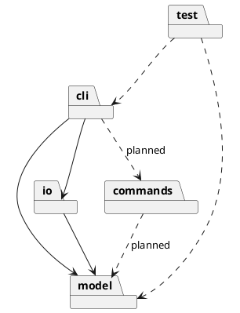
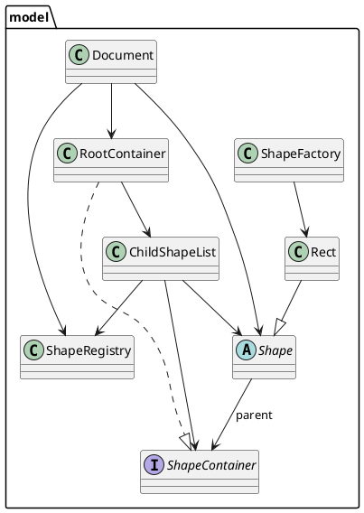
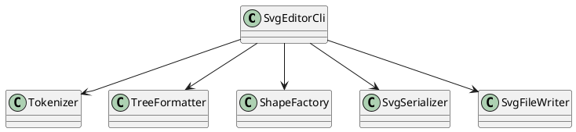

# SVG Editor 设计与过程文档

## 架构方案

### 模块职责

| 模块              | 职责                                 | 当前状态               |
| --------------- | ---------------------------------- | ------------------ |
| `src/cli/`      | 读取输入、独立词法解析、命令分派并输出结果，格式化 tree。    | 已实现                |
| `src/model/`    | 文档、根容器、容器子节点管理、全局 ID 索引、多态图形与图形工厂。 | 已实现 Stage 2-B 模型基础 |
| `src/commands/` | 可编辑命令与 undo/redo 管理。               | 未实现                |
| `src/io/`       | SVG 序列化与文件写入。                      | 已实现 save 子集        |
| `test/`         | 自动化 CLI、Tokenizer 与模型测试。           | 已实现                |

当前实现的类：

- `Document`：保存画布宽高，持有 `ShapeRegistry` 和 `RootContainer`；提供根级图形的添加、移除、查询以及全局 ID 查询。
- `ShapeRegistry`：用 `Map<string, Shape>` 维护全文档 ID 索引，ID 区分大小写；图形移除后允许该 ID 再次使用。
- `ShapeContainer`：容器接口，约定只读子节点、添加、移除和包含查询。
- `ChildShapeList`：可复用的子节点管理实现，统一维护子节点顺序、父节点关系和 ID 注册/注销；当前由 `RootContainer` 使用，未来 `Group` 可以组合同一实现。
- `RootContainer`：实现 `ShapeContainer`，代表文档根容器；它不是一种 `Shape`，不继承图形基类。
- `Shape`：抽象图形基类，封装非空 ID、父容器引用、`describe()`、`toSvgElement()` 和 SVG 属性转义。
- `Rect`：继承 `Shape`，用私有字段保存坐标、宽高和可选 fill，构造时校验几何；自身负责 tree 描述和 `<rect>` 元素生成。
- `ShapeFactory`：集中识别支持的图形类型并创建 `Rect`，避免 CLI 直接构造图形。
- `SvgEditorCli`：持有当前 `Document`，用 `readline` 逐行读取，先交给 `Tokenizer` 生成 token，再分派 `init`、`create`、`tree`、`save`、`help`、`exit`。
- `Tokenizer`：把一行原始输入切分为 token 数组，处理普通空白、双引号参数和整行注释；不执行命令、不访问文档、不输出日志。
- `SvgSerializer`：读取 `Document` 的尺寸和根容器内容，通过 `Shape.toSvgElement()` 生成 SVG 文本，不接触文件，也不读取矩形属性。
- `SvgFileWriter`：只负责把文本写入指定路径。
- `TreeFormatter`：读取 `Document` 的尺寸和根容器内容，通过 `Shape.describe()` 生成稳定的 tree 文本，不读取矩形属性。

### 依赖方向

当前代码的实际依赖：

- `cli` 可以依赖 `model` 和 `io`。
- `io` 可以依赖 `model`。
- `model` 不依赖 `cli`、`io` 或具体命令类。
- `model` 内部：`Document` 组合 `ShapeRegistry` 和 `RootContainer`，并使用 `Shape`；`RootContainer` 组合 `ChildShapeList`；`ChildShapeList` 使用 `ShapeRegistry` 和 `Shape`；`Shape` 只以类型方式引用 `ShapeContainer` 作为父节点类型；`Rect` 继承 `Shape`；`ShapeFactory` 创建 `Rect`。
- `cli` 内部：`SvgEditorCli` 依赖 `Tokenizer`、`TreeFormatter`、`ShapeFactory`、`SvgSerializer` 和 `SvgFileWriter`；`Tokenizer` 不依赖模型、I/O 或其他 CLI 类。
- `test` 通过子进程调用编译后的 CLI，并直接加载编译后的 `Tokenizer`、`Document`、`Rect` 验证词法和模型行为。

规划中的依赖：

- 后续 `commands` 依赖 `model`；`cli` 依赖 `commands` 进行编辑操作。
- 本阶段没有创建 `src/commands/`，因为 Command 与 undo/redo 被明确推迟。

### PlantUML 包图

当前模型层的类关系：

当前 CLI 层的输入与协作关系：

### 设计模式与扩展点

- 当前使用封装、多态和工厂：`Shape` 定义统一接口，`Rect` 把 tree 描述与 SVG 元素生成封装在自身；`TreeFormatter` 和 `SvgSerializer` 只依赖 `Shape` 接口；`ShapeFactory` 集中识别并创建 `Rect`。
- Task 4 新增容器抽象：`ShapeContainer` 约定容器行为，`ChildShapeList` 复用子节点顺序、父节点关系和 ID 注册规则；`RootContainer` 只代表根容器，不继承 `Shape`；`Document` 不是容器，负责文档尺寸、全局 ID 索引和根容器。该抽象为未来 `Group`/Composite 提供基础，但 `Group`、嵌套遍历和 Composite 操作尚未实现。
- Task 5 将词法切分从 `SvgEditorCli` 抽离为 `Tokenizer`：Tokenizer 只生成 token，CLI 仍保留 `switch` 命令分派。这降低了输入解析与命令执行的耦合，但尚未引入 Command 或 CommandRegistry。
- `AGENTS.md` 要求 Command、Composite 和 undo/redo；Task 2、Task 3、Task 4 与 Task 5 均未实现这些功能，因此当前仍是阶段性缺失，不是最终架构。
- `SvgEditorCli.execute` 目前是唯一的命令名分派点。后续实现 Command 时应抽出命令分发器，并把每条编辑命令封装成 undo 单元。
- 图形类型、命令集合、SVG 格式是主要变化点；`Shape` 为新增图形提供统一多态接口，`ShapeFactory` 预留类型分派位置，`ShapeContainer`/`ChildShapeList` 为未来 `Group` 预留容器复用点，`model`、`io` 与未来的 `commands` 边界已划分。本阶段不提前创建 `Group`、Command 或插件类。

## 过程记录

- Task 2 开始前检查：分支 `main`，HEAD `d67bde2`（`help and exit`），与 `origin/main` 一致；工作区干净；Node.js v22.22.2，npm 10.9.7。更早的 `8e8d144`（`init`）为初始提交；`final` 标签尚未创建。
- 对照作业原文确认：默认画布 800×600、错误统一以 `error:` 开头、未初始化文档报错、tree 使用 `svg (WxH)` 和 `rect#id` 形式。
- 原文未规定重复 `init`；按“新建空画布”解释为替换当前文档。原文也未规定只给一个尺寸、或新建后无文件名 `save` 的行为；分别采用缺失维度取默认值、以及报错而不是猜测默认路径。
- 实现分为 model（`Canvas`、`RectangleShape`、`ShapeFactory`）、io（`SvgSerializer`、`SvgFileWriter`）和 cli（`TreeFormatter`、`SvgEditorCli`）；`main.ts` 只负责启动。图形类型判断集中在 `ShapeFactory`，CLI 不直接构造矩形。
- Task 2 第一次测试运行 12 个用例中 10 个通过、2 个失败：测试直接匹配 tree 首行，但管道输出中该行前面带有 `svg> ` 提示符。修正测试，用 `withoutPrompt` 规范化输出后再断言；没有修改业务代码。重跑 12/12 通过。
- Task 2 手工执行 `npm run cli`，输入 `init 800 600`、`create rect r1 100 120 200 80 blue`、`tree`、`save <临时路径>`、`exit`；输出与生成的 SVG 均符合预期。未在浏览器中实际打开文件，浏览器验收步骤见根目录 README。
- Task 3 多态模型基础：从 `88131df` 开始，工作区仅有未跟踪的 `Task3.md`。新增 `Shape` 抽象基类和 `Rect`，将 `Canvas` 改为 `Shape[]`、`ShapeFactory.createRect()` 返回 `Rect`；`TreeFormatter` 改为调用 `describe()`，`SvgSerializer` 改为调用 `toSvgElement()`，随后删除 `RectangleShape.ts`。
- Task 3 验证：迁移后 `npm run typecheck` 通过；扩充测试后 `npm test` 为 17 个测试全部通过。`grep` 确认 `src/` 中没有 `RectangleShape` 或 `createRectangle` 残留引用，`TreeFormatter`/`SvgSerializer` 未读取矩形专属属性。
- Task 3 修正：发现 `dist/model/RectangleShape.js` 是上一轮构建残留，`tsc` 不会自动清理输出目录；已删除该生成文件（`dist/` 被 gitignore），源码无旧类引用。
- Task 2 历史记录中的 `RectangleShape` 保留为当时事实，不改写历史；当前架构以 `Shape`/`Rect` 为准。
- Task 4 开始前检查：分支 `main`，HEAD `1360a52`（`refactor: 建立 Shape 多态模型并迁移矩形实现(stage2-A)`），与 `origin/main` 一致；工作区仅有未跟踪的 `Task4.md`；当时 `Canvas` 仍是 `SvgEditorCli`、`TreeFormatter`、`SvgSerializer` 的文档模型，17 个测试作为回归基线。Node.js v22.22.2，npm 10.9.7。
- Task 4 重要设计决策：采用“Document + ShapeRegistry + ShapeContainer/ChildShapeList + RootContainer”方案。`Document` 只管理画布尺寸、全局 ID 索引和根容器；`RootContainer` 只代表根；`ChildShapeList` 统一管理子节点顺序、父节点和 ID 注册/注销；`Shape` 只保存自己的父容器引用。这样所有添加/移除只有一条受控路径，ID 索引和容器内容不会各自维护。
- 选择该方案的原因：Task 4 要求全局 ID 唯一性覆盖未来嵌套结构，同时要求根容器和未来 Group 复用容器规则。把 ID 注册表独立出来可以由所有容器共享；把子节点操作放进 `ChildShapeList`，未来 `Group` 继承 `Shape` 并实现 `ShapeContainer` 后可以直接组合同一实现，不需要复制 `add/remove` 或依赖 `Document`。
- 不采用“Document 直接持有 Map 和 RootContainer”的轻量方案：类更少，但 `Document` 与容器需要通过回调或相互引用协调 ID，未来 `Group` 若自行管理子节点会出现两套 `add/remove` 规则，容易造成 ID 索引与容器内容失同步；不满足“根容器与未来 Group 复用同一套规则”的目标。
- 不采用“Document 自己兼任根容器”的最小方案：会把文档级职责和容器级职责混在一个类中，违反 Task 4 对清晰边界的要求，也使未来 Group/Composite 缺少可复用基础，因此只适合临时原型。
- 父子关系子决策：`Shape` 使用私有 `parentContainer` 字段和只读 `parent` getter；`attachTo`/`detachFrom` 作为受控方法，只有当前父节点为空/匹配时才成功。没有引入 token 或 WeakMap 模拟包级私有访问，因为 TypeScript 无包级可见性，任务也明确不要求为访问控制增加复杂封装。
- ID 复用子决策：移除图形时 `ShapeRegistry.unregister` 删除该 ID，允许之后重新使用；这与“ID 不存在即可创建”的现有语义一致，并由“Document removes shapes, clears parents, and allows ID reuse”测试固定。
- 实现迁移：新增 `Document`、`ShapeRegistry`、`ShapeContainer`、`ChildShapeList`、`RootContainer`；`Shape` 增加父节点；CLI 改为持有 `Document`；`TreeFormatter`/`SvgSerializer` 改用 `Document` 尺寸和 `root.children`；`ShapeFactory` 保持只创建 `Rect`。搜索确认 `src/` 无 `Canvas` 引用后删除 `Canvas.ts`，避免保留两套文档状态。
- Task 4 验证：`npm run typecheck` 通过；`npm test` 24 个测试全部通过（原有 17 个 + 新增 7 个 Document/容器/父节点/ID 测试），首次完整运行无失败。手工执行 `npm run cli` 完成 `init 800 600 → create rect r1 100 120 200 80 blue → tree → save <临时路径> → exit`，输出和生成的 SVG 与迁移前一致。
- Task 4 修正：构建不会自动清理 `dist`，删除旧 `Canvas` 后发现 `dist/model/Canvas.js` 残留，已删除该生成文件（`dist/` 被 gitignore）；源码无 `Canvas` 引用。
- README 决策：本次删除 `Canvas` 并新增 Document/容器类，根 README 的 `src/model/` 目录职责条目会失真，因此只更新该条目；用户可见命令与输出未变，其他章节不改。
- 历史记录中 Task 2/3 的 `Canvas` 和 `RectangleShape` 表述保留为当时事实；当前架构已无这两个类。
- Task 5 开始前检查：分支 `main`，HEAD `b94ef0d`（`feat: 新增 Document 模型与统一容器抽象，迁移 Canvas 职责`），与 `origin/main` 一致；工作区仅有未跟踪的 `Task5.md`；`SvgEditorCli` 仍使用 `command.split(/\s+/)`，24 个测试作为回归基线。Node.js v22.22.2，npm 10.9.7。
- Task 5 词法设计：`Tokenizer` 使用状态机区分行首/注释、普通参数、双引号参数和引号结束；行首空白后为空行或 `#` 返回 `[]`；引号内累积空格和 `#`；闭合引号后仅允许空白或行尾；未闭合抛 `unclosed double quote`，其他非法引号结构抛 `invalid quote syntax`。
- 接入方式：`SvgEditorCli.handleLine` 不再使用 `trim()` 后 `split(/\s+/)`，而是调用 `Tokenizer.tokenize(line)`；token 为空时只显示下一次提示符；Tokenizer 和命令异常都进入现有 `try/catch`，输出单行 `error: ...`；`execute` 改为接收 token 数组，保留原 `switch` 分派。
- 测试：新增 `test/tokenizer.test.mjs` 的 12 个词法测试，覆盖空白、连续/前后空白、双引号空格、空字符串、未闭合、闭合后非空白、引号非参数起始、空行、注释、`#fff`、行内 `#` 和单引号；`test/cli.test.mjs` 增加 6 个集成测试，覆盖空行/注释、`#fff`、带空格路径、未闭合/非法引号后继续执行、无引号命令回归。
- `npm test` 脚本改为显式运行 `test/cli.test.mjs test/tokenizer.test.mjs`，不依赖 shell 通配符。
- Task 5 验证：`npm run typecheck` 通过；`npm test` 42 个测试全部通过（CLI 30 个 + Tokenizer 12 个），首次完整运行无失败。手工执行 `npm run cli`，输入包含注释、`#fff`、带空格引号路径、未闭合引号和非法引号；命令正常执行，两个引号错误各自输出后 CLI 继续，生成的 SVG 包含两个矩形和 `fill="#fff"`。
- Task 5 范围：未修改 `Shape.attachTo()` / `Shape.detachFrom()` 的可见性或父节点不变量；该模型层审查留作后续独立事项。
- README 决策：本次扩展了用户可见输入语法，根 README 增加简短输入规则（空白、双引号、整行注释），并更新 `src/cli/`、`test/` 的目录职责；其他段落不改。

## 一致性自查

- 模块划分：实际目录为 `src/cli/`（`main.ts`、`SvgEditorCli.ts`、`Tokenizer.ts`、`TreeFormatter.ts`）、`src/model/`（`Shape.ts`、`Rect.ts`、`Document.ts`、`ShapeRegistry.ts`、`ShapeContainer.ts`、`ChildShapeList.ts`、`RootContainer.ts`、`ShapeFactory.ts`）、`src/io/`（`SvgSerializer.ts`、`SvgFileWriter.ts`）、`test/cli.test.mjs`、`test/tokenizer.test.mjs`；`Canvas.ts` 已删除，`src/commands/` 按计划尚未创建。
- 依赖方向：`SvgEditorCli` 导入 `Document`、`ShapeFactory`、`Tokenizer` 和 `io`；`Tokenizer` 没有项目内导入；`TreeFormatter`/`SvgSerializer` 导入 `Document` 并读取 `root.children`，只调用 `describe()`/`toSvgElement()`；`Document` 组合 `ShapeRegistry` 和 `RootContainer`；`RootContainer` 组合 `ChildShapeList`；`ChildShapeList` 使用 `ShapeRegistry` 和 `Shape`；`Shape` 以类型方式引用 `ShapeContainer`；`Rect` 继承 `Shape`；`ShapeFactory` 创建 `Rect`。未发现 `model → cli/io` 的依赖。
- 词法解析：`src/cli/` 中没有 `command.split(/\s+/)`；CLI 通过 `Tokenizer.tokenize()` 获取 token 数组后再分派。
- 一类一文件：上述实现类均为独立文件，文件名与类名一致。
- 文档一致性：根目录 README 的命令语法、已实现范围和运行方式，与本文件、`package.json`、源码和测试一致。
- 阶段冲突：Command、Composite、undo/redo 尚未实现，已在本节和“未完成事项”中明确记录；`AGENTS.md` 未被修改。

## 质量保证

- 环境：Node.js v22.22.2，npm 10.9.7。
- `npm run typecheck`：通过，无类型错误。
- `npm test`：先构建，再运行 `node --test test/cli.test.mjs test/tokenizer.test.mjs`；42 个测试通过，0 失败（CLI 30 个 + Tokenizer 12 个）。
- 不变量检查：测试覆盖根容器顺序、大小写敏感 ID、重复 ID、重复/跨容器挂载、添加/移除失败不改状态、移除后清除父节点、ID 复用，以及 ID 索引与容器内容一致。
- 引用检查：`src/` 中无 `Canvas`、`RectangleShape` 或 `createRectangle` 残留；`TreeFormatter`/`SvgSerializer` 读取 `Document.root.children`，只调用 `describe()`/`toSvgElement()`，未读取矩形专属属性。
- 词法检查：`Tokenizer` 独立存在于 `src/cli/Tokenizer.ts`；`src/cli/` 中没有 `command.split(/\s+/)`；CLI 通过 token 数组分派，引号异常进入现有 `error:` 处理且不退出。
- 手工验证：执行 `npm run cli`，输入包含整行注释、`create rect ... #fff`、`save "带空格路径.svg"`、未闭合引号、非法引号结构和后续 `tree`；输出显示注释被忽略、`#fff` 作为 fill 保留、带空格路径保存成功，两个引号错误分别输出 `error:` 后 CLI 继续，生成的 SVG 包含两个矩形和 `fill="#fff"`。
- 浏览器验收步骤：运行 `npm run cli`，输入 README 中的流程并生成 `demo.svg`，用 Chrome 或 Edge 打开；应看到左上角坐标 `(100,120)`、大小 `200×80` 的蓝色矩形。Task 5 未重复在浏览器中打开文件，CLI 输出和 SVG 文本回归由自动化测试覆盖。
- Git 检查：本轮开始时 `main` 与 `origin/main` 均为 `b94ef0d`，工作区仅有未跟踪的 `Task5.md`；完成后 `git diff --check` 无空白错误（仅有 LF/CRLF 提示），`AGENTS.md` 无差异，未创建 commit、push 或 tag。

## 未完成事项

- 其他图形类型（circle/ellipse/line/text/g）、Group 容器与嵌套关系、`in` 子句。
- `read`、`canvas`、`move`、`scale`、`set`、`delete`、`group`、`ungroup`、`addto`、`front`、`back`、`show`、`undo`、`redo`。
- Command 模式、Composite 容器行为、undo/redo 历史。
- `save` 无文件名且无来源路径时明确报错；`read` 实现后再接入“保存到读入路径”。
- 按本阶段规范，不支持行内注释、单引号引用和反斜杠转义；只有行首 `#` 作为整行注释。
- 阶段 2 尚未完成：Circle、Ellipse、Line、Text、Group 与 Composite、Command/undo；Tokenizer 与双引号参数已在 Task 5 完成，Document、根容器和父节点基础已在 Task 4 完成。
- `Shape.attachTo()` / `Shape.detachFrom()` 的可见性与父节点不变量审查仍待后续独立处理。
