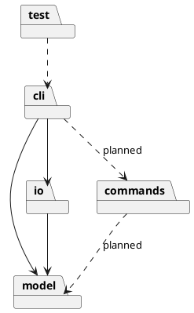

# SVG Editor 设计与过程文档

## 架构方案

### 模块职责

| 模块              | 职责                                      | 当前状态       |
| --------------- | --------------------------------------- | ---------- |
| `src/cli/`      | 读取输入、解析命令、分派并输出结果，格式化 tree。             | 已实现        |
| `src/model/`    | 画布、多态图形基类、矩形、图形工厂与文档不变量。                | 已实现 Shape/Rect 子集 |
| `src/commands/` | 可编辑命令与 undo/redo 管理。                    | 未实现        |
| `src/io/`       | SVG 序列化与文件写入。                           | 已实现 save 子集 |
| `test/`         | 自动化 CLI 与模型测试。                          | 已实现        |

当前实现的类：

- `Shape`：抽象基类，封装非空 ID，定义 `describe()` 和 `toSvgElement()`，并提供 SVG 属性转义。
- `Rect`：继承 `Shape`，用私有字段保存坐标、宽高和可选 fill，构造时校验几何；自身负责 tree 描述和 `<rect>` 元素生成。
- `SvgEditorCli`：维护当前 `Canvas`，用 `readline` 逐行读取并分派 `init`、`create`、`tree`、`save`、`help`、`exit`。
- `Canvas`：保存画布宽高和按插入顺序排列的 `Shape`，并保证 ID 唯一。
- `ShapeFactory`：集中识别支持的图形类型并创建 `Rect`，避免 CLI 直接构造图形。
- `SvgSerializer`：通过 `Shape.toSvgElement()` 生成 SVG 文本，不接触文件，也不读取矩形属性。
- `SvgFileWriter`：只负责把文本写入指定路径。
- `TreeFormatter`：通过 `Shape.describe()` 生成稳定的 tree 文本，不读取矩形属性。

### 依赖方向

当前代码的实际依赖：

- `cli` 可以依赖 `model` 和 `io`。
- `io` 可以依赖 `model`。
- `model` 不依赖 `cli`、`io` 或具体命令类。
- `test` 通过子进程调用编译后的 CLI，并直接加载编译后的 `Rect` 验证模型行为。

规划中的依赖：

- 后续 `commands` 依赖 `model`；`cli` 依赖 `commands` 进行编辑操作。
- 本阶段没有创建 `src/commands/`，因为 Command 与 undo/redo 被明确推迟。

### PlantUML 包图

### 设计模式与扩展点

- 当前使用封装、多态和工厂：`Shape` 定义统一接口，`Rect` 把 tree 描述与 SVG 元素生成封装在自身；`TreeFormatter` 和 `SvgSerializer` 只依赖 `Shape` 接口；`ShapeFactory` 集中识别并创建 `Rect`。
- `AGENTS.md` 要求 Command、Composite 和 undo/redo；Task 2 与 Task 3 均明确暂缓这些功能，因此当前仍未实现。这是阶段性冲突，不是最终架构。
- `SvgEditorCli.execute` 目前是唯一的命令名分派点。后续实现 Command 时应抽出命令分发器，并把每条编辑命令封装成 undo 单元。
- 图形类型、命令集合、SVG 格式是主要变化点；`Shape` 为新增图形提供统一多态接口，`ShapeFactory` 预留类型分派位置，`model`、`io` 与未来的 `commands` 边界已划分。本阶段不提前创建空的容器、Command 或插件类。

## 过程记录

- Task 2 开始前检查：分支 `main`，HEAD `d67bde2`（`help and exit`），与 `origin/main` 一致；工作区干净；Node.js v22.22.2，npm 10.9.7。更早的 `8e8d144`（`init`）为初始提交；`final` 标签尚未创建。
- 对照作业原文确认：默认画布 800×600、错误统一以 `error:` 开头、未初始化文档报错、tree 使用 `svg (WxH)` 和 `rect#id` 形式。
- 原文未规定重复 `init`；按“新建空画布”解释为替换当前文档。原文也未规定只给一个尺寸、或新建后无文件名 `save` 的行为；分别采用缺失维度取默认值、以及报错而不是猜测默认路径。
- 实现分为 model（`Canvas`、`RectangleShape`、`ShapeFactory`）、io（`SvgSerializer`、`SvgFileWriter`）和 cli（`TreeFormatter`、`SvgEditorCli`）；`main.ts` 只负责启动。图形类型判断集中在 `ShapeFactory`，CLI 不直接构造矩形。
- Task 2 第一次测试运行 12 个用例中 10 个通过、2 个失败：测试直接匹配 tree 首行，但管道输出中该行前面带有 `svg> ` 提示符。修正测试，用 `withoutPrompt` 规范化输出后再断言；没有修改业务代码。重跑 12/12 通过。
- Task 2 手工执行 `npm run cli`，输入 `init 800 600`、`create rect r1 100 120 200 80 blue`、`tree`、`save <临时路径>`、`exit`；输出与生成的 SVG 均符合预期。未在浏览器中实际打开文件，浏览器验收步骤见根目录 README。
- Task 3 多态模型基础：从 `88131df` 开始，工作区仅有未跟踪的 `Task3.md`。新增 `Shape` 抽象基类和 `Rect`，将 `Canvas` 改为 `Shape[]`、`ShapeFactory.createRect()` 返回 `Rect`；`TreeFormatter` 改为调用 `describe()`，`SvgSerializer` 改为调用 `toSvgElement()`，随后删除 `RectangleShape.ts`。
- Task 3 验证：迁移后 `npm run typecheck` 通过；扩充测试后 `npm test` 为 17 个测试全部通过。`grep` 确认 `src/` 中没有 `RectangleShape` 或 `createRectangle` 残留引用，`TreeFormatter`/`SvgSerializer` 未读取矩形专属属性。
- Task 3 修正：发现 `dist/model/RectangleShape.js` 是上一轮构建残留，`tsc` 不会自动清理输出目录；已删除该生成文件（`dist/` 被 gitignore），源码无旧类引用。
- Task 2 历史记录中的 `RectangleShape` 保留为当时事实，不改写历史；当前架构以 `Shape`/`Rect` 为准。

## 一致性自查

- 模块划分：实际目录为 `src/cli/`（`main.ts`、`SvgEditorCli.ts`、`TreeFormatter.ts`）、`src/model/`（`Shape.ts`、`Rect.ts`、`Canvas.ts`、`ShapeFactory.ts`）、`src/io/`（`SvgSerializer.ts`、`SvgFileWriter.ts`）、`test/cli.test.mjs`；`RectangleShape.ts` 已删除，`src/commands/` 按计划尚未创建。
- 依赖方向：`SvgEditorCli` 导入 `model` 和 `io`；`TreeFormatter` 导入 `Canvas` 并只调用 `Shape.describe()`；`SvgSerializer` 导入 `Canvas` 并只调用 `Shape.toSvgElement()`；`ShapeFactory` 导入 `Rect`；`Canvas` 与 `Rect` 依赖 `Shape`；`Shape` 没有项目内导入。未发现 `model → cli/io` 的依赖。
- 一类一文件：上述实现类均为独立文件，文件名与类名一致。
- 文档一致性：根目录 README 的命令语法、已实现范围和运行方式，与本文件、`package.json`、源码和测试一致。
- 阶段冲突：Command、Composite、undo/redo 尚未实现，已在本节和“未完成事项”中明确记录；`AGENTS.md` 未被修改。

## 质量保证

- 环境：Node.js v22.22.2，npm 10.9.7。
- `npm run typecheck`：通过，无类型错误。
- `npm test`：先构建，再运行 `node --test test/cli.test.mjs`；17 个测试通过，0 失败（原有 12 个 CLI 测试 + 5 个 `Rect`/越界测试）。
- 引用检查：`src/` 中无 `RectangleShape` 或 `createRectangle` 残留；`TreeFormatter` 只调用 `describe()`，`SvgSerializer` 只调用 `toSvgElement()`，未读取矩形专属属性。
- 手工验证：执行 `npm run cli`，完成 `init → create rect → tree → save → exit`；输出 `canvas 800x600 created`、`rect#r1 created`、tree 条目和 `saved to ... (1 element)`。生成的 SVG 包含 XML 声明、`<svg width="800" height="600" viewBox="0 0 800 600">` 和 `<rect id="r1" x="100" y="120" width="200" height="80" fill="blue"/>`。
- 浏览器验收步骤：运行 `npm run cli`，输入 README 中的流程并生成 `demo.svg`，用 Chrome 或 Edge 打开；应看到左上角坐标 `(100,120)`、大小 `200×80` 的蓝色矩形。Task 3 未重复在浏览器中打开文件，CLI 输出回归由自动化测试覆盖。

## 未完成事项

- 其他图形类型（circle/ellipse/line/text/g）、容器与父子关系、`in` 子句。
- `read`、`canvas`、`move`、`scale`、`set`、`delete`、`group`、`ungroup`、`addto`、`front`、`back`、`show`、`undo`、`redo`。
- Command 模式、Composite 容器行为、undo/redo 历史。
- `save` 无文件名且无来源路径时明确报错；`read` 实现后再接入“保存到读入路径”。
- 参数按空白分割，尚不支持带空格的引号参数；本阶段 rect 参数不受影响，含空格路径暂不支持。
- 阶段 2 尚未完成：Circle、Ellipse、Line、Text、Group、Document/统一容器、父子关系、Command/undo、Tokenizer 与带引号参数；本任务只完成 `Shape`/`Rect` 多态基础。

